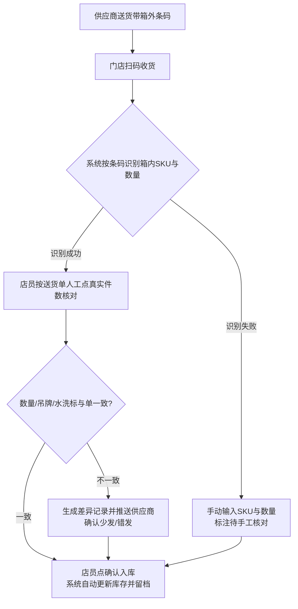
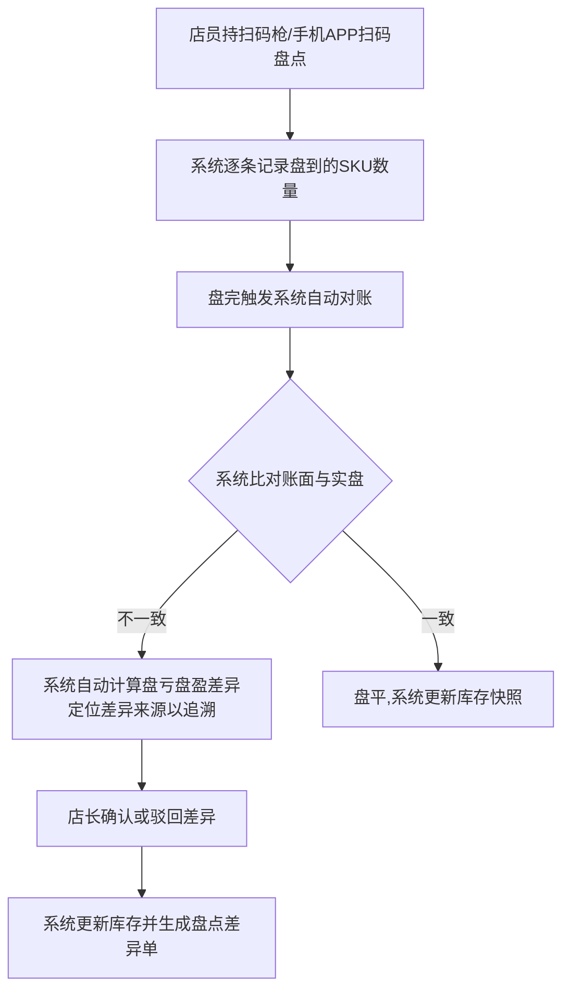
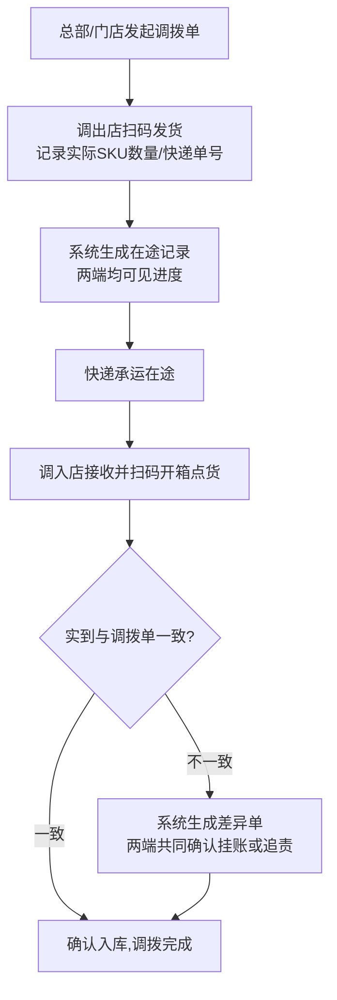
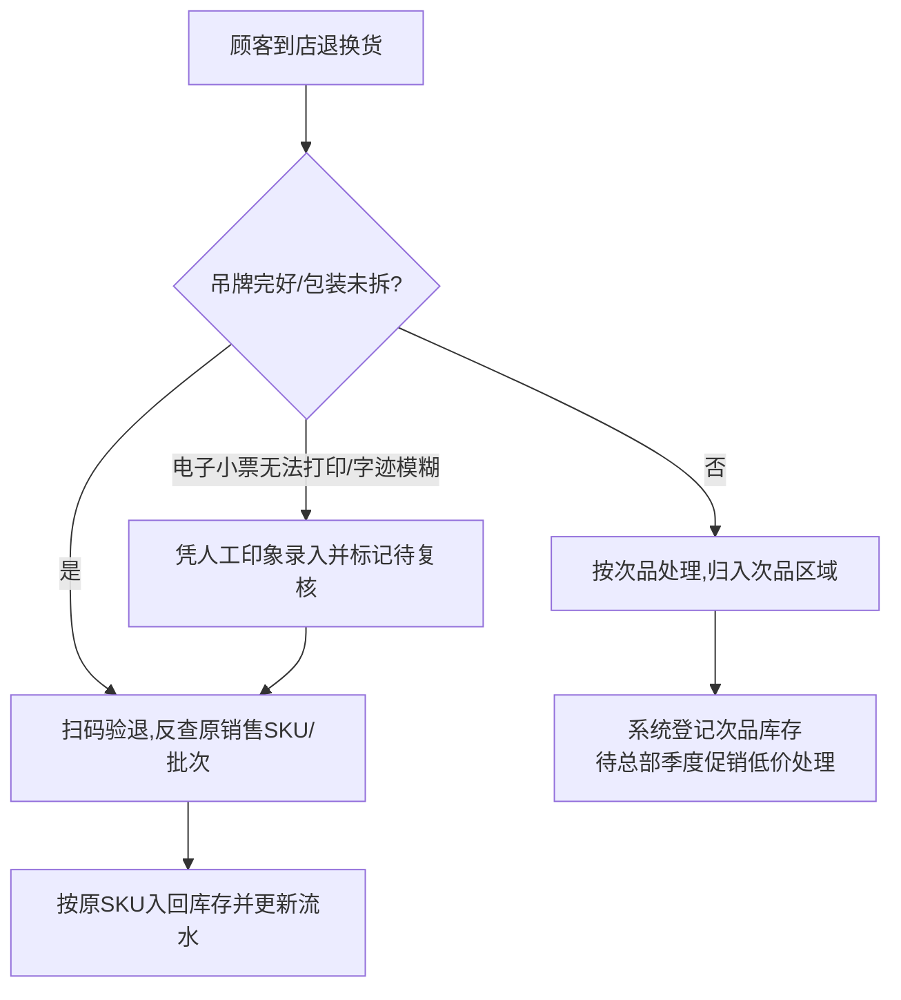
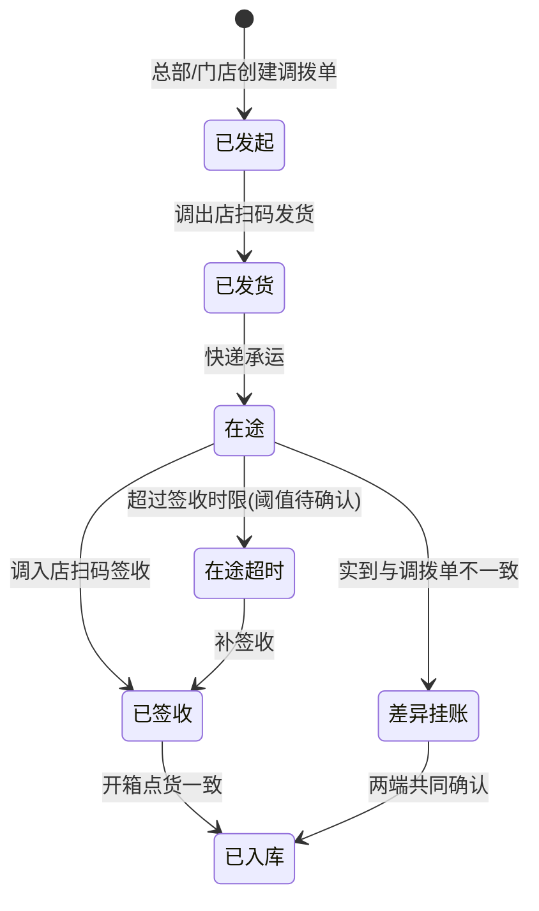
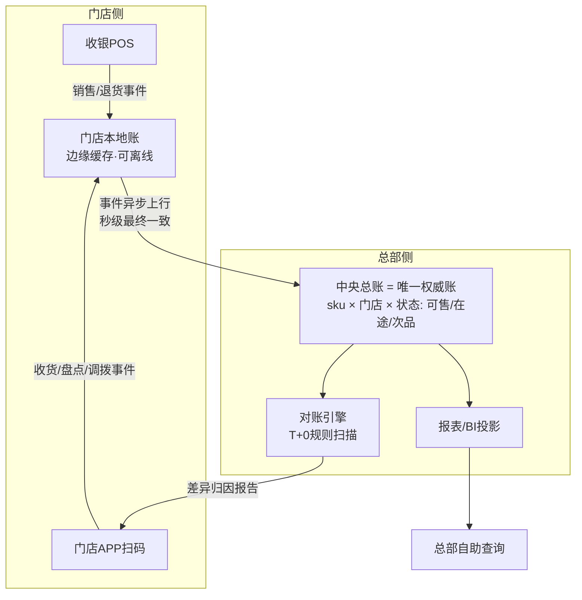

# 简岸门店WMS 产品需求文档（PRD）

**产品名称**：简岸门店WMS
**文档版本**：v1.0
**撰写日期**：2026-10-19
**需求来源**：[简岸门店WMS-需求分析-v2.md](../简岸门店WMS-需求分析-v2.md)（基于旗舰店店长张姐实地访谈）

**版本记录**

| 版本 | 日期 | 说明 |
|------|------|------|
| v1.0 | 2026-10-19 | 初稿，基于需求分析 v2 按七段式模板撰写；需求分析中未明确的细节均标注「待确认」，未做脑补 |

---

## 一、需求背景

简岸为全国约 100 家直营门店的连锁服装品牌，主营中高端女装。门店现行库存管理模式为"4 个 Excel（货号表 / SKU 表 / 库存流水表 / 调拨记录表）+ 收银系统 + 少量扫码枪"，Excel 已传承三代店长，含十几个 Sheet 与几百个公式。

**核心痛点**（源自店长访谈）：

1. **盘点低效差慢**：月底人工盘点约 3 小时/次（2 人），靠人眼对货号/颜色/尺码，准确率仅约 90%，剩余 10% 差异无法定位。
2. **库存不实时**：Excel 事后录入，只能知道"今天早上 10 点的库存"；顾客问货只能凭记忆，断货误客、投诉率高。
3. **多店协同差**：门店 Excel 相互独立不互通，调拨靠电话询问"发了什么、几号发的、单号多少"，总部/他店无法查看本店库存。
4. **调拨差异大**：在途货权属不清，收货数与调拨单/签收单常不一致（收 8 件实到 7 件），差异挂账成糊涂账。
5. **退换货入错库存**：月约 50 笔退换货中约 5 笔入错位置（10%），是库存差异最大来源之一。
6. **月损耗超标**：月损耗率 1.5%~2%（总部要求 ≤1%），80% 损耗填写"原因不明"，无法追溯根源。
7. **总部要数据慢**：每周一早 9 点销售报表需现做约 1.5 小时；临时要数据最快 30 分钟，无自助查询。
8. **采购收货靠人工**：一箱 50 件约 20 分钟人工点数并手动录 Excel；送货单与实际常不符，每周至少 1 次差错。
9. **采购退货冗长**：次品退货需店长/总部/供应商三方纸质签字约 2 周，Excel 内再手动减库存。
10. **顾客寄存灰色地带**：寄存表累计 20 多件未清理，不计销售也不退库存（本期不做）。

**受影响角色**：

- 门店店长（核心使用者）：负责盘点、收货、调拨、退换货、报表制作。
- 门店店员：约 100 家门店约 400 名，平均年龄 35 岁，负责日常收货、整理、盘点辅助。
- 总部运营/商品人员：每周索取销售报表，发起调拨，需库存数据做补货预测与活动查询。
- 供应商：采购入库、采购退货对接方。

**不做的后果**：库存差异持续累积导致月损耗超标被总部追责；总部决策依赖延迟的人工报表；调拨协同靠电话勉强维持；顾客因误报有货导致投诉流失。

---

## 二、需求目标

**核心目标**：上线门店 WMS（门店 APP + 门店 PC + 后端服务），替代"Excel + 电话"库存管理模式，实现库存实时化、操作扫码化、协同在线化、数据自助化。

| # | 目标 | 衡量标准 |
|---|------|----------|
| G1 | 盘点质量提升 | 盘点差异率 10% → ≤3%；单次盘点时长 3 小时 → ≤1 小时 |
| G2 | 库存实时可见 | 门店打开系统即可查看当前时刻实时库存（SKU 级，含在途/可售/次品分类） |
| G3 | 损耗下降 | 月损耗率 1.5%~2% → ≤1%；差异可通过追溯定位根源，消除"原因不明" |
| G4 | 录错率下降 | 调拨/收货/盘点全链路扫码化，消除人工点数与手动录 Excel 环节 |
| G5 | 报表提效 | 总部报表（周转率、Top 10 滞销款、补货预测）与临时数据改为总部自助查询；门店周一报表 1.5~3 小时 → 0；临时要数 30 分钟 → 自助即时 |

**核心价值交付**：将店长从"每周一现做报表 + 月底通宵盘点 + 打电话对调拨"的事务性工作中解放出来，让门店把精力回归卖货本身。

**本期范围**：

- **做**：Must + Should 级功能（清单见第四章）。
- **不做**：顾客寄存登记（Won't，低频灰色地带，本期不做）；采购退货电子三签（Could，链路复杂、走完约 2 周，本期不实现）；门店 PC 日常数据维护（Could，本期不实现）；供应商数据对接（Could，本期不实现）。

**落地约束**（回应"学不会 / 不稳 / 太复杂"顾虑）：

- 核心操作 ≤3 步、扫码即用、大字体大按钮；培训 1 小时内上手。
- 弱网/断网可继续扫码收货、盘点，恢复后自动同步；系统故障不得阻断门店销售。
- 零配置开箱即用，不做过度复杂配置。

---

## 三、需求核心业务流程图

### 3.1 采购入库流程

### 3.2 盘点流程

### 3.3 门店间调拨流程

### 3.4 退换货处理流程

### 3.5 调拨在途状态机

### 3.6 双层账本数据流（差异追溯底层）

---

## 四、需求功能清单

| 终端 | 模块 | 功能 | 描述 |
|------|------|------|------|
| 门店APP | 扫码入库 | 扫码收货 | 【Must】扫描箱外条码自动识别箱内 SKU 与数量，联动送货单，支持人工核点件数，确认后自动入库并留档 |
| 门店APP | 扫码入库 | 收货差异处理 | 【Should】实点数与送货单不一致时生成差异记录，可推送供应商确认少发/错发 |
| 门店APP | 扫码盘点 | 扫码盘点 | 【Must】持手机/扫码枪扫码自动记录盘到 SKU 数量，替代人眼对货号与手动抄录 |
| 门店APP | 扫码盘点 | 差异自动对账 | 【Must】盘完系统自动比对账面与实盘，自动计算盘亏盘盈并生成差异单 |
| 门店APP | 扫码盘点 | 快速盘点 | 【Should】支持仅盘点热卖款/指定范围的每日快速盘点，控制盘点时长 |
| 门店APP | 实时库存 | 实时库存查询 | 【Must】随时查看当前时刻实时库存（SKU 级，含在途/可售/次品分类），替代 Excel 事后查询 |
| 门店APP | 实时库存 | 库存分类视图 | 【Should】按可售、在途、次品状态分类展示库存数量 |
| 门店APP | 调拨管理 | 调拨发起与查看 | 【Must】发起/接收调拨，实时查看"调拨中/已发货/在途/已签收/已入库"全程进度，无需电话询问 |
| 门店APP | 调拨管理 | 调拨扫码发货/收货 | 【Must】调出店扫码发货登记实际 SKU/数量/快递单号，调入店扫码开箱点货 |
| 门店APP | 调拨管理 | 调拨差异处理 | 【Should】实到与调拨单不一致时生成差异单，两端共同确认挂账或追责 |
| 门店APP | 差异追溯 | 库存差异追溯 | 【Must】盘点差异自动定位来源（销售未扣库存、退换货入错位、调拨差异、丢失破损），替代"原因不明" |
| 门店APP | 退换货 | 扫码验退与入库 | 【Must】退货扫码反查原 SKU/批次，吊牌完好入回原库存，次品归入次品区域 |
| 门店APP | 退换货 | 次品登记 | 【Should】登记次品库存及处理状态，联动总部季度促销处理 |
| 门店APP | 寄存管理 | 顾客寄存登记 | 【Won't·本期不做】寄存商品单独登记，不计销售/不退库存，支持到期提醒与取件销记；低频灰色地带 |
| 门店PC | 报表中心 | 销售报表生成 | 【Must】自动生成上周销量、库存周转率、Top 10 滞销款、下周补货预测等报表 |
| 门店PC | 报表中心 | 日常数据维护 | 【Could·本期不实现】管理货号表/SKU 表/库存流水/调拨记录，替代手工维护 4 个 Excel |
| 门店后端 | 库存服务 | 库存实时更新 | 【Must】收银系统、调拨、退货、盘点的库存变动实时同步至库存账 |
| 门店后端 | 库存服务 | 实时计算与快照 | 【Must】计算库存周转率/Top 10/滞销判定，维护历史库存快照 |
| 门店后端 | 协同服务 | 多门店数据互通 | 【Must】各门店库存、调拨、在途数据在线共享，总部/门店可查看任意门店 SKU 库存 |
| 门店后端 | 差异服务 | 差异定位引擎 | 【Should】关联销售/退货/调拨/收银流水定位差异来源 |
| 门店后端 | 调拨服务 | 在途货权管理 | 【Should】维护调拨在途状态与货权归属，支持丢失/损毁责任判定 |
| 供应链中台后端 | 数据服务 | 总部数据自助查询 | 【Must】总部自助查询各店实时库存、周转率、滞销款、补货预测，无需门店现做 |
| 供应链中台后端 | 采购协同 | 供应商数据对接 | 【Could·本期不实现】收货差异、采购退货与供应商电子化对账协同（送货单校验） |

### 4.1 痛点 → 功能追溯映射

| 背景痛点 | 对应功能 | 优先级 |
|---|---|---|
| 盘点低效差慢 | 扫码盘点 / 差异自动对账 / 快速盘点 | Must / Should |
| 库存不实时 | 实时库存查询 / 库存实时更新 | Must |
| 多店协同差 | 调拨发起与查看 / 调拨扫码发货收货 / 多门店数据互通 | Must |
| 调拨差异大 | 调拨差异处理 / 在途货权管理 | Should |
| 退换货入错库存 | 扫码验退与入库 | Must |
| 月损耗超标且 80% 原因不明 | 库存差异追溯 / 差异定位引擎 | Must / Should |
| 总部要数据慢 | 销售报表生成 / 总部数据自助查询 | Must |
| 采购收货靠人工 | 扫码收货 / 收货差异处理 | Must / Should |
| 采购退货流程冗长 | 采购退货（电子三签） | Could（本期不实现） |
| 顾客寄存留灰色地带 | 顾客寄存登记 | Won't（本期不做） |

---

## 五、需求功能详述

### 5.1 门店APP——扫码入库

#### 5.1.1 扫码收货

**原型描述**：
收货页顶部为"扫描箱外条码"大按钮与扫码框，中部展示识别出的箱内 SKU 清单（货号/颜色/尺码/数量）并与送货单逐行对比，差异行红色高亮，底部为"确认入库"主按钮（对应张姐手绘 6 个界面草图之一）。

**用户故事**：
> 作为一个店员，我想要扫描箱外条码自动识别箱内 SKU 与数量并对照送货单核点，以便于快速准确完成到货入库。

**前置条件**：
- 店员账号已登录且具有收货权限。
- 供应商已送货到场，箱外条码完好可扫。

**核心逻辑**：
- 扫码 → 系统按条码解析箱内 SKU 与数量 → 展示待收清单 → 店员按送货单人工点真实件数 → 数量/吊牌/水洗标一致 → 点"确认入库"。
- 系统写入"采购收货"不可变事件，更新库存账，收货单留档。
- 输入：箱外条码 + 送货单；输出：收货单 + 库存事件 + 库存变动。

**边界条件与异常处理**：
- 边界：一箱多 SKU 时逐箱扫码；单箱件数上限按实际箱规处理（箱规主数据待确认）。
- 异常：条码识别失败 → 转手动输入 SKU 与数量，标注"待手工核对"；实点与送货单不一致 → 拦截入库并生成差异记录（见 5.1.2）；断网 → 扫码数据暂存本地，恢复后自动同步。

**技术难点分析**：
- 箱外条码到箱内 SKU/数量的映射规则需随供应商条码体系维护（供应商主数据待确认）。
- 与收银系统商品主数据对齐（待确认项 1、2）。

**验收标准 (Acceptance Criteria)**：
- 🎯 **成功场景**：扫描有效箱外条码，3 秒内展示箱内 SKU 与数量清单，确认入库后库存实时增加并生成可追溯收货单。
- ✔️ **校验场景**：实点件数与送货单不一致时，系统拦截入库并生成差异记录。
- ❌ **异常场景**：断网状态下扫码数据不丢失，恢复网络后自动同步入库。

**测试用例**：
- 扫码识别箱内SKU成功
- 实点与单不符生成差异
- 断网扫码恢复后同步

---

#### 5.1.2 收货差异处理

**原型描述**：
差异确认页左右分栏展示"送货单数量 vs 实点数量"，差异项高亮，底部为"推送供应商确认"按钮与差异单状态标签。

**用户故事**：
> 作为一个店员，我想要在实点与送货单不一致时生成差异记录并推送供应商确认，以便于明确少发/错发责任。

**前置条件**：
- 扫码收货过程中实点与送货单不一致。
- 店员具有差异登记权限。

**核心逻辑**：
- 系统生成差异记录（差异单号、SKU、单量、实点、差异量、操作人、时间戳），推送供应商确认。
- 供应商确认前，该批货按实点入库，差异部分挂账；供应商确认结果回写差异单状态。
- 输入：送货单 + 实点数；输出：差异记录 + 供应商确认单。

**边界条件与异常处理**：
- 边界：部分 SKU 差异按行记录；差异量为 0 禁止生成差异单。
- 异常：供应商超时未确认 → 差异单保持"待确认"并进入定期对账提醒（提醒周期待确认）；推送失败 → 差异单不丢失，支持重推。

**技术难点分析**：
- 与供应商的对接方式（系统对接或人工核款）待确认（待确认项 6）。
- 差异单与库存事件的关联追溯。

**验收标准 (Acceptance Criteria)**：
- 🎯 **成功场景**：不一致时自动生成差异单并推送供应商，供应商确认后差异单状态更新为已确认。
- ✔️ **校验场景**：差异量为 0 时系统禁止生成差异单。
- ❌ **异常场景**：推送失败时差异单不丢失，可重新推送。

**测试用例**：
- 差异自动生成并推送
- 零差异禁止建差异单
- 推送失败可重推

---

### 5.2 门店APP——扫码盘点

#### 5.2.1 扫码盘点

**原型描述**：
盘点任务页展示盘点范围（全店/热卖款/指定区域）与开始按钮；扫码过程中实时显示已盘 SKU 数与进度条，大按钮设计；点"结束盘点"触发自动对账。

**用户故事**：
> 作为一个店员，我想要持手机/扫码枪逐件扫码记录盘到数量，以便于替代人眼对货号与手动抄录。

**前置条件**：
- 已登录且具有盘点权限。
- 盘点任务已创建并开始。

**核心逻辑**：
- 逐件扫码 → 系统逐条记录 SKU 数量 → 盘完触发自动对账（5.2.2）→ 产出实盘快照与盘点差异单/盘平结果。
- 输入：扫码流水；输出：实盘快照 + 盘点结果。

**边界条件与异常处理**：
- 边界：同一 SKU 连续扫码自动累加计数（累加规则待确认）；盘点范围外 SKU 在快速盘点中提示不计入。
- 异常：扫到未知条码 → 提示"未匹配商品主数据"并挂入待处理清单；盘点中断 → 支持暂停/继续，已盘数据保留。

**技术难点分析**：
- 大批量扫码时的本地性能与离线缓存（月盘 2 人 3 小时的量级）。
- 扫码节奏与店员操作习惯匹配（店员平均 35 岁，需低学习成本）。

**验收标准 (Acceptance Criteria)**：
- 🎯 **成功场景**：连续扫码不卡顿，盘完 1 分钟内产出对账结果。
- ✔️ **校验场景**：扫到未知条码被拦截并提示，不静默丢弃。
- ❌ **异常场景**：盘点中途退出，已盘数据不丢失，可续盘。

**测试用例**：
- 扫码累加计数正确
- 未知条码提示拦截
- 中途退出已盘保留

---

#### 5.2.2 差异自动对账

**原型描述**：
对账结果页展示账面 vs 实盘逐 SKU 对比表，差异项列出盘亏/盘盈数量与建议归因（附证据链入口），店长可点"确认"或"驳回"。

**用户故事**：
> 作为一个店长，我想要盘完系统自动比对并计算盘亏盘盈、定位差异来源，以便于替代月底人工对 4 个 Excel。

**前置条件**：
- 盘点任务已完成扫码。
- 事件流水与对账规则库已启用。

**核心逻辑**：
- 差异 = 实盘快照 − 账面余额（期初 + Σ事件）。
- 对账引擎在"上次盘点 → 本次盘点"时间窗口内跑规则库 R1~R5：R1 有销售流水无库存扣减（POS 流水与库存扣减事件差集）；R2 退货入库 SKU ≠ 原销售单 SKU；R3 调拨差异单未闭环；R4 在途超时未签收；R5 收货差异未与供应商确认。
- 归因输出：结论 + 证据链（关联单据号列表）+ 置信度；匹配失败标记"无法解释"并输出可疑事件 Top-N（按时间/数量匹配度排序）。
- 店长确认 → 生成盘点调整单（留痕事件）并更新库存；驳回 → 回退重盘或挂起。
- 输入：实盘快照 + 事件流水；输出：盘点差异单 + 归因报告 + 盘点调整单。

**边界条件与异常处理**：
- 边界：差异量为 0 → 盘平，更新库存快照；归因置信度低于阈值转人工复核（阈值待确认）。
- 异常：规则引擎故障 → 降级为纯差异列表，不阻断盘点结果查看。

**技术难点分析**：
- 对账规则库的可配置性与准确率（误报控制）。
- T+0 准实时扫描（R1 每小时）的调度成本。

**验收标准 (Acceptance Criteria)**：
- 🎯 **成功场景**：盘完自动产出差异单与归因结论，高置信度结论附证据链（关联单据号列表）。
- ✔️ **校验场景**：店长驳回后库存数据不被修改。
- ❌ **异常场景**：规则引擎异常时降级为纯差异列表，盘点结果仍可查看。

**测试用例**：
- 盘亏盘盈自动计算
- 归因结论附证据链
- 引擎故障降级不阻断

---

#### 5.2.3 快速盘点

**原型描述**：
快速盘点入口支持选择"热卖款/指定货架/指定 SKU 范围"，确认后进入与 5.2.1 相同的扫码页，页头标注本次范围。

**用户故事**：
> 作为一个店长，我想要每天只盘热卖款或指定范围，以便于把盘点时长控制在每日可承受范围。

**前置条件**：
- 已配置快速盘点范围（热卖款定义待确认，建议按周销量排序配置）。
- 已登录且具有盘点权限。

**核心逻辑**：
- 按选定范围生成盘点任务 → 扫码 → 仅对范围内 SKU 对账 → 差异走 5.2.2 同一闭环。
- 输入：范围定义；输出：范围内差异单。

**边界条件与异常处理**：
- 边界：扫到范围外 SKU → 提示"不在本次范围"并计入待处理，不计入对账；范围为空禁止开始。
- 异常：范围配置加载失败 → 禁止开始盘点并提示重试。

**技术难点分析**：
- 热卖款定义的配置化（销量阈值待确认）。

**验收标准 (Acceptance Criteria)**：
- 🎯 **成功场景**：选定热卖款范围扫码后，仅输出范围内差异单。
- ✔️ **校验场景**：扫到范围外 SKU 有提示且不影响对账结果。
- ❌ **异常场景**：范围配置加载失败时禁止开始盘点。

**测试用例**：
- 范围外扫码有提示
- 空范围禁止开始
- 范围内差异正常输出

---

### 5.3 门店APP——实时库存

#### 5.3.1 实时库存查询

**原型描述**：
库存查询页顶部固定搜索栏（支持货号/SKU/关键字），下方列表展示当前时刻实时库存，每行含可售/在途/次品数量，页脚标注数据时间戳。

**用户故事**：
> 作为一个店员，我想要随时查看当前时刻的实时库存，以便于顾客问货时当场回答。

**前置条件**：
- 已登录；门店库存账已完成初始化。

**核心逻辑**：
- 查询库存账（sku × 门店 × 状态），数据来自本地账/中央账投影，展示可售/在途/次品数量并标注数据时间。
- 输入：SKU/货号/关键字；输出：实时库存数。

**边界条件与异常处理**：
- 边界：无匹配 SKU → 空态提示；SKU 状态多值 → 分行展示。
- 异常：断网 → 展示本地账最后已知数并标注数据截止时间（如"截至今天 10:00"），不冒充实时。

**技术难点分析**：
- 本地账与中央账最终一致下的展示口径（时间戳标注）。

**验收标准 (Acceptance Criteria)**：
- 🎯 **成功场景**：查询任一 SKU，2 秒内返回当前时刻可售/在途/次品数量。
- ✔️ **校验场景**：输入不存在的货号返回空态提示，不报错。
- ❌ **异常场景**：断网时展示本地账数据并标注截止时间。

**测试用例**：
- 实时库存秒级返回
- 无此货号空态提示
- 断网展示并标时间

---

#### 5.3.2 库存分类视图

**原型描述**：
库存页顶部页签切换：可售 / 在途 / 次品（寄存本期不做，不展示），各页签为列表 + 数量汇总头。

**用户故事**：
> 作为一个店长，我想要按状态分类查看库存，以便于掌握可售、在途、次品各有多少。

**前置条件**：
- 同 5.3.1。

**核心逻辑**：
- 按状态维度筛选库存账；在途展示在途池虚拟仓位（货权归属规则待确认，见 5.12.1）。
- 输入：状态页签选择；输出：对应状态 SKU 列表与汇总数。

**边界条件与异常处理**：
- 边界：某状态无数据 → 空态展示；寄存状态本期不做 → 页签不展示。
- 异常：页签数据加载失败 → 提示重试，不影响其他页签。

**技术难点分析**：
- 在途池虚拟仓位与门店实物仓的换算展示口径。

**验收标准 (Acceptance Criteria)**：
- 🎯 **成功场景**：切换页签展示对应状态 SKU 列表与汇总数。
- ✔️ **校验场景**：各页签汇总数与明细逐行加总一致。
- ❌ **异常场景**：某状态无数据时展示空态，不报错。

**测试用例**：
- 页签切换筛选正确
- 汇总与明细一致
- 空状态展示空态

---

### 5.4 门店APP——调拨管理

#### 5.4.1 调拨发起与查看

**原型描述**：
调拨列表页含"我发起的/我接收的/全部"筛选与状态标签（调拨中/已发货/在途/已签收/已入库）；发起页选择对方门店、SKU 与数量后提交。

**用户故事**：
> 作为一个店长，我想要在线发起调拨并实时查看全程进度，以便于不再打电话问"发了什么、几号发、单号多少"。

**前置条件**：
- 已登录且具有调拨权限。
- 调拨发起规则已确认（待确认项 3：总部统一发起还是允许门店互调）。

**核心逻辑**：
- 创建调拨单（调出店、调入店、SKU、数量）→ 状态机流转（见 3.5）→ 调出/调入两端 + 总部实时可见。
- 调拨单挂中央账在途池虚拟仓位。
- 输入：调拨需求；输出：调拨单 + 状态流水。

**边界条件与异常处理**：
- 边界：未发货调拨单可撤销；已发货不可撤销，需走在途/差异流程（撤销规则待确认）。
- 异常：调入店该 SKU 可售库存不足（总部视角）→ 提示；同步延迟 → 展示最近状态 + 时间戳。

**技术难点分析**：
- 多端状态实时同步；在途池虚拟仓位设计（见 5.12.1）。

**验收标准 (Acceptance Criteria)**：
- 🎯 **成功场景**：发起调拨后两端门店与总部均可见，状态随发货/签收实时更新。
- ✔️ **校验场景**：未发货调拨单可撤销，已发货不可撤销。
- ❌ **异常场景**：同步延迟时展示最近状态并标注时间戳。

**测试用例**：
- 调拨单三端可见
- 未发货单可撤销
- 延迟时标注时间戳

---

#### 5.4.2 调拨扫码发货/收货

**原型描述**：
发货页扫码登记实际 SKU/数量并录入快递单号；收货页扫码开箱点货，逐件确认，页面对比"调拨单 vs 实到"。

**用户故事**：
> 作为一个调出店/调入店店员，我想要扫码登记发货与收货实际件数，以便于账实一致、差异有据可查。

**前置条件**：
- 发货侧：调拨单已发起；收货侧：调拨单已发货在途。

**核心逻辑**：
- 调出店扫码发货 → 记录实际 SKU/数量/快递单号 → 在途池记账（货权规则待确认）。
- 调入店扫码开箱点货 → 实到 vs 调拨单比对 → 一致确认入库 / 不一致走 5.4.3。
- 输入：扫码流水 + 快递单号；输出：发货/签收事件 + 在途池变动。

**边界条件与异常处理**：
- 边界：部分签收按 SKU 分行处理；一单多次发货合并同一调拨单（规则待确认）。
- 异常：实到与单不一致 → 强制生成差异单后才能继续；在途超时未签收 → 告警通知两端（时限阈值待确认）。

**技术难点分析**：
- 在途货权归属规则配置化（待业务拍板，待确认项 4）。
- 两端同时操作的冲突处理。

**验收标准 (Acceptance Criteria)**：
- 🎯 **成功场景**：扫码发货后在途池增加对应虚拟库存，调入店签收一致后完成入库。
- ✔️ **校验场景**：实到与单不一致时强制生成差异单才能继续流程。
- ❌ **异常场景**：在途超时触发告警并通知两端门店。

**测试用例**：
- 发货在途池记账正确
- 不一致强制差异单
- 超时未签收告警

---

#### 5.4.3 调拨差异处理

**原型描述**：
差异单详情页展示单量 vs 实到、差异量、挂账/追责选项与两端确认记录，状态标签跟踪闭环进度。

**用户故事**：
> 作为一个两端店长，我想要对不一致生成差异单并共同确认挂账或追责，以便于不再累积糊涂账。

**前置条件**：
- 调拨收货实到与调拨单不一致。

**核心逻辑**：
- 生成差异单 → 两端确认（挂账/追责）→ 闭环后调拨单置为已入库；差异事件留痕进入对账窗口（R3 规则跟踪闭环状态）。
- 输入：差异信息；输出：差异单 + 两端确认记录。

**边界条件与异常处理**：
- 边界：差异量为 0 不生成差异单；部分差异按 SKU 分行。
- 异常：两端确认不一致 → 升级总部仲裁（仲裁流程待确认）；追责认定依赖在途货权规则（待确认项 4）。

**技术难点分析**：
- 与在途货权规则联动；挂账差异的长期跟踪机制（避免再次"挂账 2 个月"）。

**验收标准 (Acceptance Criteria)**：
- 🎯 **成功场景**：差异单经两端确认后闭环，调拨单状态更新为已入库。
- ✔️ **校验场景**：仅单端确认不足以闭环。
- ❌ **异常场景**：确认超时进入总部仲裁提醒。

**测试用例**：
- 两端确认后闭环
- 单端确认不闭环
- 超时升级总部仲裁

---

### 5.5 门店APP——差异追溯

#### 5.5.1 库存差异追溯

**原型描述**：
差异追溯报告页支持选择时间窗口（默认"上次盘点 → 本次盘点"），展示归因结论、证据链（关联单据号列表）与置信度，匹配失败时展示可疑事件 Top-N 列表。

**用户故事**：
> 作为一个店长，我想要知道每月损耗和差异出在哪里，以便于替代"原因不明"、定位根源并整改。

**前置条件**：
- 事件流水与对账引擎已启用。
- 历史库存快照可用。

**核心逻辑**：
- 复用 5.2.2 对账规则库 R1~R5；归因输出 = 结论 + 证据链 + 置信度。
- 对账时机从"月盘才跑"升级为 T+0 准实时（R1 每小时扫描），销售掉单当天发现。
- 输入：事件流水 + 快照；输出：归因报告。

**边界条件与异常处理**：
- 边界：无匹配规则 → 明确标注"无法解释"并输出可疑事件 Top-N；置信度低于阈值 → 转人工复核（阈值待确认）。
- 异常：POS 流水缺失 → 降级为仅 WMS 内部规则并显著标注。

**技术难点分析**：
- 规则库覆盖率与误报率平衡；跨系统流水（POS ↔ WMS）关联（待确认项 5）。

**验收标准 (Acceptance Criteria)**：
- 🎯 **成功场景**：盘点差异报告给出归因结论与证据链，R1 规则每小时扫描、当天发现销售掉单。
- ✔️ **校验场景**：无匹配规则时输出 Top-N 可疑事件，不输出"原因不明"。
- ❌ **异常场景**：POS 流水缺失时降级运行并显著标注数据缺口。

**测试用例**：
- 归因结论带证据链
- 无匹配输出Top-N
- POS缺失降级并标注

---

### 5.6 门店APP——退换货

#### 5.6.1 扫码验退与入库

**原型描述**：
退换货页扫码商品后展示原销售单信息（SKU/批次/购买时间），按吊牌与包装判断结果分流："入回原库存"或"归次品"，无原单时提供人工录入入口并强制勾选"待复核"。

**用户故事**：
> 作为一个店员，我想要退货扫码反查原销售单并正确入回库存，以便于消除退换货入错位置。

**前置条件**：
- 顾客到店退换货；吊牌/包装状态可判断。
- POS 销售数据已对接（待确认项 1、5）。

**核心逻辑**：
- 扫码 → 反查原销售 SKU/批次 → 吊牌完好/包装未拆 → 按原 SKU 入回库存并更新流水；否则按次品处理归入次品区域（5.6.2）。
- 电子小票无法打印/字迹模糊 → 凭人工印象录入并标记待复核。
- 输入：退货商品条码；输出：退货入库事件 / 次品登记。

**边界条件与异常处理**：
- 边界：换货按"一退一进"两笔事件处理（换货规则细节待确认）。
- 异常：查无原销售单 → 人工录入 + 强制待复核标记；入库 SKU ≠ 原销售单 SKU → 纳入 R2 对账规则。

**技术难点分析**：
- 原销售单反查依赖 POS 数据对接的完整度。

**验收标准 (Acceptance Criteria)**：
- 🎯 **成功场景**：扫码反查原销售 SKU 并正确入回对应库存位置，流水可追溯。
- ✔️ **校验场景**：吊牌不完好的货强制走次品流程，不能入回可售库存。
- ❌ **异常场景**：查无原单时允许人工录入但强制打待复核标记。

**测试用例**：
- 反查原单正确入回
- 吊牌破损走次品流
- 查无原单标待复核

---

#### 5.6.2 次品登记

**原型描述**：
次品列表页展示次品 SKU/数量/原因/状态（待处理/已促销处理），支持登记入口与状态流转操作。

**用户故事**：
> 作为一个店长，我想要登记次品库存及处理状态，以便于对接总部季度促销低价处理。

**前置条件**：
- 存在退换货次品或盘点发现的次品。

**核心逻辑**：
- 登记次品 → 次品账增加、可售库存扣减 → 总部季度促销处理时更新状态并扣减次品账。
- 输入：次品信息（SKU/数量/原因）；输出：次品登记事件。

**边界条件与异常处理**：
- 边界：次品重新可售 → 走盘点调整流程并留痕。
- 异常：促销处理与库存扣减联动失败 → 告警并保留待处理状态（联动规则待确认）。

**技术难点分析**：
- 次品与可售库存的状态流转规则；与总部季度促销的联动口径。

**验收标准 (Acceptance Criteria)**：
- 🎯 **成功场景**：次品登记后可售库存扣减、次品账增加，数量一致。
- ✔️ **校验场景**：次品状态每次变更均留痕可查。
- ❌ **异常场景**：促销处理时次品账同步扣减，失败则告警。

**测试用例**：
- 登记后扣可售加次品
- 状态变更留痕
- 促销处理同步扣减

---

### 5.7 门店APP——寄存管理

#### 5.7.1 顾客寄存登记（本期不做）

**范围说明**：
寄存商品单独登记、不计销售/不退库存、支持到期提醒与取件销记——属低频灰色地带（寄存表累计 20 多件未清理），本期不做（Won't）。寄存商品的会计口径与强制管理规则见待确认项 7，留待后续版本评估。

---

### 5.8 门店PC——报表中心

#### 5.8.1 销售报表生成

**原型描述**：
报表中心页支持选择统计周期，一键生成上周销量、库存周转率、Top 10 滞销款、下周补货预测四类报表，支持导出；页头标注数据截止时间。

**用户故事**：
> 作为一个店长，我想要系统自动生成销售报表，以便于不再每周一现做 1.5 小时报表。

**前置条件**：
- 已登录门店 PC；库存账与 POS 数据已接入。

**核心逻辑**：
- 从中央账 BI 投影层计算：上周销量、库存周转率、Top 10 滞销款、下周补货预测；按权限范围展示（本店/授权门店）。
- 输入：周期选择；输出：报表（可导出）。

**边界条件与异常处理**：
- 边界：数据不完整 → 标注数据截止时间；补货预测算法口径未拍板 → 预测列标注待确认。
- 异常：计算服务异常 → 提示重试，不展示错误数据。

**技术难点分析**：
- 周转率/滞销判定/补货预测的计算口径需总部拍板（口径待确认）。
- 报表重查询落投影层，不在总账跑重查询。

**验收标准 (Acceptance Criteria)**：
- 🎯 **成功场景**：选择"上周"一键生成四类报表，门店周一报表工时 1.5~3 小时 → 0。
- ✔️ **校验场景**：数据不完整时明确标注数据截止时间。
- ❌ **异常场景**：计算服务异常时提示重试，不展示错误数据。

**测试用例**：
- 一键生成四类报表
- 数据不全标截止时间
- 服务异常不展示错值

---

#### 5.8.2 日常数据维护（本期不实现）

**范围说明**：
管理货号表/SKU 表/库存流水/调拨记录，替代手工维护 4 个 Excel——属 Could 级，本期不实现。旧 4 个 Excel 的迁移范围与历史差异数据处理见待确认项 10。

---

### 5.9 门店后端——库存服务

#### 5.9.1 库存实时更新

**原型描述**：
无（后端服务，无前端原型）。

**用户故事**：
> 作为一个系统，我想要把收银、调拨、退货、盘点的库存变动实时同步至库存账，以便于任何终端看到的都是当前时刻真实库存。

**前置条件**：
- POS/门店 APP/门店 PC 事件源已接入。
- 门店本地账与中央总账已部署。

**核心逻辑**：
- 所有库存变动统一为不可变事件：`{ event_id, store_id, sku_id, qty_delta, 事件类型, 关联单据号, 操作人, 时间戳, 来源系统 }`；只增不改，修正通过反向事件。
- 事件类型覆盖：销售、退货入库、采购收货、调拨发货/签收/入库、盘点调整、报损。
- 事件先落门店本地账，异步上行中央账，秒级最终一致；账面库存 = 期初快照 + Σ事件。
- 输入：各源系统库存变动；输出：库存账 + 事件流水。

**边界条件与异常处理**：
- 边界：事件乱序到达 → 按时间戳 + 版本号排序校正。
- 异常：重复事件 → 按 event_id 幂等去重；上行失败 → 本地账重试与补偿，不丢事件。

**技术难点分析**：
- 事件溯源模型的存储与查询性能（月事件量级见 6.1）。
- 幂等与乱序处理；POS 对接方式待确认（待确认项 1）。

**验收标准 (Acceptance Criteria)**：
- 🎯 **成功场景**：任一终端操作后，库存变动在其他终端秒级可见（最终一致）。
- ✔️ **校验场景**：同一事件重复上报不产生双倍扣减。
- ❌ **异常场景**：上行中断恢复后无事件丢失。

**测试用例**：
- 变动秒级多端可见
- 重复事件幂等去重
- 断链恢复无事件丢失

---

#### 5.9.2 实时计算与快照

**原型描述**：
无（后端服务，无前端原型）。

**用户故事**：
> 作为一个总部人员，我想要系统维护历史库存快照并实时计算周转率、Top 10、滞销判定，以便于报表与差异追溯有数据基础。

**前置条件**：
- 事件流水持续写入；计算口径已确认。

**核心逻辑**：
- 定时/事件驱动计算库存周转率、Top 10 滞销款；维护历史库存快照（供追溯窗口对账使用）。
- 计算结果落 BI 投影层，不在总账跑重查询。
- 输入：事件流水；输出：指标结果 + 历史快照。

**边界条件与异常处理**：
- 边界：快照缺失 → 从事件流重放重建。
- 异常：计算任务失败 → 告警并重试，不阻塞账本写入主链路。

**技术难点分析**：
- 快照存储成本与查询性能平衡；计算口径待总部确认。

**验收标准 (Acceptance Criteria)**：
- 🎯 **成功场景**：每日生成库存快照，报表指标可由快照 + 事件复算一致。
- ✔️ **校验场景**：快照缺失时可从事件流重放重建，结果一致。
- ❌ **异常场景**：计算任务失败不阻塞库存主链路。

**测试用例**：
- 快照每日按时生成
- 缺失可重放重建
- 计算失败不阻塞主链

---

### 5.10 门店后端——协同服务

#### 5.10.1 多门店数据互通

**原型描述**：
无（后端服务；前端表现为 5.3.1 他店库存查询与 5.4.1 调拨进度可见）。

**用户故事**：
> 作为一个总部人员，我想要在线共享各店库存、调拨、在途数据，以便于总部/门店可查看任意门店 SKU 库存。

**前置条件**：
- 中央总账运行；权限配置完成（待确认项 3、9）。

**核心逻辑**：
- 门店事件上行汇总至中央账；他店库存以只读投影共享——门店仅见授权范围可售量，不见成本/流水；调拨单/在途池双端实时。
- 数据边界：写路径隔离（门店本地账），读投影共享。
- 输入：查询/订阅请求；输出：授权范围内的库存/调拨/在途数据。

**边界条件与异常处理**：
- 边界：权限不足 → 仅返回授权范围数据。
- 异常：中央账不可用 → 门店本地功能（收货/盘点/销售）不受影响，仅共享查询降级。

**技术难点分析**：
- 数据隔离与共享的边界实现（写隔离、读投影）；权限模型待确认。

**验收标准 (Acceptance Criteria)**：
- 🎯 **成功场景**：总部可查看任意门店 SKU 库存，门店可见授权他店可售量。
- ✔️ **校验场景**：无权限的查看请求被拦截并留痕。
- ❌ **异常场景**：中央账不可用时门店本地功能不受影响。

**测试用例**：
- 总部可查任意门店
- 越权查看被拦截
- 中央账故障不影响门店

---

### 5.11 门店后端——差异服务

#### 5.11.1 差异定位引擎

**原型描述**：
无（后端服务；前端表现为 5.5.1 追溯报告）。

**用户故事**：
> 作为一个系统，我想要关联销售/退货/调拨/收银流水定位差异来源，以便于损耗有因可查、可整改。

**前置条件**：
- 事件流水 + POS 数据已接入（待确认项 5）。

**核心逻辑**：
- 规则库 R1~R5（定义见 5.2.2）；每条规则可配置启用/停用。
- 归因输出结论 + 证据链 + 置信度；T+0 准实时扫描（R1 每小时）；匹配失败输出可疑事件 Top-N。
- 输入：事件流水 + POS 流水；输出：归因报告。

**边界条件与异常处理**：
- 边界：规则未覆盖的场景 → 明确标注"无法解释"并给 Top-N。
- 异常：POS 断流 → 降级为 WMS 内部规则并告警。

**技术难点分析**：
- 规则可配置化；跨系统数据关联；误报率控制。

**验收标准 (Acceptance Criteria)**：
- 🎯 **成功场景**：5 类规则可配置启停，归因报告含证据链与置信度。
- ✔️ **校验场景**：停用某规则不影响其他规则运行与盘点主流程。
- ❌ **异常场景**：POS 断流时引擎降级运行并触发告警。

**测试用例**：
- 规则可配置启停
- 归因输出证据链
- POS断流降级告警

---

### 5.12 门店后端——调拨服务

#### 5.12.1 在途货权管理

**原型描述**：
无（后端服务；前端表现为 5.3.2 在途页签与 5.4.x 调拨状态）。

**用户故事**：
> 作为一个总部人员，我想要维护调拨在途状态与货权归属，以便于丢失/损毁责任可判定、不再挂账成糊涂账。

**前置条件**：
- 调拨单进入在途状态。
- 货权归属规则已完成配置（规则本身待确认项 4，负责人：供应链，截止 2026-10-18，已逾期需催办）。

**核心逻辑**：
- 在途数量挂中央账"在途池"虚拟仓位，既不在调出店也不在调入店的可售库存中。
- 签收与差异确认时按配置自动转移记账：在途货算调出店/调入店/总部、运输丢损责任方。
- 输入：调拨状态流转 + 货权规则配置；输出：在途池记账 + 货权转移事件。

**边界条件与异常处理**：
- 边界：在途超时未签收 → 告警（时限阈值待确认）。
- 异常：货权规则未配置 → 阻止自动转移记账并提示配置，不预设默认值（规则须总部先拍板）。

**技术难点分析**：
- 规则配置化与自动记账转移；与调拨差异单联动。

**验收标准 (Acceptance Criteria)**：
- 🎯 **成功场景**：在途库存挂虚拟仓位，两端可售库存不被重复计算。
- ✔️ **校验场景**：签收时按配置自动完成货权转移记账并留痕。
- ❌ **异常场景**：规则缺失时阻止自动转移并提示配置。

**测试用例**：
- 在途挂虚拟仓位
- 签收自动转移记账
- 规则缺失阻止并提示

---

### 5.13 供应链中台后端

#### 5.13.1 总部数据自助查询

**原型描述**：
无（后端服务；前端为总部查询门户，支持门店/SKU/指标维度筛选与导出）。

**用户故事**：
> 作为一个总部运营人员，我想要自助查询各店实时库存、周转率、滞销款、补货预测，以便于不再等门店 30 分钟现凑数据。

**前置条件**：
- 总部账号与权限已配置；BI 投影层就绪。

**核心逻辑**：
- 查询请求走投影层（从总账派生，不在总账跑重查询）；返回各店实时库存与报表指标。
- 输入：查询条件（门店/SKU/周期）；输出：数据集（支持分页与导出）。

**边界条件与异常处理**：
- 边界：大数据量查询 → 分页 + 异步导出（同步/异步阈值待确认）。
- 异常：投影层故障 → 提示降级信息，不返回过期数据冒充实时。

**技术难点分析**：
- 投影层一致性延迟控制；查询性能（全部门店 SKU 维度）。

**验收标准 (Acceptance Criteria)**：
- 🎯 **成功场景**：总部自助查询任一门店 SKU 实时库存与周转率，临时要数 30 分钟 → 自助即时。
- ✔️ **校验场景**：越权查询被拦截并留痕。
- ❌ **异常场景**：投影层故障时提示降级，不返回过期数据冒充实时。

**测试用例**：
- 自助查询即时返回
- 越权查询被拦截
- 投影故障提示降级

---

#### 5.13.2 供应商数据对接（本期不实现）

**范围说明**：
收货差异、采购退货与供应商电子化对账协同（送货单校验）——属 Could 级，本期不实现；采购退货电子三签链路复杂（走完约 2 周），与供应商的对接深度见待确认项 6。

---

## 六、非功能性需求

> 标注 ※ 的数值为建议目标值（需求分析文档未给出，待与总部/研发确认后锁定）；其余数值均来自需求分析文档。

### 6.1 性能

- **响应时间**：核心接口（扫码识别、库存查询、盘点提交、调拨状态查询）P95 ≤ 1.5s、P99 ≤ 3s（※建议值）。
- **吞吐量**：峰值 50 QPS、并发在线用户 100（按 400 名店员的 25% 同时在线估算，※建议值）。
- **容量预估**：事件流水月存量约 10 万条起——可估算下限为退换货 5,000 笔/月（50 笔/店/月 × 100 店）+ 各店月度全盘与日常收发货事件；销售事件量取决于 POS 对接范围（待确认项 1）；SKU 总量级待确认（依赖商品主数据）。

### 6.2 可用性

- **SLA**：年度可用率 ≥99.9%（※建议值）。
- **RTO / RPO**：门店侧离线优先——断网/弱网可继续扫码收货、盘点，恢复后自动同步；门店本地账未同步事件不丢失（门店侧 RPO ≈ 0）；本地账上行中央账为秒级最终一致（需求分析口径）；中央账故障 RTO ≤ 4 小时（※建议值）。
- **降级策略**：POS 对接失败时销售事件缓存本地账，恢复后回放；中央账不可用时门店本地功能（收货/盘点/查本店库存）不受影响；系统故障不得阻断门店销售（收银独立于 WMS 运行）。

### 6.3 安全

- **认证与权限**：登录方式与企业统一认证对接（待确认）；RBAC 分级（店员/店长/总部/供应商）；敏感操作（盘点调整、差异确认、库存修改）需店长角色二次确认并留痕。
- **数据加密**：传输全链路 TLS 1.2 及以上（※建议值）；存储敏感字段加密与密钥管理（※建议值）。
- **合规与防护**：满足网络安全等级保护 2.0 二级要求（※建议值，待确认）；防 SQL 注入 / XSS / CSRF / 越权访问；事件流水不可变（只增不改，修正走反向事件），操作留痕、自动版本化备份（呼应"店员删公式致库存少 200 件"事故）。

### 6.4 监控

- **核心指标**：业务指标——盘点差异率（目标 ≤3%）、月损耗率（目标 ≤1%）、录错率、报表生成时长、差异归因率；系统指标——接口 5xx 错误率 ≤0.1%（※建议值）、P99 延迟、本地账上行同步延迟。
- **告警规则**：P0（库存服务不可用/账实数据不一致）电话 + 即时通知，值班响应 ≤15 分钟；P1（错误率超阈/同步延迟超时/在途超时）即时通知，响应 ≤30 分钟（※建议值）。
- **日志与链路**：操作日志留存 ≥180 天（※建议值）；全链路 Trace 覆盖"扫码 → 事件 → 入库 → 上行同步"链路。

---

## 七、上线计划

### 7.1 灰度策略

- **批次与节奏**（※批次比例为拟定值，待与总部确认）：
  - B1：旗舰店 1 家（种子店——访谈对象张姐，手绘 6 个界面草图，天然产品共建者），驻店陪跑 2~4 周。
  - B2：同区域 3~5 家门店，观察 2 周。
  - B3：20 家门店，观察 2 周。
  - B4：全量 100 家门店。
- **灰度规则**：按门店等级与区域逐批放开；每批需覆盖店长 + 店员双角色实操验证；每批放行前完成该批店员 1 小时培训。
- **放行标准**（每批推进须全部满足）：
  1. 该批盘点差异率 ≤3%（G1）。
  2. 扫码收货/盘点提交成功率 ≥99%（※拟定值）。
  3. 系统可用性 ≥99.9%，无 P0/P1 未闭环缺陷。
  4. 培训 1 小时后，店员独立完成收货/盘点/查库存三项操作的通过率 ≥90%（※拟定值）。
  5. 零"系统阻断门店销售"事故。
- **暂停条件**（触达任一即暂停放号）：出现阻断销售事故；库存数据不一致导致错误业务决策；出现 P0 缺陷；接口错误率 >1% 持续 30 分钟（※拟定阈值）。

### 7.2 回滚方案

- **触发条件**：P0 缺陷导致库存服务不可用；门店销售被阻断；接口错误率 >1% 持续 30 分钟；账实不一致范围扩大（※拟定阈值，待确认）。
- **回滚步骤**：
  1. 总部关闭 WMS 写入口，系统转只读（负责人：总部运维）。
  2. 门店导出当前库存快照与未同步事件清单（负责人：店长）。
  3. 门店恢复"4 Excel + 收银"旧模式运营，差异挂账待处理（负责人：店长）。
  4. 修复后从快照重建账本，补录挂账差异并双轨核对（负责人：总部 + 研发）。
- **回滚验证**：抽 3 家门店账实对账一致；POS 销售与库存扣减抽查一致；调拨在途单逐单核对状态。
- **回滚时效**：从回滚决策到执行完成 ≤4 小时（※拟定值）。

---

## 附：待确认事项汇总

以下事项在需求分析中未明确，本文一律标注「待确认」，未做脑补；其中 Must 级功能相关项（1、2、3、4、5、11）按需求分析确认原则应在开发前完成确认。

| 序号 | 待确认事项 | 关联章节 | 负责人 | 截止日期 |
|------|------------|----------|--------|----------|
| 1 | 门店 APP 是否统一品牌自研，还是后端复用总部现有"零售系统 / ERP"（涉及扫码枪兼容接口） | 5.1.1 / 5.6.1 / 5.9.1 / 6.1 | - | - |
| 2 | 扫码枪与手机 APP 的条码解析库如何对接现有收银系统商品主数据 | 5.1.1 | - | - |
| 3 | 总部发起调拨单的规则与权限划分（100 家直营门店，总部统一发起还是允许门店互调） | 5.4.1 / 5.10.1 | - | - |
| 4 | 调拨在途库存算调出店还是调入店；路上丢失/损毁算谁的（在途货权归属规则） | 5.4.2 / 5.12.1 | 供应链 | 2026-10-18（已逾期，需催办） |
| 5 | 收银系统自动减库存失败（员工操作失误）的来源数占比，是否需对收银流水做二次校验 | 5.5.1 / 5.6.1 / 5.11.1 | - | - |
| 6 | 采购退货电子化对账是否要求与供应商系统对接，还是仅内部流转 + 手动核款 | 5.1.2 / 5.13.2 | - | - |
| 7 | 寄存商品会计口径（是否计销售/库存）及寄存周期强制管理规则 | 5.7.1 | - | - |
| 8 | 门店 PC 报表中心是否保留"店长手工调整"能力，还是完全系统自动生成（涉及权限） | 5.8.1 | - | - |
| 9 | 不同规模/等级门店的系统功能是否差异化配置 | 5.10.1 | - | - |
| 10 | 上线后旧 4 个 Excel 的迁移范围与历史差异数据处理策略 | 5.8.2 | - | - |
| 11 | 系统稳定性要求与上线切换策略（容灾/离线兜底） | 6.2 / 第七章 | - | - |
| 12 | 店员培训投入与操作复杂度上线约束（店员平均 35 岁） | 6.x / 7.1 | - | - |

另：第六章及第七章中标注 ※ 的数值均为建议目标值，待确认后锁定。
