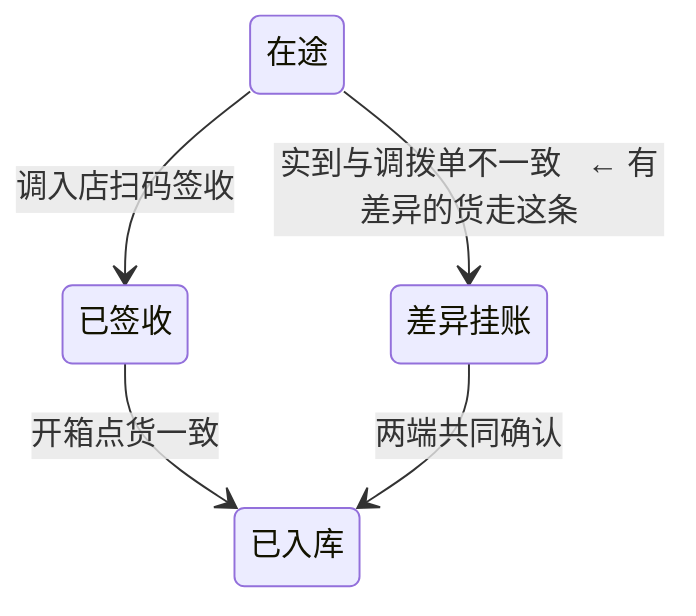
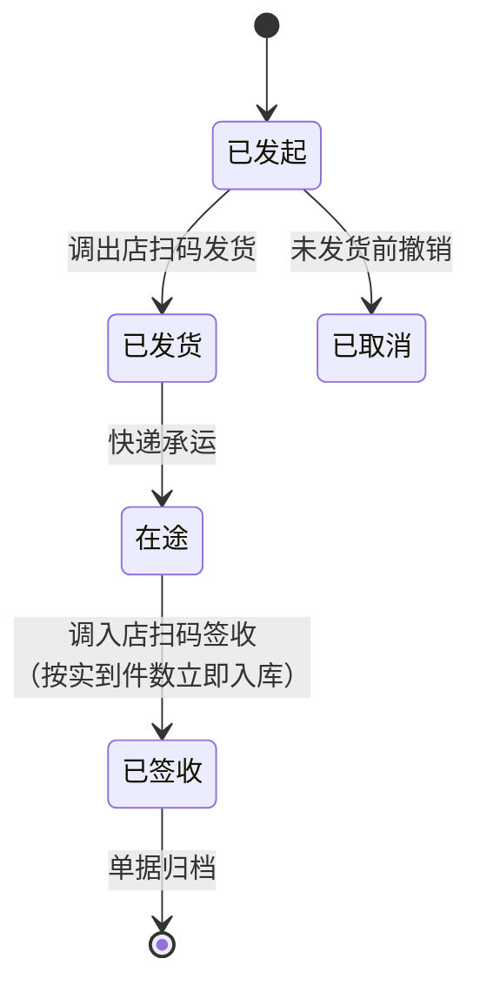
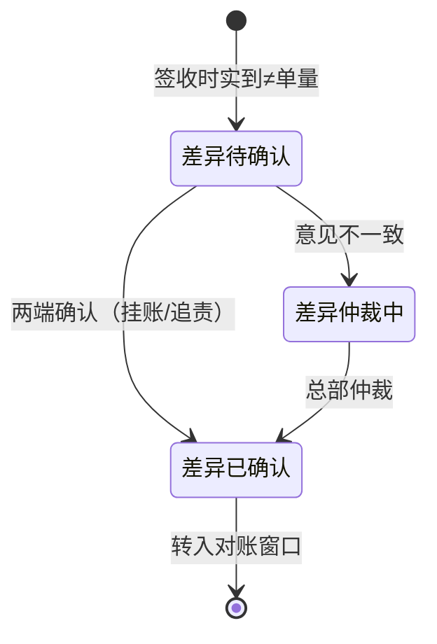

# 简岸门店WMS 库存账务正确性专项评审

**评审日期**：2026-10-21
**评审对象**：`简岸门店WMS-PRD-v2.1-20261020.md`（修复前，已归档留档）→ 已修复并更名为 `简岸门店WMS-PRD-v2.1-20261021.md`（内容版本 v2.2）
**评审性质**：跨功能账务闭合性评审（非文档质量评审）
**结论**：发现 **P0 级设计缺陷 3 项、P1 级 3 项、P2 级 1 项**，其中 3 项 P0 会导致生产环境库存账永久偏离且无法自愈。全部已在 v2.2 修复。

---

## 一、为什么需要这次评审

### 1.1 v2.1 的评审做了什么

从版本记录可还原出既有评审的检查维度：

| 检查项 | 覆盖情况 |
|---|---|
| 章节完整性（七段式 / 九章） | 做过 |
| 目标可度量性（G1~G8 带度量方式与验收时点） | 做过 |
| 功能边界数值（行数上限、件数上限、时限） | 做过 |
| 测试用例条数（每功能 6~10 条） | 做过 |
| 待确认项登记（27 项，含负责人与截止日） | 做过 |
| **跨功能库存账务闭合性** | **未做** |

前五项全部通过。这正是问题的关键：**这套评审能保证"文档合格"，但不能保证"系统算得对"**。

### 1.2 未被发现的直接原因

采用"每功能独立验收"的组织方式时，每条 AC 单独看都是成立的：

- 5.1.1 收货的 AC：`实点不一致 → 拦截入库并生成差异记录` ✔ 单看合理
- 5.4.2 调拨的 AC：`实到与单不一致时强制生成差异单才能继续` ✔ 单看合理
- 5.9.1 库存的 AC：`同一事件重复上报不产生双倍扣减` ✔ 单看合理

三条都是对的。**但把它们串起来跑一遍，账就不平了。** 没有任何一条 AC 是"全链路跑完后守恒恒等式成立"。

### 1.3 待确认项机制的副作用

PRD 有两处用了同一个说辞：

- `9.1 待确认项 4`：调拨在途的库存算调出店还是调入店（在途货权规则），标"阻塞 B1、已逾期需催办"
- `5.12.1 边界`：货权规则未配置 → **阻止自动转移记账**并提示配置

`阻塞 B1` 这个标签让"调拨差异货品不入账"看起来像是"等供应链拍板"的正常状态。但事实上：

> **"货权算谁的"是业务规则，可以待决；"实到的 7 件是否入账"是系统正确性，不能待决。**

PRD 用前者的合法性，掩盖了后者。这是本次问题能长期存在的最主要原因。

---

## 二、P0 问题详述

### P0-1 调拨差异时整单不入库

**问题**：v2.1 第 3.6 节状态机：



`已入库` 有两条入口，**都要求先"一致"或先"确认"**。存在差异时，实到的货进入 `差异挂账`，而该状态**不产生任何库存记账事件**。

**后果推演**（调拨单 8 件，实到 7 件）：

| 步骤 | 调出店 | 在途池 | 调入店可售 | 挂账量 | 账实差额 |
|---|---|---|---|---|---|
| 发货 | −8 | +8 | 0 | 0 | 0（守恒） |
| 签收（7 件） | −8 | 0（全额清池） | **0** | **0** | **−7（不守恒）** |

**7 件实物在库房里，但账上一件都不存在。** 它们不在任何科目里：不在调入店可售、不在在途池、不在挂账量、不在次品账。

**连锁后果**：

1. **销售时账实不符**：店员卖这 7 件中的一件，POS 扣减会扣成负数或扣无可扣
2. **盘点时变成盘盈**：这 7 件会被盘出来 → `差异 = 实盘 − 账面 = +7` → 生成一张新的盘盈差异单 → **一张调拨单制造出第二张差异单**，且新差异单会指向"原因不明"
3. **R3 规则永久误报**：5.11.1 的 R3 定义为"调拨差异单未闭环"，而该差异单在人工确认前永远不闭环 → R3 对该 SKU 持续告警 → 告警疲劳
4. **G5 归因覆盖率指标被注水**：这些差异最终以"无法解释"收场，正是 PRD 在痛点 P6 里要消灭的"原因不明"

**讽刺之处**：PRD 在痛点 P4（`:33`）明确定义了这个问题——"收 8 件实到 7 件，差异挂账 2 个月成糊涂账"，并在 G8 设定了"挂账差异清理期限 ≤7 天"的目标。**v2.1 的设计把 P4 从 Excel 搬进了系统，只是换了个载体。** 而且更糟：Excel 里那 7 件物理货还在店里、店长心里有数；系统里这 7 件是隐身的。

### P0-2 库存账无守恒恒等式，无校验机制

**问题**：全文仅定义 `账面库存 = 期初快照 + Σ事件`（`:935`、`:1324`），没有定义各科目之间的闭合关系，也没有任何校验/重放机制。

- 搜"守恒 / 恒等式 / 定时校验 / 事件重放 / replay"：**0 结果**
- 8.2 宣称"中央账是唯一权威账（Single Source of Truth）"，但 **SSOT 只保证"只有一个账"，不保证"这个账是对的"**
- 唯一沾边的对账是盘点的 `差异 = 实盘快照 − 账面余额`（`:459`）——这是"月盘时发现账错了"，不是"实时校验账对不对"

**新科目缺失**：P0-1 产生的差额，v2.1 里**没有任何科目承载**。在途池是"已发货未签收"，签收后即清空；可售和次品都不包括差货。**账上存在一个结构性缺口**。

### P0-3 收货与调拨的差异处理口径自相矛盾

这是最能说明"这是设计疏漏而非认知缺失"的证据——**同一份 PRD 里，同一个业务问题（实到≠单量）有两个相反的设计**：

| 场景 | 原文 | 做法 | 评价 |
|---|---|---|---|
| 收货差异 5.1.2 `:370` | "供应商确认前该批货**按实点入库**，差异部分挂账" | 先入库，后核差异 | ✅ 正确 |
| 调拨差异 5.4.3 `:706` | "生成差异单 → 两端确认 → **闭环后调拨单置为已入库**" | 先核差异，后入库 | ❌ 错误 |
| 收货 5.1.1 `:325` | "实点与送货单不一致 → **拦截入库**并生成差异记录" | 不入库 | ❌ 与 5.1.2 自相矛盾 |

注意第 1 行和第 3 行：**5.1.1 说拦截入库，5.1.2 说按实点入库**——同一功能的两个小节互相矛盾。这说明团队是懂正确做法的（5.1.2 写对了），但**各节独立撰写、缺少横向对照**。

---

## 三、P1 / P2 问题

### P1-1 入库动作无幂等键

- 唯一幂等描述在 `:940`：`重复事件 → 按 event_id 幂等去重`
- 这是**下游兜底**，不是**上游防护**。"确认入库"点两次会生成**两个不同的 event_id**，两个都通过——恰恰是 event_id 去重防不住的场景
- 四个写库存的按钮（确认入库 / 结束盘点 / 确认发货 / 确认签收）**全无防重定义**；搜"防重复提交 / 防重复点击 / 请求去重 / 幂等键 / 唯一约束"：0 结果
- 有唯一约束的只有单号（`调拨单号全局唯一`），这是单据编号唯一，不是业务请求幂等

### P1-2 离线同步无去重，7 天暂存无冲突规则

`:325`：`断网 → 扫码数据暂存本地（保留 7 天），恢复后自动同步`。未定义暂存记录与已上行事件的对应关系。**离线收一次货、以为失败又在线收一次 → 两笔都进账。**

### P1-3 事件类型清单两处不一致

| 位置 | 清单 |
|---|---|
| `5.9.1 :934` | 销售、退货入库、采购收货、调拨发货/签收/入库、盘点调整、报损 |
| `8.1 :1324` | 销售、退货入库、采购收货、**采购退货**、调拨发货/签收/入库、盘点调整、报损、**寄存出入** |

第八章是 5.9.1 的超集。开发时按哪个实现？未说明。这是 v2.0 扩章时引入的（v1.0 只有一处）。

### P2-1 R3 规则的设计性误报

R3 = "调拨差异单未闭环"。因 P0-1，差异单可能长期不闭环 → R3 永久告警。**PRD 最想解决的"糊涂账"，被设计成了系统噪音。**

---

## 四、修复方案

### 4.1 核心设计原则：单据状态与库存记账解耦

这是本次修复的**唯一根本原则**，其余改动均由它推导：

> **单据状态机追踪"单据走到哪一步"，库存事件追踪"货有没有入账"。二者解耦，互不阻塞。**

推论：
- 调拨单状态机里**不应出现**"因为要有差异所以货不入库"的路径
- 差异单应是**独立单据**，它的状态只管"责任归谁"，不管"货在不在"
- 业务规则待决（货权）只能阻塞**责任分摊记账**，不能阻塞**实物入库记账**

### 4.2 调拨状态机重画

**修复后**（v2.2 第 3.6 节）：调拨单收敛为 5 个状态，`已入库` 并入 `已签收`（签收即入库），`差异挂账` 移出为独立差异单状态机（3.6.1）。





| 项 | 修复前 | 修复后 |
|---|---|---|
| 有差异时入不入库 | 一件都不入 | **按实到件数立即入库** |
| 差异挂账是什么 | 调拨单的主状态 | 差异单的状态，独立单据 |
| 谁阻塞谁 | 差异阻塞入库 | **互不阻塞** |
| 差额在账上吗 | 不在任何科目 | **计入「待清理挂账量」** |
| 货权未拍板时 | 阻止记账（连带货不入库） | 阻止货权转移，**货照常入库** |

### 4.3 新增守恒恒等式（8.1.1）

```text
① 总量守恒
   Σ库存账(可售 + 次品) + Σ在途池 + Σ待清理挂账量 + Σ寄存量
     = 期初快照 + Σ(全部已写入事件的 qty_delta)

② 非负约束：各科目 ≥ 0
③ 可追溯：无关联单据号的事件禁止写入
```

**三层校验**：实时（写事件时校验②③）/ 每小时（重算Σ校验①）/ 日终（全量对账，超阈值阻断次日开单）。

**「待清理挂账量」是本次新增的关键科目**——它补上了 P0-1/P0-2 指的账务缺口。挂账量不再是"无主状态"，而是**在账上、有归属、可查询、有账龄**。G8 的"挂账差异账龄"从此有真实数据来源（v2.1 里这个指标取不到数）。

**用 P0-1 的案例验证修复**（调拨 8 件，实到 7 件）：

| 步骤 | 调出店 | 在途池 | 调入店可售 | 挂账量 | 合计 | 守恒 |
|---|---|---|---|---|---|---|
| 修复前·签收 | −8 | 0 | **0** | **0** | −8 | ❌ 丢 7 件 |
| 修复后·签收 | −8 | 0 | **+7** | **+1** | **0** | ✅ 平衡 |

### 4.4 新增幂等规范（8.1.2）

```text
client_txn_id = 单据号 + 动作码 + 终端本地序号

确认入库（收货）：收货单号 + "RECV" + 序号
结束盘点：      盘点任务号 + "CNT"  + 序号
确认发货：      调拨单号   + "SHIP" + 序号
确认签收：      调拨单号   + "RECV" + 序号
退货入库：      退货单号   + "RTN"  + 序号
```

关键点：**幂等键必须在扫码当下生成**，而非同步时生成——这是离线/在线双录能去重的前提。

### 4.5 统一差异处理口径

三个入口统一为"**货先入，账先记，差异后查**"：

| 入口 | 修复后口径 |
|---|---|
| 收货 5.1.1 | 按实点件数入库，差额挂账（与 5.1.2 对齐） |
| 调拨 5.4.2 | 签收即按实到入库，差额挂账 |
| 退货 5.6.1 | 原本正确（入回原库存/归次品），无需改动 |

### 4.6 其余修复

| 问题 | 修复 |
|---|---|
| P1-3 清单不一致 | 8.1 定为单一事实来源，5.9.1 改为引用 |
| P2-1 R3 误报 | 改为"差异单超 7 天未得出结论"（按账龄，不按"是否闭环"） |
| 时序图 | 3.3 调拨时序图补"按实到件数入库"动作（原图 else 分支同样无入库） |

---

## 五、修改清单

| # | 位置 | 改动 |
|---|---|---|
| 1 | 文档头 | 版本号 → v2.2，补版本记录 |
| 2 | `3.3` 调拨时序图 | else 分支补"按实到件数入库" |
| 3 | `3.6` 调拨状态机 | **重画**，5 个状态，签收即入库 |
| 4 | `3.6.1`（新增） | 调拨差异单状态机，独立单据 |
| 5 | `5.1.1` :325 | 拦截入库 → 按实点入库 |
| 6 | `5.1.1` AC / 测试用例 | 同步改写 + 补防重用例 |
| 7 | `5.3.1` | UI 增加"待清理挂账量"列（店长可见）+ 守恒校验状态 |
| 8 | `5.4.1` :614 | UI 状态标签去掉"差异挂账"/"已入库" |
| 9 | `5.4.2` | 核心逻辑改为签收即入库；补守恒/防重 AC 与用例 |
| 10 | `5.4.3` | 改写为"只处理差额归属，不处理入库"；补关键 AC |
| 11 | `5.9.1` | 事件清单改为引用 8.1；补 client_txn_id 幂等 |
| 12 | `5.11.1` R3 | 改为按账龄判定 |
| 13 | `5.12.1` | 货权规则与入库解耦；补解耦 AC |
| 14 | `8.1`（新增说明） | 定为事件类型单一事实来源 |
| 15 | `8.1.1`（新增） | **守恒约束**：四科目恒等式 + 三层校验 |
| 16 | `8.1.2`（新增） | **幂等规范**：client_txn_id + 离线去重 |
| 17 | `8.3` | 补"待清理挂账量"科目说明；货权与入库解耦 |
| 18 | 功能表 :273 | 调拨状态描述同步 |
| 19 | `9.1` 待确认项 4 | 明确"只阻塞货权转移，不阻塞入库" |
| 20 | `9.3`（新增原则） | 业务规则待决 ≠ 系统正确性待决 |
| 21 | `9.4`（新增） | 评审硬门槛：守恒 AC + 防重 AC + 全链路推演 |

---

## 六、防复发机制

### 6.1 评审硬门槛

每个涉及库存变动的功能，AC 中**必须**包含一条守恒类 AC 和一条防重类 AC，否则不得通过验收。已写入 9.4。

### 6.2 全链路账务推演

PRD 评审必须做一次：**收货 → 入库 → 调拨 → 签收 → 盘点 → 销售**，逐步骤校验守恒恒等式。

这是 v2.1 及以前**完全缺失**的环节，也是三类问题未被发现的直接原因。它不是文档检查，是一次"把系统当真的跑一遍"。

### 6.3 区分两类未决项

| 类型 | 例子 | 可否阻塞开发 |
|---|---|---|
| 业务规则未决 | 货权归属、调拨权限、计提口径 | 可以，用配置化 + 规则外置承接 |
| 系统正确性 | 守恒、幂等、签收即入库 | **不可以**，必须在 PRD 中定死 |

**禁止用"待确认项"标签包装系统正确性缺陷。** 已写入 9.3。

### 6.4 跨章节对照检查

同一业务问题在多章节出现时（如"实到≠单量"同时出现在收货、调拨、退货），必须横向对照口径一致性。5.1.1 与 5.1.2 自相矛盾、收货与调拨双标，都是这一环节缺失的产物。

---

## 七、遗留与后续

| 项 | 状态 |
|---|---|
| 待确认项 4（在途货权） | 仍未拍板，但**不再阻塞入库**；PRD 已明确其只影响责任与财务科目 |
| 待确认项 18（两端并发冲突策略） | 仍未拍板；v2.2 按"先入库者为准 + 后到标记重复"处理 |
| 待确认项 19（挂账清理期限与坏账认定） | 仍未拍板；v2.2 按 ≤7 天设计并留待确认 |
| 件级追溯（8.4） | 仍为 V2 演进项；SKU 级账只能回答"少几件"，回答不了"哪一件" |
| 寄存科目 | 本期不实现，科目已在 8.1.1 预留 |

**建议**：v2.2 合入前，由研发对 8.1.1 三层校验的性能影响做一次评估（日增约 100 万条事件，每小时全量重算的成本需要实测）。