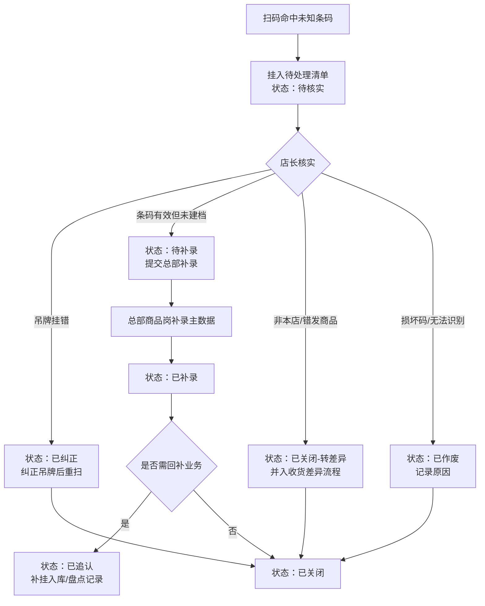

# 简岸门店WMS 未匹配条码处置流程（方案草案）

**状态**：✅ 已于 2026-10-20 合并进 [简岸门店WMS-PRD-v2.1-20261021.md](./简岸门店WMS-PRD-v2.1-20261021.md)（当时版本号 v2.1-20261020，2026-10-21 账务专项修复后更名为现文件名，内容版本 v2.2），**本文退役留档**。已拍板三项（不自动追认、超时 48h、与待确认项 2 合并评审）落于 PRD 3.7 关键规则表 ★ 项；待确认 2 / 4 转为 PRD 待确认项 26 / 27。后续修改一律以 PRD 3.7 为唯一准绳，勿再改本文。
**撰写日期**：2026-10-20
**关联章节**：PRD 5.1.1（扫码收货异常）、5.2.1（盘点异常）、第九章待确认事项（条码解析库对接收银主数据）
**素材来源**：[第5章-用户访谈原始记录-店长.md](../第5章-用户访谈原始记录-店长.md)（访谈原话："供应商把 A 款吊牌挂到 B 款"这类事天天有）

---

## 一、现状与缺口

PRD v2.0 对未匹配条码只写到"挂起"为止，**没有写后续处置**：

| 环节 | PRD 现状 | 缺口 |
|------|----------|------|
| 识别拦截 | ✅ 5.1.1 / 5.2.1：提示"未匹配商品主数据"并挂入待处理清单，不静默丢弃 | — |
| 对账口径 | ✅ 5.2.1：挂起条目不计入盘点对账 | — |
| **谁来核实** | ❌ 未写 | 责任人未定义（店长 / 总部商品岗） |
| **核实后怎么处置** | ❌ 未写 | 无状态流转、无操作入口 |
| **同一码后续被正常识别** | ❌ 未写 | 挂起条目能否"追认"未定义 |
| **时限与日清** | ❌ 未写 | 无超时提醒、无汇总报表 |

不补的后果：待处理清单只进不出，越积越多，店长扫完就忘——「不静默丢弃」做了，但**丢弃发生在人心**，系统层面等同于没闭环。

---

## 二、术语

- **未匹配条码**：扫码枪回传的条码，在商品主数据（对接收银系统）中查无记录。
- **待处理清单**：未匹配条码的挂起队列，按条码（code）维度存，同码累加次数。
- **追认**：挂起后该条码被补录进主数据、或经人工确认实际有效，把挂起时段的扫描记录补做业务处理。

---

## 三、状态流转（核心）

| 状态 | 含义 | 进入条件 | 操作人 | 退出条件 |
|------|------|----------|--------|----------|
| 待核实 | 刚扫到，等店长判断 | 扫码未匹配 | 系统自动 | 店长做出四选一判断 |
| 已纠正 | 吊牌挂错，已换回正确吊牌 | 店长判断为挂错 | 店长 | 重扫该商品通过 |
| 待补录 | 条码真实有效，主数据缺失 | 店长判断为未建档 | 店长 | 总部完成补录 |
| 已补录 | 主数据已建档 | 总部补录完成 | 总部商品岗 | 判断是否回补业务 |
| 已追认 | 挂起期间的扫描记录已补做业务 | 需回补 | 店长确认 | 流程终止 |
| 已关闭-转差异 | 非本店商品 / 供应商错发 | 店长判断 | 店长 | 并入收货差异流程（5.1.2） |
| 已作废 | 码损坏、无法识别 | 店长判断 | 店长 | 记录原因后终止 |

**所有状态变更留操作日志**（谁、何时、从什么状态改到什么状态），与 PRD 第八章账本留痕口径一致。

---

## 四、关键场景

### 场景 1：同一码挂起后，下午被正常识别（本次评审重点）

**规则建议：不自动追认，人工确认。**

1. 上午扫 `6901001001901` → 未匹配 → 挂起（待核实）
2. 下午总部补录主数据（或纠正吊牌），该码可正常识别
3. 店长此时**再次扫到同一码**，系统在弹出商品卡片的同时提示：
   > 该条码曾于今日 10:24 挂入待处理清单，待处理条目已关联
4. 店长在待处理清单中确认「已核实-匹配到 JN24AW001」→ 条目转**已补录 / 已追认**
5. 挂起时段内（10:24 ~ 确认时刻）该码的其他扫描记录，由系统列出、店长勾选是否回补入账

**为什么不自动追认**：自动入账会把未经核实的数据静默写进库存账，一旦是错发/挂错场景就产生错误库存，且第八章账本要求可追溯——**人工确认才有人为签收责任**。（待确认事项 1，已拍板：不自动追认）

### 场景 2：吊牌挂错（访谈高频）

店长把 B 款吊牌换回 A 款 → 条目标「已纠正」→ 重扫 A 款条码正常入账。**不产生主数据变更**。

### 场景 3：供应商新条码未建档

提交补录申请（条码 + 现场照片 + 供应商）→ 总部商品岗补录 → 状态流转「待补录 → 已补录」。补录 SLA 与待确认项 2（条码解析库对接收银主数据）**合并评审**（待确认事项 5，已拍板：合并）。

### 场景 4：非本店商品 / 错发

并入 5.1.2 收货差异流程（挂账待供应商确认），不在待处理清单里单独闭环。

---

## 五、角色与操作

| 角色 | 可执行操作 | 不可执行 |
|------|-----------|----------|
| 店长 | 核实四选一判断、标记已纠正/已作废/转差异、确认追认回补 | 直接补录主数据 |
| 总部商品岗 | 主数据补录、审批追认回补范围 | — |
| 系统 | 挂起、同码计数、再次命中时关联提示、状态留痕、超时提醒 | 自动改状态为已追认 |

---

## 六、时限与汇总

- **日清**：待处理清单每日闭店前须清零，未清零次日开店推送提醒（当日运营节奏）
- **超时升级**：挂起超 **48 小时**未核实 → 升级提醒总部运营（日清失守时的兜底，已拍板）
- **汇总**：日报含「今日未匹配条码数、已处置数、积压数」——对齐 PRD 第二章 G 项的损耗追溯目标

---

## 七、对 Demo 的改动（评审通过后实施）

1. `pendingBarcodes` / `pendingCodes` 结构改为 `[{ code, count, status, at }]`，同码累加显示 `×N`，带状态标签
2. 持久化进 mock（不再随页面刷新丢失），两个页面共享同一份清单
3. 卡片加最小处置入口：点条码 tag → 弹出四选一（挂错/未建档/错发/损坏）→ 状态标签更新
4. 场景 1 的"再次命中关联提示"：扫到清单内已有码时 toast 关联提示
5. 演示入口改为递增序列造不同码（不使用概率，保证演示可复现）

---

## 八、待确认事项（1 / 3 / 5 已拍板，2 / 4 待评审时定）

| # | 问题 | 结论 | 影响 |
|---|------|------|------|
| 1 | 挂起条目能否自动追认入账？ | ✅ **已拍板（2026-10-20）：否**，人工确认（见场景 1 理由） | 决定自动补账逻辑有无 → 无自动补账 |
| 2 | 处置权限：店长可否自行关闭条目？ | ⏳ 待定。建议：核实判断店长做，主数据补录总部做 | 决定角色权限表 |
| 3 | 日清时限与超时升级规则 | ✅ **已拍板（2026-10-20）：超时 48 小时升级**，日清+闭店提醒保留 | 决定提醒推送实现 |
| 4 | 追认回补的审批链（谁批准回补库存） | ⏳ 待定。建议：总部商品岗批准 | 决定回补是否需审批页 |
| 5 | 与待确认项 2（条码解析库对接收银主数据）合并评审？ | ✅ **已拍板（2026-10-20）：是**，同一套主数据链路 | 决定 PRD 第九章条目怎么合并 |

---

**评审通过后的合并计划**：第三章状态表并入 PRD 5.1.1 / 5.2.1 的异常分支；第四章场景 1 并入 5.1.1；第八章待确认事项并入 PRD 第九章（编号顺延）；第七章 Demo 改动同步更新 CLAUDE.md 的功能清单。
