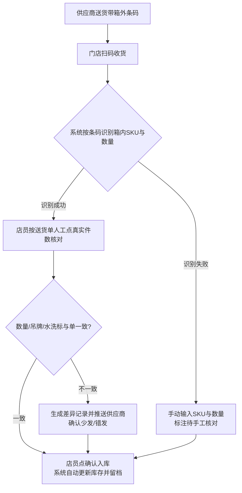
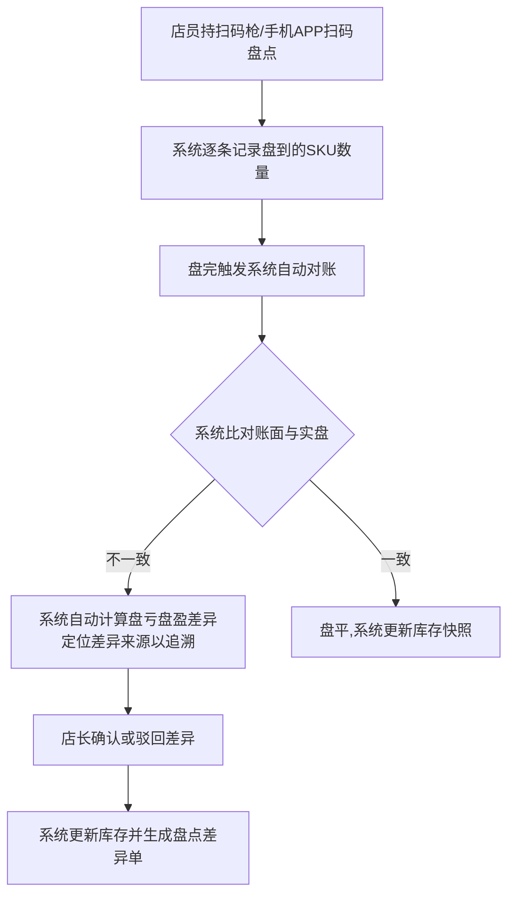
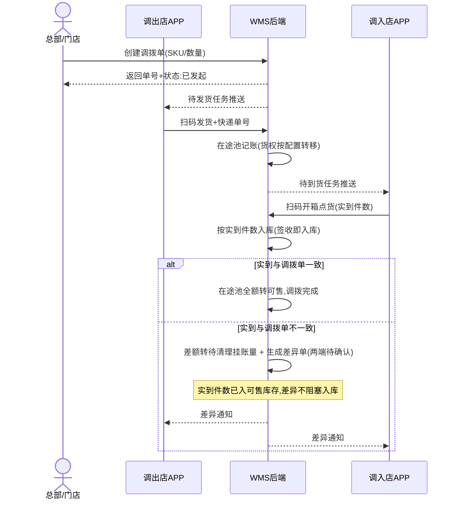
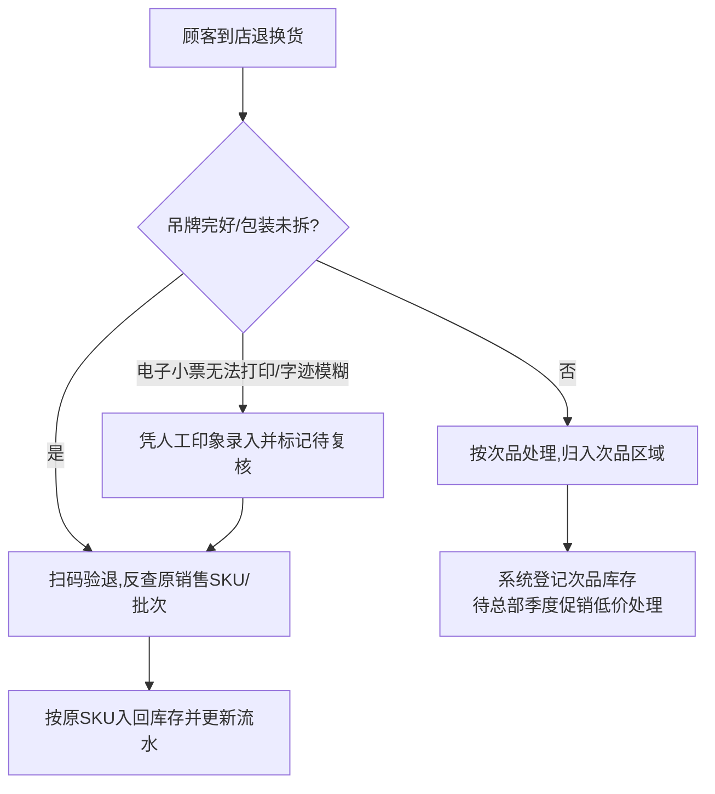
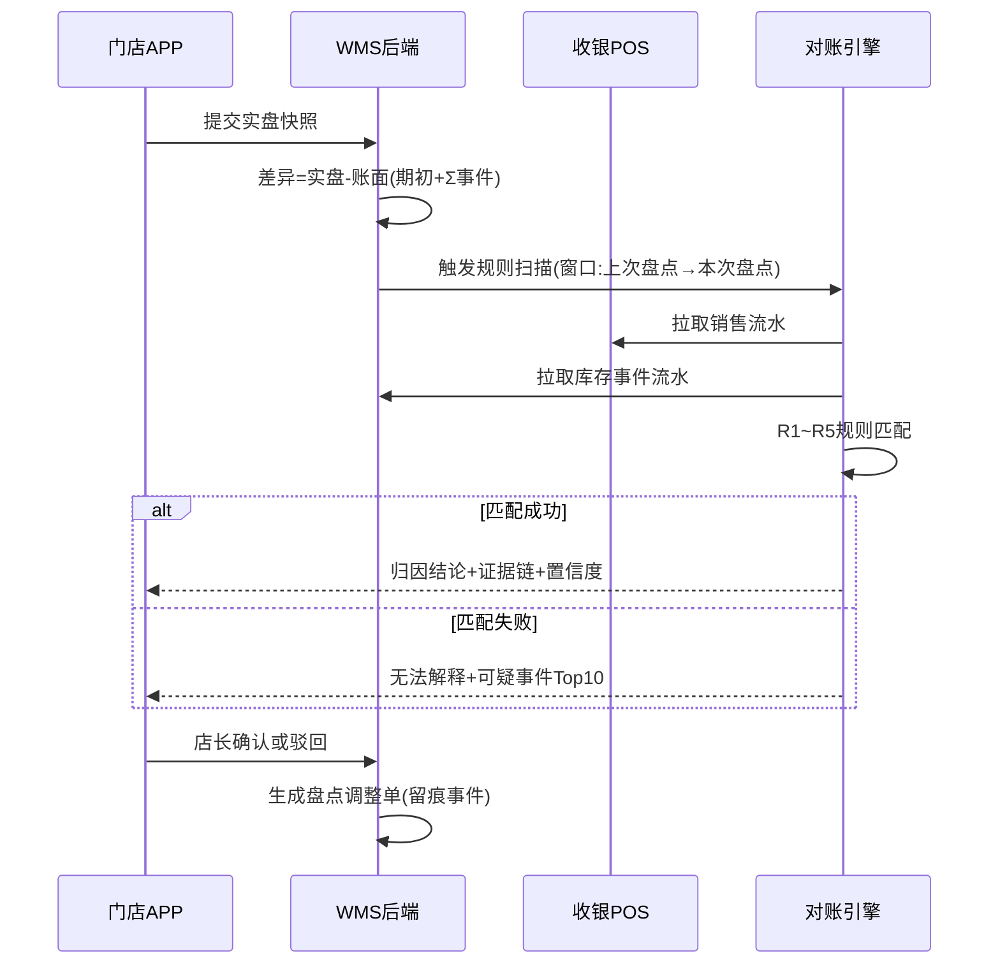
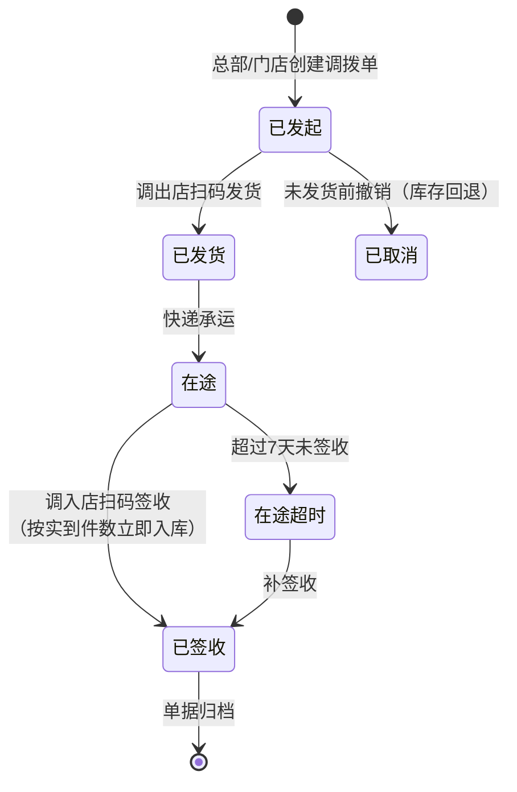
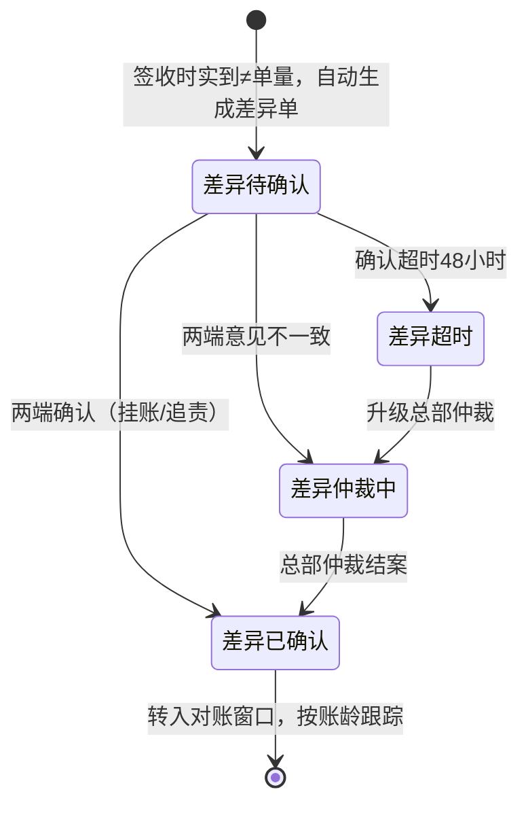
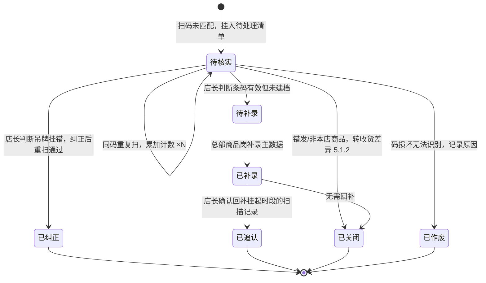
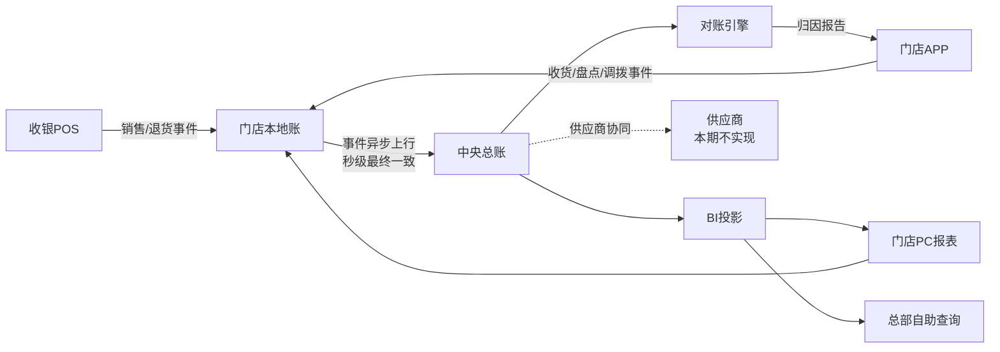
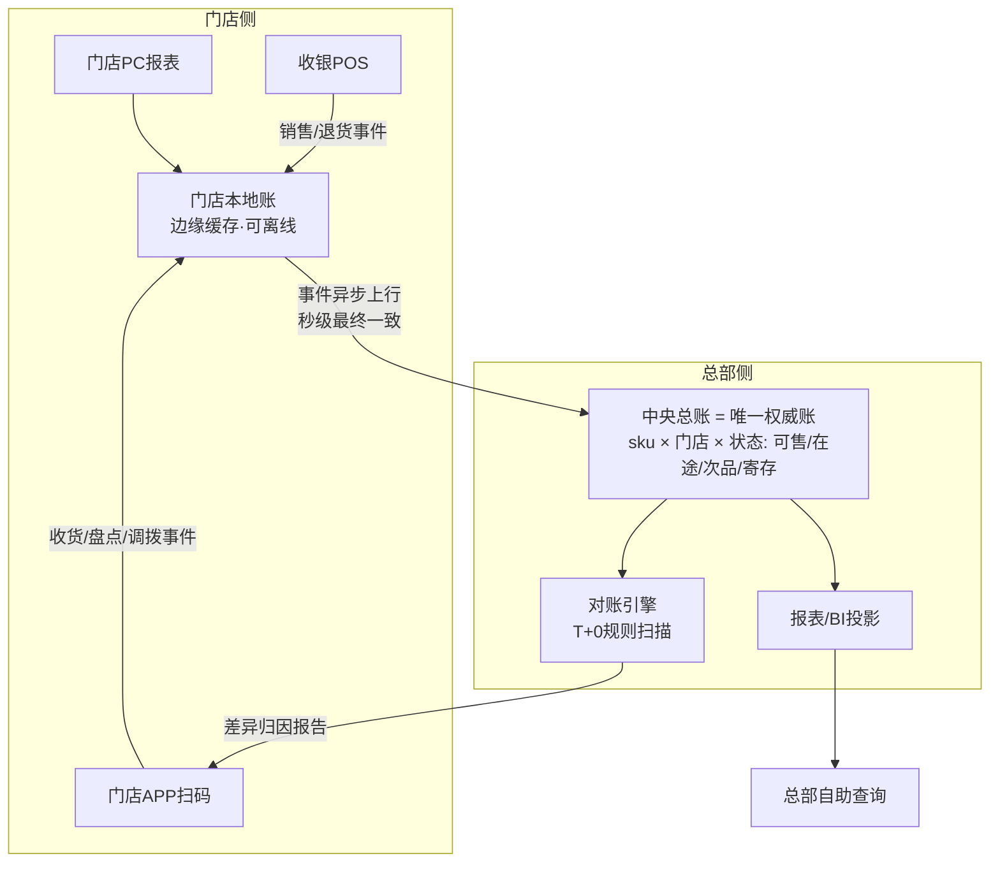

# 简岸门店WMS 产品需求文档（PRD）

**产品名称**：简岸门店WMS
**文档版本**：v2.3
**撰写日期**：2026-10-19
**需求来源**：[简岸门店WMS-需求分析-v2.md](../简岸门店WMS-需求分析-v2.md)（基于旗舰店店长张姐实地访谈）

**版本记录**

| 版本 | 日期 | 说明 |
|------|------|------|
| v1.0 | 2026-10-19 | 初稿，七段式 + 附录，留档于同目录 `简岸门店WMS-PRD-20261019.md` |
| v2.0 | 2026-10-19 | 相对 v1.0：① 章节扩展为九章（新增"八、账本与数据架构设计""九、待确认事项汇总"两个正文章节）；② 第二章目标细化 G1~G8，每项目标带度量方式与验收时点；③ 第五章功能详述补全边界数值，测试用例由每功能 3 条扩充至 6~10 条；④ 非功能性需求新增 6.5 易用性节，全部数值拍板（取消 ※建议值挂起）；⑤ 上线计划新增 7.3 变革管理与 7.4 业务规则前置；⑥ 流程图补 2 张 sequenceDiagram（调拨三方时序、对账引擎时序）与 4.3 端到端数据流全景图 |
| v2.1 | 2026-10-20 | 并入《未匹配条码处置流程》方案：① 新增 3.7 未匹配条码处置状态机（挂起四选一处置、状态流转、日清 + 48h 升级、日报汇总对齐 G4/G5）；② 5.1.1 / 5.2.1 补未匹配条码异常规则、验收场景与测试用例；③ 9.2 新增待确认项 26（处置权限）、27（追认回补审批链）。**本次已拍板**：挂起条目不自动追认入账（人工确认）、超时升级 48 小时、与待确认项 2（条码解析库对接收银主数据）合并评审 |
| **v2.2** | **2026-10-21** | **库存账务正确性专项修复**（详见 `简岸门店WMS-库存账务专项评审-20261021.md`）：① **重画 3.6 调拨状态机**——单据状态与库存记账解耦，新增 3.6.1 差异单状态机；调拨单收敛为 5 个状态，"差异挂账"不再作为调拨单主状态；**签收即入库**，实到几件入几件，差异不再阻塞入库；② 新增 **8.1.1 库存账守恒约束**（四科目恒等式 + 三层校验），新增「待清理挂账量」科目，使挂账量显式入账、有账龄、可查询；③ 新增 **8.1.2 幂等与防重复确认规范**（`client_txn_id` 业务幂等键，覆盖收货/盘点/发货/签收/退货五类入库动作，离线同步按该键去重）；④ **统一收货差异口径**——5.1.1 由"拦截入库"改为"按实点入库 + 差额挂账"，与调拨、退货口径一致；⑤ 事件类型清单收敛到 8.1 单一事实来源（原 5.9.1 与 8.1 两处清单不一致）；⑥ R3 规则由"差异单未闭环"改为按账龄判定，消除永久误报；⑦ 3.3 调拨时序图补"按实到件数入库"动作；⑧ 全部库存类功能补守恒与防重验收标准。**本次修复的根因**：原设计中调拨差异时整单不入库，实到货品游离于全部账务科目之外（账不守恒），且以"在途货权待确认"为由将系统正确性问题包装为业务待决项 |
| **v2.3** | **2026-10-23** | **新增 2.6 信息架构与导航**（此前 IA 未定义，功能入口放哪里全凭实现即兴，导致次品登记被埋入退换货二级、退货数据无外部入口）：① 定义三层导航（底部 Tab / 功能页 / 二级页）与底部 Tab 五项清单（不加不动）；② 定义首页工作台聚合规则——首页只放"数字 + 直达"，数据单一来源不复制页面；③ 定义任何数据页 ≤2 次点击可达、功能页网格不满铺；④ 次品列表回归 5.6.2 独立页面定位（一级功能入口）；⑤ 后续新增功能必须先在本节登记入口归属再实现 |

**待确认事项提示**：本文标「待确认」处均来自需求分析第八章未决项或撰写中新识别的未决项，未做推测性补充。Must 级功能中涉及未决项的部分（调拨发起权限、在途货权、离线兜底策略、收银对接方式）**必须在开发启动前由对应负责人拍板**，见第九章。

---

## 一、需求背景

### 1.1 业务现状

简岸为全国约 100 家直营门店的连锁服装品牌，主营中高端女装。门店当前依赖「4 个 Excel（货号表 / SKU 表 / 库存流水表 / 调拨记录表）+ 收银系统 + 少量扫码枪」管理库存，Excel 已传承三代店长，含十几个 Sheet 和几百个公式。本文基于旗舰店店长张姐（从业 8 年）的实地访谈整理。

### 1.2 核心痛点

| # | 痛点 | 现状量化 | 受影响角色 |
|---|------|----------|------------|
| P1 | 盘点低效差慢 | 月末盘点约 3 小时（每次 2 人），人眼对货号/颜色/尺码，准确率约 90%，10% 差异无法定位 | 店长、店员 |
| P2 | 库存不实时 | Excel 事后录入，只能查到"今天早上 10 点"的库存；顾客问货靠记忆，误报有货引发投诉 | 店长、店员 |
| P3 | 多店协同差 | 各店 Excel 独立不互通，调拨靠电话问"发了什么、几号发、快递单号" | 店长、总部 |
| P4 | 调拨差异大 | 在途货权属不清，收 8 件实到 7 件，差异挂账 2 个月成糊涂账 | 店长、总部 |
| P5 | 退换货入错库存 | 月约 50 笔退换货中约 5 笔入错位置（10%），是库存差异最大来源之一 | 店员 |
| P6 | 月损耗超标 | 月损耗率 1.5%~2%（总部要求 ≤1%），80% 损耗填写"原因不明" | 店长、总部 |
| P7 | 总部要数据慢 | 每周一早 9 点销售报表现做约 1.5 小时；临时要数据最快 30 分钟 | 店长、总部 |
| P8 | 采购收货靠人工 | 一箱 50 件约 20 分钟人工点数并手动录 Excel；送货单与实际常不符，每周至少 1 次差错 | 店员 |
| P9 | 采购退货冗长 | 次品退货需店长/总部/供应商三方纸质签字约 2 周，Excel 内再手动减库存 | 店长、总部 |
| P10 | 顾客寄存灰色地带 | 寄存表累计 20 多件未清理，不计销售也不退库存 | 店员 |

### 1.3 受影响角色

- 门店店长（核心使用者）：负责盘点、收货、调拨、退换货、报表制作。
- 门店店员：约 100 家门店约 400 名，平均年龄 35 岁，负责日常收货、整理、盘点辅助。
- 总部运营/商品人员：每周索取销售报表，发起调拨，需库存数据做补货预测与活动查询。
- 供应商：采购入库、采购退货对接方（本期不实现电子化对接）。

### 1.4 不做的后果

库存差异持续累积导致月损耗超标被总部追责；总部决策依赖延迟的人工报表；调拨协同靠电话勉强维持；顾客因误报有货导致投诉流失。

---

## 二、需求目标

### 2.1 核心目标

上线门店 WMS（门店 APP + 门店 PC + 后端服务），替代"Excel + 电话"库存管理模式，实现库存实时化、操作扫码化、协同在线化、数据自助化。

### 2.2 可衡量目标

| # | 目标 | 当前值 | 目标值 | 度量方式 | 验收时点 |
|---|------|--------|--------|----------|----------|
| G1 | 盘点差异率下降 | 约 10% | ≤3% | 系统盘点差异单 ÷ 盘点 SKU 行数 | B1 放行时 |
| G2 | 盘点时长缩短 | 约 3 小时/次 | ≤1 小时/次 | 系统记录盘点任务起止时间 | B1 放行时 |
| G3 | 库存实时可见 | 问货靠记忆 | 任意 SKU 库存查询 ≤3 秒返回当前时刻数 | 接口 P95 延迟 + 数据时间戳 | B1 放行时 |
| G4 | 月损耗率下降 | 1.5%~2% | ≤1% | 月报损事件金额 ÷ 月销售金额 | B3 结束时 |
| G5 | 损耗归因覆盖率提升 | 80% "原因不明" | 归因覆盖率 ≥70% | 有归因结论的差异单 ÷ 差异单总数 | B3 结束时 |
| G6 | 录错率下降 | 退换入错率 10%；收货差错每周 ≥1 次 | 退换入错率 ≤2%；收货差错每月 ≤1 次 | R2 规则命中数；收货差异单数 | B3 结束时 |
| G7 | 报表提效 | 周一报表现做 1.5~3 小时；临时要数 30 分钟 | 门店报表工时 0；总部自助查询即时返回 | 系统报表生成记录；查询接口延迟 | B1 放行时 |
| G8 | 调拨协同在线化 | 电话询问；挂账差异 2 个月 | 调拨进度在线可见；挂账差异清理期限 ≤7 天 | 系统调拨状态流水；挂账差异单账龄 | B2 放行时 |

### 2.3 核心价值交付

将店长从"每周一现做报表 + 月底通宵盘点 + 打电话对调拨"的事务性工作中解放出来，让门店把精力回归卖货本身。

### 2.4 范围边界（MoSCoW）

| 级别 | 功能 | 说明 |
|------|------|------|
| Must（13 项） | 扫码收货、扫码盘点、差异自动对账、实时库存查询、调拨发起与查看、调拨扫码发货/收货、库存差异追溯、扫码验退与入库、销售报表生成、库存实时更新、实时计算与快照、多门店数据互通、总部数据自助查询 | 本期交付，缺一不可 |
| Should（7 项） | 收货差异处理、快速盘点、库存分类视图、调拨差异处理、次品登记、差异定位引擎、在途货权管理 | 本期交付，资源紧张时可降级 |
| Could（3 项） | 采购退货（电子三签）、日常数据维护、供应商数据对接 | **本期不实现** |
| Won't（1 项） | 顾客寄存登记 | **本期不做**（低频灰色地带） |

### 2.5 落地约束

- 核心操作 ≤3 步、扫码即用、大字体大按钮；培训 1 小时内上手。
- 弱网/断网可继续扫码收货、盘点，恢复后自动同步；系统故障不得阻断门店销售。
- 零配置开箱即用，全局配置项 ≤5，不做过度复杂配置。

### 2.6 信息架构与导航（v2.3 新增）

**三层导航结构**：

| 层级 | 内容 | 规则 |
|------|------|------|
| 第 1 层 · 底部 Tab | 首页 / 库存 / 调拨 / 功能 / 我的 | 固定五项，不加不动；Tab 只给高频操作域 |
| 第 2 层 · 功能页 | 收货单、扫码盘点、实时库存、调拨进度、退换货、次品登记 | 「功能」Tab 网格内平级铺开；每个功能在网格中只出现一次 |
| 第 3 层 · 二级页 | 待复核清单、退货记录、扫码验退、次品列表等 | 只从各自功能页进入，不在其他页面重复开门 |

**首页工作台聚合规则**：

- 首页是聚合层：只放「数字 + 直达」（如退货待复核 N、次品待处理 N、今日退货 N 件），点击数字跳转对应数据页
- 数据单一来源：首页不复制任何列表，所有数据仍以各功能页为唯一事实来源
- 聚合候选资格：需要"当日清"或"超期升级"的数据（待收货、在途、盘点中、退货待复核、次品待处理、收货差异）进首页待办；纯查看型数据（流水、报告）不进

**通用约束**：

- 任何数据页从底部 Tab 出发 ≤2 次点击可达
- 功能页网格不满铺：新功能先评估归入现有页面（作为 Tab 内功能页或二级页），确属独立高频场景才新增网格入口
- 新增功能必须先在本节登记入口归属，再进入实现

---

## 三、需求核心业务流程图

### 3.1 采购入库流程



### 3.2 盘点流程



### 3.3 门店间调拨流程（三方时序）



### 3.4 退换货处理流程



### 3.5 差异对账与追溯时序



### 3.6 调拨在途状态机

> **设计原则：单据状态与库存记账解耦。** 调拨单状态机只追踪**单据**流转，入库由"签收事件"驱动、差异由"差异单"驱动，两者并行且互不阻塞。**签收即入库**——实到几件就入几件，差异不改变货已入账的事实。



**调拨单状态仅 5 个**：已发起 / 已发货 / 在途 / 已签收 / 已取消。原"已入库"与"已签收"合并（签收即入库，不再分两个动作）；**"差异挂账"不是调拨单状态**，已移至 3.6.1 差异单状态机。

### 3.6.1 调拨差异单状态机（独立单据，不阻塞库存）



| 关键规则 | 说明 |
|---|---|
| 签收即入库 | 调入店扫码签收时**按实到件数立即写入"调拨入库"事件**，实到 7 件则 7 件入账，生成 1 件待清理挂账量 |
| 差异不阻塞入库 | 差异单的确认/仲裁**只影响责任归属与财务挂账科目**，不影响库存已按实收入账 |
| 挂账量在账上 | 差额计入"待清理挂账量"科目（见 8.1.1），既不在两端可售、也不在在途池，**但在账上可查、有账龄** |
| 账龄驱动告警 | 差异单超过 7 天未得出结论 → 列入待清理清单并通知总部（G8），不因"未闭环"本身告警 |

---

### 3.7 未匹配条码处置状态机（跨扫码入库/盘点）

扫到未匹配商品主数据的条码时，系统挂起（5.1.1 / 5.2.1 均不静默丢弃），后续处置按本状态机流转。



**关键规则**（★ 为 2026-10-20 已拍板项）：

| # | 规则 | 说明 |
|---|------|------|
| 1 | ★ **不自动追认入账** | 后续同码被正常识别时，系统仅提示"该条码曾于 xx:xx 挂起"，条目状态变更与挂起时段记录回补均由店长人工确认——自动入账会把未核实数据静默写进库存账，违背 8.1 可追溯前提 |
| 2 | 按码去重、同码累加 | 清单按 code 维度存，同码重复扫显示 `code ×N`（件数不丢失） |
| 3 | ★ **超时 48 小时升级** | 挂起超 48h 未核实 → 自动升级提醒总部运营；日清（每日闭店前清零、未清零次日开店提醒）为当日运营节奏，48h 升级为兜底 |
| 4 | 日报汇总 | 日报含「今日未匹配数 / 已处置数 / 积压数」，支撑 G4 损耗率与 G5 归因覆盖率验收取数 |
| 5 | 全程留痕 | 状态变更记录操作人、时间、前后状态，口径同 8.1 事件化要求 |
| 6 | 跨页共享 | 入库与盘点共用同一份待处理清单（同一条码异常不因入口不同而分裂） |

**处置权限**：店长做核实四选一判断与条目关闭，总部商品岗做主数据补录——权限边界见待确认项 26；追认回补的审批链见待确认项 27。补录链路与待确认项 2（条码解析库对接收银主数据）**合并评审（已拍板）**。

---

## 四、需求功能清单

### 4.1 功能清单

| 终端 | 模块 | 功能 | 描述 | 优先级 |
|------|------|------|------|--------|
| 门店APP | 扫码入库 | 扫码收货 | 扫描箱外条码自动识别箱内 SKU 与数量，联动送货单，支持人工核点件数，确认后自动入库并留档 | Must |
| 门店APP | 扫码入库 | 收货差异处理 | 实点数与送货单不一致时生成差异记录，可推送供应商确认少发/错发 | Should |
| 门店APP | 扫码盘点 | 扫码盘点 | 持手机/扫码枪扫码自动记录盘到 SKU 数量，替代人眼对货号与手动抄录 | Must |
| 门店APP | 扫码盘点 | 差异自动对账 | 盘完系统自动比对账面与实盘，自动计算盘亏盘盈并生成差异单 | Must |
| 门店APP | 扫码盘点 | 快速盘点 | 支持仅盘点热卖款/指定范围的每日快速盘点，控制盘点时长 | Should |
| 门店APP | 实时库存 | 实时库存查询 | 随时查看当前时刻实时库存（SKU 级，含在途/可售/次品分类），替代 Excel 事后查询 | Must |
| 门店APP | 实时库存 | 库存分类视图 | 按可售、在途、次品状态分类展示库存数量 | Should |
| 门店APP | 调拨管理 | 调拨发起与查看 | 发起/接收调拨，实时查看"已发起/已发货/在途/已签收/已取消"全程进度，无需电话询问 | Must |
| 门店APP | 调拨管理 | 调拨扫码发货/收货 | 调出店扫码发货登记实际 SKU/数量/快递单号，调入店扫码开箱点货 | Must |
| 门店APP | 调拨管理 | 调拨差异处理 | 实到与调拨单不一致时生成差异单，两端共同确认挂账或追责 | Should |
| 门店APP | 差异追溯 | 库存差异追溯 | 盘点差异自动定位来源（销售未扣库存、退换货入错位、调拨差异、丢失破损），替代"原因不明" | Must |
| 门店APP | 退换货 | 扫码验退与入库 | 退货扫码反查原 SKU/批次，吊牌完好入回原库存，次品归入次品区域 | Must |
| 门店APP | 退换货 | 次品登记 | 登记次品库存及处理状态，联动总部季度促销处理 | Should |
| 门店APP | 寄存管理 | 顾客寄存登记 | 寄存商品单独登记，不计销售/不退库存，支持到期提醒与取件销记 | Won't（本期不做） |
| 门店PC | 报表中心 | 销售报表生成 | 自动生成上周销量、库存周转率、Top 10 滞销款、下周补货预测等报表 | Must |
| 门店PC | 报表中心 | 日常数据维护 | 管理货号表/SKU 表/库存流水/调拨记录，替代手工维护 4 个 Excel | Could（本期不实现） |
| 门店后端 | 库存服务 | 库存实时更新 | 收银系统、调拨、退货、盘点的库存变动实时同步至库存账 | Must |
| 门店后端 | 库存服务 | 实时计算与快照 | 计算库存周转率/Top 10/滞销判定，维护历史库存快照 | Must |
| 门店后端 | 协同服务 | 多门店数据互通 | 各门店库存、调拨、在途数据在线共享，总部/门店可查看任意门店 SKU 库存 | Must |
| 门店后端 | 差异服务 | 差异定位引擎 | 关联销售/退货/调拨/收银流水定位差异来源 | Should |
| 门店后端 | 调拨服务 | 在途货权管理 | 维护调拨在途状态与货权归属，支持丢失/损毁责任判定 | Should |
| 供应链中台后端 | 数据服务 | 总部数据自助查询 | 总部自助查询各店实时库存、周转率、滞销款、补货预测，无需门店现做 | Must |
| 供应链中台后端 | 采购协同 | 供应商数据对接 | 收货差异、采购退货与供应商电子化对账协同（送货单校验） | Could（本期不实现） |

### 4.2 痛点 → 功能追溯映射

| 背景痛点 | 对应功能 | 优先级 |
|---|---|---|
| P1 盘点低效差慢 | 扫码盘点 / 差异自动对账 / 快速盘点 | Must / Should |
| P2 库存不实时 | 实时库存查询 / 库存实时更新 | Must |
| P3 多店协同差 | 调拨发起与查看 / 调拨扫码发货收货 / 多门店数据互通 | Must |
| P4 调拨差异大 | 调拨差异处理 / 在途货权管理 | Should |
| P5 退换货入错库存 | 扫码验退与入库 | Must |
| P6 月损耗超标且 80% 原因不明 | 库存差异追溯 / 差异定位引擎 | Must / Should |
| P7 总部要数据慢 | 销售报表生成 / 总部数据自助查询 | Must |
| P8 采购收货靠人工 | 扫码收货 / 收货差异处理 | Must / Should |
| P9 采购退货流程冗长 | 采购退货（电子三签） | Could（本期不实现） |
| P10 顾客寄存留灰色地带 | 顾客寄存登记 | Won't（本期不做） |

### 4.3 端到端数据流全景



---

## 五、需求功能详述

本章覆盖全部 Must 与 Should 功能（20 项），按模块分组；Won't / Could 三项在章末给出范围说明。每个功能覆盖：原型描述 → 用户故事 → 前置条件 → 核心逻辑 → 边界条件与异常处理 → 技术难点分析 → 验收标准 → 测试用例。

### 5.1 门店APP——扫码入库

#### 5.1.1 扫码收货

**原型描述**：
收货页：顶部通栏"扫描箱外条码"主按钮（高 88px，品牌绿 #07C160，白字），点击弹出全屏扫码框（占屏宽 80%）；中部为识别结果列表，每行展示货号/颜色/尺码/数量，与送货单逐行对比，差异行红色高亮并左移标记；底部固定"确认入库"主按钮与"转手工录入"次按钮。整页正文字号 ≥16sp。

**用户故事**：
> 作为一个店员，我想要扫描箱外条码自动识别箱内 SKU 与数量并对照送货单核点，以便于快速准确完成到货入库。

**前置条件**：
- 店员账号已登录且具有收货权限。
- 供应商已送货到场，箱外条码完好可扫。

**核心逻辑**：
- 扫码 → 系统按条码解析箱内 SKU 与数量（响应 P95 ≤300ms）→ 展示待收清单 → 店员按送货单人工点真实件数 → 数量/吊牌/水洗标一致 → 点"确认入库"。
- 系统写入"采购收货"不可变事件（八要素见 8.1），更新库存账，收货单留档。
- 数据流向：输入 = 箱外条码 + 送货单；输出 = 收货单 + 库存事件 + 库存变动。

**边界条件与异常处理**：
- 边界：单箱 SKU 行数上限 100 行，超出分批收货；单 SKU 数量上限 9999；一箱多 SKU 逐箱扫码。
- 异常：条码识别失败 → 转手工录入 SKU 与数量并强制标注"待手工核对"；实点与送货单不一致 → **按实点件数入库**并生成差异记录（见 5.1.2），差额计入「待清理挂账量」科目（见 8.1.1）；断网 → 扫码数据暂存本地（保留 7 天），扫码当下即生成 `client_txn_id`，恢复后按其去重同步（见 8.1.2）。
- 异常（未匹配条码）：扫到未匹配商品主数据的条码 → 提示"未匹配商品主数据"并挂入待处理清单（按码去重、同码累加 ×N），不静默丢弃、不阻断正常扫码入库；后续再次扫到同码时提示"该条码曾于 xx:xx 挂起"；**不自动追认入账**，处置按 3.7 状态机由店长人工流转，挂起超 48h 未核实升级提醒总部运营。

**技术难点分析**：
- 箱外条码到箱内 SKU/数量的映射规则需随供应商条码体系维护（供应商主数据待确认）。
- 与收银系统商品主数据对齐（待确认项 1、2）。

**验收标准 (Acceptance Criteria)**：
- 🎯 **成功场景**：扫描有效箱外条码，P95 ≤300ms 展示箱内 SKU 与数量清单；确认入库后库存实时增加并生成可追溯收货单。
- ✔️ **校验场景**：实点件数与送货单不一致时，系统**按实点件数入库**并生成差异记录（口径同 5.1.2 / 5.4.3）；单箱超过 100 行时提示分批。
- ✔️ **校验场景（未匹配条码）**：未知条码被挂入待处理清单且状态可按 3.7 流转；同码重复扫累加 ×N；挂起 48h 未核实触发升级提醒；条目未经人工确认不得写入库存账。
- ❌ **异常场景**：条码识别失败可转手工录入且强制标注待核对；断网扫码数据不丢失，恢复网络后自动同步入库。

**测试用例**：
- 扫码识别箱内SKU成功
- 识别结果3秒内展示
- 实点与单一致确认入库
- 数量不符按实点入库并生成差异
- 差额计入待清理挂账量科目
- 反复点击确认入库只入账一次
- 吊牌水洗标不符可标注
- 条码识别失败转手工录入
- 手工录入强制标待核对
- 断网扫码暂存不丢失
- 恢复网络自动同步入库
- 单箱超100行分批处理
- 未知条码挂入待处理清单可处置
- 同码重复扫累加计数×N
- 挂起48小时未核实升级提醒
- 未确认挂起条目不写入库存账

---

#### 5.1.2 收货差异处理

**原型描述**：
差异确认页：左右分栏"送货单数量 vs 实点数量"，差异项红色高亮；中部差异原因单选（少发/错发/破损/其他）+ 拍照上传区（最多 3 张，单张 ≤5MB）；底部"推送供应商确认"主按钮；页顶显示差异单号与状态标签（待确认/已确认/已关闭）。

**用户故事**：
> 作为一个店员，我想要在实点与送货单不一致时生成差异记录并推送供应商确认，以便于明确少发/错发责任。

**前置条件**：
- 扫码收货过程中实点与送货单不一致。
- 店员具有差异登记权限。

**核心逻辑**：
- 系统生成差异记录（差异单号、SKU、单量、实点、差异量、原因、照片、操作人、时间戳），推送供应商确认。
- 供应商确认前该批货按实点入库，差异部分挂账；供应商确认结果回写差异单状态，进入 R5 对账规则跟踪。
- 数据流向：输入 = 送货单 + 实点数 + 原因/照片；输出 = 差异记录 + 供应商确认单。

**边界条件与异常处理**：
- 边界：差异单行数上限 100 行；差异量为 0 禁止生成差异单；部分 SKU 差异按行记录。
- 异常：供应商 T+3 未确认 → 自动提醒门店跟进；推送失败 → 差异单不丢失，支持重推；已确认差异单不可修改，修正走新差异单。

**技术难点分析**：
- 与供应商的对接方式（系统对接或人工核款）待确认（待确认项 6）。
- 差异单与库存事件的关联追溯。

**验收标准 (Acceptance Criteria)**：
- 🎯 **成功场景**：不一致时自动生成差异单并推送供应商，供应商确认后差异单状态更新为已确认。
- ✔️ **校验场景**：差异量为 0 禁止生成差异单；差异单超过 100 行禁止提交；照片超过 3 张或单张超 5MB 被拦截。
- ❌ **异常场景**：推送失败时差异单不丢失，可重新推送；供应商 3 天未确认自动提醒。

**测试用例**：
- 差异自动生成并推送供应商
- 差异行含单量实点差异量
- 零差异禁止建差异单
- 差异超100行禁止提交
- 照片最多上传3张
- 推送失败差异单不丢失
- 供应商3天未确认提醒
- 已确认差异单不可修改

---

### 5.2 门店APP——扫码盘点

#### 5.2.1 扫码盘点

**原型描述**：
盘点任务页：页头显示任务名称与范围（全店/热卖款/指定区域），中部大扫码按钮（88px）+ 已盘数量与进度条，下方已盘 SKU 列表（支持滑动核对）；底部"结束盘点"主按钮。支持扫码枪与手机摄像头两种录入方式。

**用户故事**：
> 作为一个店员，我想要持手机/扫码枪逐件扫码记录盘到数量，以便于替代人眼对货号与手动抄录。

**前置条件**：
- 已登录且具有盘点权限。
- 盘点任务已创建并开始。

**核心逻辑**：
- 逐件扫码 → 系统逐条记录 SKU 数量 → 盘完点"结束盘点"触发自动对账（5.2.2）→ 产出实盘快照与盘点差异单/盘平结果。
- 数据流向：输入 = 扫码流水；输出 = 实盘快照 + 盘点结果。

**边界条件与异常处理**：
- 边界：单任务 SKU 行数上限 5000 行；单 SKU 计数上限 9999；同一 SKU 连续扫码自动累加，3 秒内重复扫同一吊牌提示"已盘过"。
- 异常：扫到未知条码 → 提示"未匹配商品主数据"并挂入待处理清单（按码去重、同码累加 ×N，与扫码入库共用同一清单），挂起条目不计入对账，处置按 3.7 状态机流转（48h 升级、不自动追认）；盘点中断 → 支持暂停/继续，已盘数据本地保留 7 天。

**技术难点分析**：
- 大批量扫码时的本地性能与离线缓存（月盘 2 人 3 小时的量级）。
- 扫码节奏与店员操作习惯匹配（店员平均 35 岁，需低学习成本）。

**验收标准 (Acceptance Criteria)**：
- 🎯 **成功场景**：连续扫码不卡顿，单任务支持 5000 SKU；盘完 1 分钟内产出对账结果。
- ✔️ **校验场景**：同一 SKU 重复扫码正确累加；未知条码被拦截并提示，不静默丢弃。
- ✔️ **校验场景（未匹配条码）**：同码重复扫在清单中累加 ×N；挂起条目不计入本次对账；状态可按 3.7 流转且与扫码入库侧共享同一清单。
- ❌ **异常场景**：盘点中途退出已盘数据不丢失，可续盘；断网时本地续盘，恢复后自动上传快照。

**测试用例**：
- 扫码累加计数正确
- 同一SKU重复扫有提示
- 未知条码拦截并提示
- 未知条码挂起可按3.7处置
- 同码重复扫累加×N
- 挂起条目不计入对账
- 单任务盘5000个SKU
- 单SKU计数上限9999
- 盘点进度实时显示
- 中途退出已盘数据保留
- 断网盘点本地续盘
- 恢复后自动上传快照

---

#### 5.2.2 差异自动对账

**原型描述**：
对账结果页：页头汇总"盘亏 X 件 / 盘盈 Y 件 / 盘平 Z 件"；主体为账面 vs 实盘逐 SKU 对比表，差异项列出数量与建议归因（含置信度标签）；店长可逐项"确认"或"驳回"，也可批量确认；底部"生成盘点调整单"按钮。

**用户故事**：
> 作为一个店长，我想要盘完系统自动比对并计算盘亏盘盈、定位差异来源，以便于替代月底人工对 4 个 Excel。

**前置条件**：
- 盘点任务已完成扫码。
- 事件流水与对账规则库已启用。

**核心逻辑**：
- 差异 = 实盘快照 − 账面余额（期初 + Σ事件）。
- 对账引擎在"上次盘点 → 本次盘点"时间窗口内跑规则库 R1~R5（定义见 5.11.1）。
- 归因输出：结论 + 证据链（关联单据号列表）+ 置信度；置信度低于阈值转人工复核（阈值待确认项 15）；匹配失败标记"无法解释"并输出可疑事件 Top 10。
- 店长确认 → 生成盘点调整单（留痕事件）并更新库存；驳回 → 回退重盘或挂起。
- 数据流向：输入 = 实盘快照 + 事件流水；输出 = 盘点差异单 + 归因报告 + 盘点调整单。

**边界条件与异常处理**：
- 边界：差异量为 0 → 盘平，更新库存快照；批量确认上限 500 行/次。
- 异常：规则引擎故障 → 降级为纯差异列表，不阻断盘点结果查看；店长全部驳回 → 任务回到"盘点中"可续盘。
- 防重：**"结束盘点"与"生成盘点调整单"均携带业务幂等键 `client_txn_id`（见 8.1.2）**，重复提交不产生二次调整；断网续盘恢复上传的实盘快照按幂等键去重，不覆盖已对账结果。

**技术难点分析**：
- 对账规则库的可配置性与准确率（误报控制）。
- T+0 准实时扫描（R1 每小时）的调度成本。

**验收标准 (Acceptance Criteria)**：
- 🎯 **成功场景**：盘完自动产出差异单与归因结论，高置信度结论附证据链（关联单据号列表）。
- ✔️ **校验场景**：店长驳回后库存数据不被修改；批量确认上限 500 行/次。
- ✔️ **校验场景（守恒）**：盘点调整单写入后 `Σ库存账 + 在途池 + 待清理挂账量` 等于调整前台账（调整仅做账面-实盘平移，不凭空增减），见 8.1.1。
- ✔️ **校验场景（防重）**：重复提交"生成盘点调整单"不产生二次库存调整。
- ❌ **异常场景**：规则引擎异常时降级为纯差异列表，盘点结果仍可查看。

**测试用例**：
- 盘亏盘盈自动计算
- 归因结论附证据链
- 高置信度直接推荐处理
- 低置信度转人工复核
- 店长确认生成调整单
- 店长驳回库存不改
- 无匹配规则输出Top10
- 盘平更新库存快照
- 引擎故障降级不阻断
- 重复提交调整单只调整一次
- 盘后守恒恒等式成立

---

#### 5.2.3 快速盘点

**原型描述**：
快速盘点入口位于盘点页顶部，点击后弹出范围选择面板：热卖款（默认近 7 天销量 Top 50，可调整）/ 指定货架 / 指定 SKU 范围；确认后进入与 5.2.1 相同的扫码页，页头常驻本次范围标签。

**用户故事**：
> 作为一个店长，我想要每天只盘热卖款或指定范围，以便于把盘点时长控制在每日可承受范围。

**前置条件**：
- 已配置快速盘点范围（热卖款定义：近 7 天销量 Top 50，阈值待确认项 25 关联）。
- 已登录且具有盘点权限。

**核心逻辑**：
- 按选定范围生成盘点任务 → 扫码 → 仅对范围内 SKU 对账 → 差异走 5.2.2 同一闭环。
- 数据流向：输入 = 范围定义；输出 = 范围内差异单。

**边界条件与异常处理**：
- 边界：扫到范围外 SKU → 提示"不在本次范围"并计入待处理，不计入对账；范围为空禁止开始；单日快速盘点次数不限。
- 异常：范围配置加载失败 → 禁止开始盘点并提示重试。

**技术难点分析**：
- 热卖款定义的配置化（销量周期与阈值）。

**验收标准 (Acceptance Criteria)**：
- 🎯 **成功场景**：选定热卖款范围扫码后，仅输出范围内差异单，单次时长 ≤30 分钟。
- ✔️ **校验场景**：扫到范围外 SKU 有提示且不影响对账结果；空范围禁止开始。
- ❌ **异常场景**：范围配置加载失败时禁止开始盘点。

**测试用例**：
- 热卖款范围一键开始
- 范围外扫码提示不计入
- 空范围禁止开始
- 范围配置失败禁止开始
- 范围内差异正常输出
- 快速盘点每日可多次
- 范围名单可配置更新

---

### 5.3 门店APP——实时库存

#### 5.3.1 实时库存查询

**原型描述**：
库存查询页：顶部固定搜索栏（货号/SKU/关键字，支持扫码即查），下方列表展示当前时刻实时库存，每行含可售/在途/次品三列数量（**店长角色额外可见"待清理挂账量"列及账龄角标**），页脚常驻数据时间戳（如"数据截至 15:32"）；断网时顶部显示黄色离线横幅。

**用户故事**：
> 作为一个店员，我想要随时查看当前时刻的实时库存，以便于顾客问货时当场回答。

**前置条件**：
- 已登录；门店库存账已完成初始化。

**核心逻辑**：
- 查询库存账（sku × 门店 × 状态），在线时读中央账投影，断网时读门店本地账；展示可售/在途/次品数量并标注数据时间；店长角色可见待清理挂账量与账龄。
- **四科目合计恒等于台账总量**（见 8.1.1），页面汇总行展示该恒等式校验状态，供店长自查账实一致。
- 数据流向：输入 = SKU/货号/关键字；输出 = 实时库存数 + 数据时间戳。

**边界条件与异常处理**：
- 边界：无匹配 SKU → 空态提示；SKU 多状态多值 → 分行展示；单次查询返回行数上限 500 行。
- 异常：断网 → 展示本地账最后已知数并标注数据截止时间，不冒充实时；查询超时 → 3 秒未返回即提示重试。

**技术难点分析**：
- 本地账与中央账最终一致下的展示口径（时间戳标注）。
- 离线本地读取 ≤200ms 的本地索引设计。

**验收标准 (Acceptance Criteria)**：
- 🎯 **成功场景**：查询任一 SKU，P95 ≤300ms 返回当前时刻可售/在途/次品数量。
- ✔️ **校验场景**：输入不存在的货号返回空态提示，不报错。
- ❌ **异常场景**：断网时展示本地账数据（本地读取 ≤200ms）并标注截止时间。

**测试用例**：
- 库存查询秒级返回
- 结果含可售在途次品
- 页面标注数据时间戳
- 无此货号空态提示
- 断网展示本地账数据
- 本地查询200ms内返回
- 多终端库存最终一致
- 他店库存按权限可见

---

#### 5.3.2 库存分类视图

**原型描述**：
库存页顶部页签切换：可售 / 在途 / 次品（寄存本期不做，不展示该页签）；各页签为列表 + 汇总头（总数与件数）；在途页签额外显示预计签收时间与快递单号。

**用户故事**：
> 作为一个店长，我想要按状态分类查看库存，以便于掌握可售、在途、次品各有多少。

**前置条件**：
- 同 5.3.1。

**核心逻辑**：
- 按状态维度筛选库存账；在途展示在途池虚拟仓位（货权归属规则待确认，见 5.12.1）。
- 数据流向：输入 = 状态页签选择；输出 = 对应状态 SKU 列表与汇总数。

**边界条件与异常处理**：
- 边界：某状态无数据 → 空态展示；寄存状态本期不做 → 页签不展示。
- 异常：页签数据加载失败 → 提示重试，不影响其他页签。

**技术难点分析**：
- 在途池虚拟仓位与门店实物仓的换算展示口径。

**验收标准 (Acceptance Criteria)**：
- 🎯 **成功场景**：切换页签展示对应状态 SKU 列表与汇总数，在途页签含快递单号。
- ✔️ **校验场景**：各页签汇总数与明细逐行加总一致；在途数量不计入可售。
- ❌ **异常场景**：某状态无数据时展示空态，不报错。

**测试用例**：
- 页签切换筛选正确
- 汇总与明细加总一致
- 空状态展示空态
- 寄存页签本期不展示
- 在途数量不计入可售
- 页签加载失败可重试

---

### 5.4 门店APP——调拨管理

#### 5.4.1 调拨发起与查看

**原型描述**：
调拨列表页：顶部"我发起的/我接收的/全部"筛选 + 状态标签（已发起/已发货/在途/已签收/已取消）；存在差异的调拨单额外挂"差异待处理"角标（角标指向差异单，不改变主状态）；发起页选择对方门店（支持按门店搜索）、SKU（扫码或搜索添加）与数量，提交前显示预计在途天数；详情页含状态时间轴。

**用户故事**：
> 作为一个店长，我想要在线发起调拨并实时查看全程进度，以便于不再打电话问"发了什么、几号发、单号多少"。

**前置条件**：
- 已登录且具有调拨权限。
- 调拨发起规则已确认（待确认项 3：总部统一发起还是允许门店互调）。

**核心逻辑**：
- 创建调拨单（调出店、调入店、SKU、数量）→ 状态机流转（见 3.6）→ 调出/调入两端 + 总部实时可见。
- 调拨单挂中央账在途池虚拟仓位；未发货可撤销，撤销后库存自动回退。
- 数据流向：输入 = 调拨需求；输出 = 调拨单 + 状态流水。

**边界条件与异常处理**：
- 边界：未发货调拨单可撤销；已发货不可撤销，需走在途/差异流程；单号全局唯一；调入店该 SKU 可售库存不足（总部视角）→ 提示但允许提交（以发货实点为准）。
- 异常：同步延迟 → 展示最近状态 + 时间戳；两端同时操作同一调拨单 → 后到方收到冲突提示（冲突策略待确认项 18）。

**技术难点分析**：
- 多端状态实时同步；在途池虚拟仓位设计（见 5.12.1）。

**验收标准 (Acceptance Criteria)**：
- 🎯 **成功场景**：发起调拨后两端门店与总部均可见，状态随发货/签收实时更新。
- ✔️ **校验场景**：未发货调拨单可撤销且库存回退；已发货不可撤销；调拨单号全局唯一。
- ❌ **异常场景**：同步延迟时展示最近状态并标注时间戳；并发操作有冲突提示。

**测试用例**：
- 调拨单三端实时可见
- 状态随流转实时更新
- 未发货调拨单可撤销
- 已发货单不可撤销
- 调入店库存不足提示
- 调拨单号全局唯一
- 取消后库存自动回退
- 同步延迟标注时间戳

---

#### 5.4.2 调拨扫码发货/收货

**原型描述**：
发货页：扫码登记实际 SKU/数量，快递单号输入框（必填），底部"确认发货"按钮；收货页：扫码开箱点货，逐件确认，页面对比"调拨单 vs 实到"，差异行红色高亮，底部"确认签收"按钮。

**用户故事**：
> 作为一个调出店/调入店店员，我想要扫码登记发货与收货实际件数，以便于账实一致、差异有据可查。

**前置条件**：
- 发货侧：调拨单已发起；收货侧：调拨单已发货在途。

**核心逻辑**：
- 调出店扫码发货 → 记录实际 SKU/数量/快递单号 → 在途池记账（货权规则待确认）。
- 调入店扫码开箱点货 → **按实到件数立即写入"调拨入库"事件（签收即入库）** → 实到 vs 调拨单比对：一致则单据归档；不一致则差额计入「待清理挂账量」科目并生成差异单走 5.4.3。
- **差异不阻塞入库**：无论差异单是否确认，实到的货都已入账、可售、可被盘点。
- 数据流向：输入 = 扫码流水 + 快递单号；输出 = 发货/签收事件 + 在途池变动 + 待清理挂账量变动。

**边界条件与异常处理**：
- 边界：部分签收按 SKU 分行处理；快递单号必填才能发货；一单多次发货合并同一调拨单（规则待确认）。
- 异常：实到与单不一致 → **按实到入库 + 生成差异单**（不阻断入库）；在途超过 7 天未签收 → 告警通知两端门店与总部。
- 防重：确认发货 / 确认签收均携带业务幂等键 `client_txn_id`（见 8.1.2），重复提交不产生二次库存变动。

**技术难点分析**：
- 在途货权归属规则配置化（待业务拍板，待确认项 4）——**货权影响责任与财务科目，不影响入库动作**。
- 两端同时操作的冲突处理。

**验收标准 (Acceptance Criteria)**：
- 🎯 **成功场景**：扫码发货后在途池增加对应虚拟库存，调入店签收后**按实到件数完成入库**。
- ✔️ **校验场景**：快递单号为空禁止发货；实到与单不一致时按实到入库并生成差异单，**入库动作不受差异单状态影响**。
- ✔️ **校验场景（守恒）**：签收完成后 `Σ库存账 + 在途池 + 待清理挂账量` 与发货前台账相符（见 8.1.1）。
- ✔️ **校验场景（防重）**：同一 `client_txn_id` 重复提交不产生二次入库。
- ❌ **异常场景**：在途超过 7 天触发告警并通知两端；两端同时操作有冲突提示。

**测试用例**：
- 发货登记实际SKU数量
- 快递单号必填才能发货
- 在途池增加虚拟库存
- 签收按实到件数入库
- 实到7件单8件：7件入账1件挂账
- 差异未确认不影响货已入库
- 签收后守恒恒等式成立
- 重复提交签收只入账一次
- 部分签收按SKU分行
- 在途7天未签收告警
- 两端同时操作有冲突提示
- 发货后调拨单不可撤销

---

#### 5.4.3 调拨差异处理

**原型描述**：
差异单详情页：展示单量 vs 实到、差异量、挂账/追责选项与两端确认记录，状态标签跟踪闭环进度；支持按差异单号搜索与按账龄排序。

**用户故事**：
> 作为一个两端店长，我想要对不一致生成差异单并共同确认挂账或追责，以便于不再累积糊涂账。

**前置条件**：
- 调拨收货实到与调拨单不一致。

**核心逻辑**：
- **签收时已按实到入库**，本功能只处理差额的归属，不处理入库（入库见 5.4.2）。
- 生成差异单 → 两端确认（挂账/追责）→ 得出结论后进入对账窗口闭环（R3 按账龄跟踪）。
- 差额在签收时已计入「待清理挂账量」科目（见 8.1.1），**确认与否都不影响货已入账**；确认后由该科目按结论核销（追责方承担 / 计入损耗 / 反向冲回）。
- 挂账差异设置清理期限 ≤7 天（G8），超期列入待清理清单并通知总部。
- 数据流向：输入 = 差异信息；输出 = 差异单 + 两端确认记录 + 挂账量核销事件。

**边界条件与异常处理**：
- 边界：差异量为 0 不生成差异单；部分差异按 SKU 分行。
- 异常：两端确认不一致 → 升级总部仲裁（仲裁流程待确认）；确认超时 48 小时 → 自动升级总部仲裁提醒；追责认定依赖在途货权规则（待确认项 4）——**规则未拍板期间，差额停留于待清理挂账量科目，不阻塞收货与销售**。

**技术难点分析**：
- 与在途货权规则联动；挂账差异的长期跟踪机制（避免再次"挂账 2 个月"）——**通过显式入账 + 账龄告警实现，而非依赖两端人工确认**。

**验收标准 (Acceptance Criteria)**：
- 🎯 **成功场景**：差异单经两端确认后得出结论并完成挂账量核销。
- ✔️ **校验场景**：仅单端确认不足以得出结论；挂账超 7 天列入待清理。
- ✔️ **校验场景（守恒）**：实到 7 件 / 单量 8 件时，签收后即有 7 件入库、1 件计入待清理挂账量，`Σ库存账 + 挂账量 = 8`（见 8.1.1）。
- ✔️ **校验场景（关键）**：差异单未确认期间，调入店该 SKU 可售库存已包含实到的 7 件，可正常销售与盘点。
- ❌ **异常场景**：确认超时 48 小时升级总部仲裁提醒。

**测试用例**：
- 差异单一键生成
- 差额计入待清理挂账量
- 两端确认后完成挂账核销
- 单端确认不出结论
- 差异未确认期间货可正常销售
- 签收后守恒恒等式成立
- 确认超时升级总部仲裁
- 挂账差异进入对账窗口
- 挂账超7天列入待清理
- 追责认定按货权规则
- 差异单状态全程留痕

---

### 5.5 门店APP——差异追溯

#### 5.5.1 库存差异追溯

**原型描述**：
差异追溯报告页：顶部时间窗口选择器（默认"上次盘点 → 本次盘点"，可自选）；主体为归因结论卡片（结论 + 置信度 + 证据链入口，点击展开关联单据号列表）；匹配失败时展示可疑事件 Top 10 列表（按时间/数量匹配度排序）；支持导出报告。

**用户故事**：
> 作为一个店长，我想要知道每月损耗和差异出在哪里，以便于替代"原因不明"、定位根源并整改。

**前置条件**：
- 事件流水与对账引擎已启用。
- 历史库存快照可用。

**核心逻辑**：
- 复用 5.2.2 对账规则库 R1~R5；归因输出 = 结论 + 证据链 + 置信度。
- 对账时机从"月盘才跑"升级为 T+0 准实时（R1 每小时扫描），销售掉单当天发现。
- 数据流向：输入 = 事件流水 + 快照；输出 = 归因报告。

**边界条件与异常处理**：
- 边界：无匹配规则 → 明确标注"无法解释"并输出可疑事件 Top 10；置信度低于阈值 → 转人工复核（阈值待确认项 15）。
- 异常：POS 流水缺失 → 降级为仅 WMS 内部规则并显著标注数据缺口。

**技术难点分析**：
- 规则库覆盖率与误报率平衡；跨系统流水（POS ↔ WMS）关联（待确认项 5）。

**验收标准 (Acceptance Criteria)**：
- 🎯 **成功场景**：盘点差异报告给出归因结论与证据链，R1 规则每小时扫描、当天发现销售掉单。
- ✔️ **校验场景**：无匹配规则时输出 Top 10 可疑事件，不输出"原因不明"；追溯窗口可自选。
- ❌ **异常场景**：POS 流水缺失时降级运行并显著标注数据缺口。

**测试用例**：
- 归因结论带证据链
- 证据链含关联单据号
- 无匹配输出Top10
- R1规则每小时扫描
- 销售掉单当天可发现
- POS缺失降级并标注
- 追溯窗口可自选
- 归因报告可导出

---

### 5.6 门店APP——退换货

#### 5.6.1 扫码验退与入库

**原型描述**：
退换货页：扫码后展示原销售单信息卡片（SKU/批次/购买时间/原单号）；按吊牌与包装判断结果分流："入回原库存"或"归次品"两个大按钮；查无原单时展示人工录入表单，底部固定勾选"标记待复核"（必勾才能提交）；待复核清单有独立入口与角标提醒。

**用户故事**：
> 作为一个店员，我想要退货扫码反查原销售单并正确入回库存，以便于消除退换货入错位置。

**前置条件**：
- 顾客到店退换货；吊牌/包装状态可判断。
- POS 销售数据已对接（待确认项 1、5）。

**核心逻辑**：
- 扫码 → 反查原销售 SKU/批次 → 吊牌完好/包装未拆 → 按原 SKU 入回库存并更新流水；否则按次品处理归入次品区域（5.6.2）。
- 电子小票无法打印/字迹模糊 → 凭人工印象录入并标记待复核；24 小时内补到原单信息可解除标记。
- 数据流向：输入 = 退货商品条码；输出 = 退货入库事件 / 次品登记。

**边界条件与异常处理**：
- 边界：换货按"一退一进"两笔事件处理（换货规则细节待确认）；同一天同一顾客多笔退货合并展示。
- 异常：查无原销售单 → 人工录入 + 强制待复核标记；入库 SKU ≠ 原销售单 SKU → 纳入 R2 对账规则。

**技术难点分析**：
- 原销售单反查依赖 POS 数据对接的完整度。

**验收标准 (Acceptance Criteria)**：
- 🎯 **成功场景**：扫码反查原销售 SKU 并正确入回对应库存位置，流水可追溯。
- ✔️ **校验场景**：吊牌不完好的货强制走次品流程，不能入回可售库存；人工录入必须勾选待复核才能提交。
- ❌ **异常场景**：查无原单时允许人工录入但强制打待复核标记，24 小时内补原单可解除。

**测试用例**：
- 反查原销售单成功
- 吊牌完好入回原库存
- 吊牌破损强制走次品
- 入库位置与原单一同
- 退错SKU纳入R2对账
- 查无原单可人工录入
- 人工录入强制标待复核
- 24小时内补原单解标记
- 换货生成一退一进两单

---

#### 5.6.2 次品登记

**原型描述**：
次品列表页：次品 SKU/数量/原因/状态（待处理/已促销处理）列表 + 汇总头；登记入口为浮动按钮；支持按状态筛选与按登记时间排序。

**用户故事**：
> 作为一个店长，我想要登记次品库存及处理状态，以便于对接总部季度促销低价处理。

**前置条件**：
- 存在退换货次品或盘点发现的次品。

**核心逻辑**：
- 登记次品 → 次品账增加、可售库存扣减 → 总部季度促销处理时更新状态并扣减次品账。
- 数据流向：输入 = 次品信息（SKU/数量/原因）；输出 = 次品登记事件。

**边界条件与异常处理**：
- 边界：次品重新可售 → 走盘点调整流程并留痕；次品原因必填。
- 异常：促销处理与库存扣减联动失败 → 告警并保留待处理状态（联动规则待确认）；次品损失计提口径待确认（待确认项 24）。

**技术难点分析**：
- 次品与可售库存的状态流转规则；与总部季度促销的联动口径。

**验收标准 (Acceptance Criteria)**：
- 🎯 **成功场景**：次品登记后可售库存扣减、次品账增加，数量一致。
- ✔️ **校验场景**：次品状态每次变更均留痕可查；次品原因必填。
- ❌ **异常场景**：促销处理时次品账同步扣减，失败则告警。

**测试用例**：
- 登记后可售扣次品加
- 数量变动双向一致
- 状态变更全程留痕
- 促销处理同步扣次品账
- 次品重新可售走调整
- 次品原因必填
- 处理状态可筛选
- 次品登记后可售加次品不变（守恒）

---

### 5.7 门店APP——寄存管理

#### 5.7.1 顾客寄存登记（本期不做）

**范围说明**：
寄存商品单独登记、不计销售/不退库存、支持到期提醒与取件销记——属低频灰色地带（寄存表累计 20 多件未清理），本期不做（Won't）。寄存商品的会计口径与强制管理规则见待确认项 7，留待后续版本评估。

---

### 5.8 门店PC——报表中心

#### 5.8.1 销售报表生成

**原型描述**：
报表中心页：左侧报表类型导航（上周销量/库存周转率/Top 10 滞销款/下周补货预测），右侧周期选择器 + "生成报表"主按钮；结果区表格 + 图表切换，页头常驻数据截止时间；顶部"导出 Excel"次按钮。

**用户故事**：
> 作为一个店长，我想要系统自动生成销售报表，以便于不再每周一现做 1.5 小时报表。

**前置条件**：
- 已登录门店 PC；库存账与 POS 数据已接入。

**核心逻辑**：
- 从中央账 BI 投影层计算：上周销量、库存周转率、Top 10 滞销款、下周补货预测；按权限范围展示（本店/授权门店）。
- 周转率成本来源（移动加权 vs 月末一次加权）待确认项 14；补货预测算法口径待确认，未拍板前预测列标注待确认。
- 数据流向：输入 = 周期选择；输出 = 报表（可导出）。

**边界条件与异常处理**：
- 边界：数据不完整 → 标注数据截止时间；单次导出上限 5 万行；查询大数据量转异步导出（阈值待确认项 20）。
- 异常：计算服务异常 → 提示重试，不展示错误数据。

**技术难点分析**：
- 周转率/滞销判定/补货预测的计算口径需总部拍板（待确认项 14）。
- 报表重查询落投影层，不在总账跑重查询。

**验收标准 (Acceptance Criteria)**：
- 🎯 **成功场景**：选择"上周"一键生成四类报表，报表首屏 ≤3 秒、导出 5 万行 ≤30 秒，门店周一报表工时 1.5~3 小时 → 0。
- ✔️ **校验场景**：数据不完整时明确标注数据截止时间；导出超过 5 万行转异步。
- ❌ **异常场景**：计算服务异常时提示重试，不展示错误数据。

**测试用例**：
- 一键生成四类报表
- 报表工时降为0
- 数据不全标截止时间
- 补货预测列标待确认
- 导出5万行30秒内
- 报表首屏3秒内
- 服务异常不展示错值
- 报表数字与账本一致

---

#### 5.8.2 日常数据维护（本期不实现）

**范围说明**：
管理货号表/SKU 表/库存流水/调拨记录，替代手工维护 4 个 Excel——属 Could 级，本期不实现。旧 4 个 Excel 的迁移范围与历史差异数据处理见待确认项 10。

---

### 5.9 门店后端——库存服务

#### 5.9.1 库存实时更新

**原型描述**：
无（后端服务，无前端原型）。

**用户故事**：
> 作为一个系统，我想要把收银、调拨、退货、盘点的库存变动实时同步至库存账，以便于任何终端看到的都是当前时刻真实库存。

**前置条件**：
- POS/门店 APP/门店 PC 事件源已接入。
- 门店本地账与中央总账已部署。

**核心逻辑**：
- 所有库存变动统一为不可变事件：`{ event_id, store_id, sku_id, qty_delta, 事件类型, 关联单据号, 操作人, 时间戳, 来源系统 }`；只增不改，修正通过反向事件。
- 事件类型覆盖以 **8.1 为准**（单一事实来源）：销售、退货入库、采购收货、采购退货、调拨发货/签收/入库、盘点调整、报损、寄存出入。
- 事件先落门店本地账，异步上行中央账，秒级最终一致；账面库存 = 期初快照 + Σ事件，守恒约束见 8.1.1。
- 数据流向：输入 = 各源系统库存变动；输出 = 库存账 + 事件流水。

**边界条件与异常处理**：
- 边界：事件乱序到达 → 按时间戳 + 版本号排序校正；单事件 qty_delta 上限 ±9999。
- 异常：重复事件 → 按 event_id 幂等去重；**业务动作重复提交 → 按 `client_txn_id` 幂等拦截（见 8.1.2）**；上行失败 → 本地账重试与补偿，不丢事件；上行积压 >10 万条 → P0 告警。

**技术难点分析**：
- 事件溯源模型的存储与查询性能（日增约 100 万条，见 6.1）。
- 幂等与乱序处理；POS 对接方式待确认（待确认项 1）。

**验收标准 (Acceptance Criteria)**：
- 🎯 **成功场景**：任一终端操作后，库存变动在其他终端秒级可见（最终一致），上行同步延迟 P95 ≤60 秒。
- ✔️ **校验场景**：同一事件重复上报不产生双倍扣减；同一业务动作重复提交按 `client_txn_id` 拦截（8.1.2）；乱序事件校正后账实一致。
- ✔️ **校验场景（守恒）**：任一时刻 `Σ库存账 + 在途池 + 待清理挂账量 + 寄存量 = 期初 + Σqty_delta`（8.1.1），小时校验与日终对账均通过。
- ❌ **异常场景**：上行中断恢复后无事件丢失；积压超 10 万条触发 P0 告警。

**测试用例**：
- 变动秒级多端可见
- 事件只增不改
- 修正走反向事件
- 重复事件幂等去重
- 乱序事件按版本校正
- 断链恢复无事件丢失
- 上行失败自动重试
- 事件含完整八要素
- 账面等于期初加事件

---

#### 5.9.2 实时计算与快照

**原型描述**：
无（后端服务，无前端原型）。

**用户故事**：
> 作为一个总部人员，我想要系统维护历史库存快照并实时计算周转率、Top 10、滞销判定，以便于报表与差异追溯有数据基础。

**前置条件**：
- 事件流水持续写入；计算口径已确认（待确认项 14）。

**核心逻辑**：
- 定时/事件驱动计算库存周转率、Top 10 滞销款；维护历史库存快照（供追溯窗口对账使用）。
- 计算结果落 BI 投影层，不在总账跑重查询。
- 数据流向：输入 = 事件流水；输出 = 指标结果 + 历史快照。

**边界条件与异常处理**：
- 边界：快照缺失 → 从事件流重放重建；快照按日留存，热数据 90 天在线。
- 异常：计算任务失败 → 告警并重试，不阻塞账本写入主链路。

**技术难点分析**：
- 快照存储成本与查询性能平衡；计算口径待总部确认。

**验收标准 (Acceptance Criteria)**：
- 🎯 **成功场景**：每日生成库存快照，报表指标可由快照 + 事件复算一致。
- ✔️ **校验场景**：快照缺失时可从事件流重放重建，结果一致。
- ❌ **异常场景**：计算任务失败不阻塞库存主链路。

**测试用例**：
- 快照每日按时生成
- 指标可由快照复算
- 快照缺失可重放重建
- 周转率计算口径一致
- Top10按配置周期
- 计算失败不阻塞主链
- 重查询走投影层
- 计算结果带时间戳

---

### 5.10 门店后端——协同服务

#### 5.10.1 多门店数据互通

**原型描述**：
无（后端服务；前端表现为 5.3.1 他店库存查询与 5.4.1 调拨进度可见）。

**用户故事**：
> 作为一个总部人员，我想要在线共享各店库存、调拨、在途数据，以便于总部/门店可查看任意门店 SKU 库存。

**前置条件**：
- 中央总账运行；权限配置完成（待确认项 3、9、21）。

**核心逻辑**：
- 门店事件上行汇总至中央账；他店库存以只读投影共享——门店仅见授权范围可售量，不见成本/流水；调拨单/在途池双端实时。
- 数据边界：写路径隔离（门店本地账），读投影共享（详见 8.2）。
- 数据流向：输入 = 查询/订阅请求；输出 = 授权范围内的库存/调拨/在途数据。

**边界条件与异常处理**：
- 边界：权限不足 → 仅返回授权范围数据；成本/流水字段仅总部与授权店长可见。
- 异常：中央账不可用 → 门店本地功能（收货/盘点/销售）不受影响，仅共享查询降级。

**技术难点分析**：
- 数据隔离与共享的边界实现（写隔离、读投影）；权限模型待确认。

**验收标准 (Acceptance Criteria)**：
- 🎯 **成功场景**：总部可查看任意门店 SKU 库存，门店可见授权他店可售量。
- ✔️ **校验场景**：无权限的查看请求被拦截并留痕；他店成本/流水不可见。
- ❌ **异常场景**：中央账不可用时门店本地功能不受影响。

**测试用例**：
- 总部可查任意门店
- 门店见授权他店可售
- 他店成本流水不可见
- 越权查看被拦截留痕
- 中央账故障不影响门店
- 写路径门店间隔离
- 读投影秒级同步
- 权限变更即时生效

---

### 5.11 门店后端——差异服务

#### 5.11.1 差异定位引擎

**原型描述**：
无（后端服务；前端表现为 5.5.1 追溯报告）。

**用户故事**：
> 作为一个系统，我想要关联销售/退货/调拨/收银流水定位差异来源，以便于损耗有因可查、可整改。

**前置条件**：
- 事件流水 + POS 数据已接入（待确认项 5）。

**核心逻辑**：
- 规则库：R1 有销售流水无库存扣减（POS 流水与库存扣减事件差集，对应约 30% 损耗源头）；R2 退货入库 SKU ≠ 原销售单 SKU；**R3 调拨差异单超 7 天未得出结论（按挂账账龄判定，不因"未闭环"本身告警——避免差异单长期挂起导致规则永久误报）**；R4 在途超时未签收；R5 收货差异未与供应商确认。每条规则可配置启用/停用。
- 归因输出结论 + 证据链 + 置信度；T+0 准实时扫描（R1 每小时）；匹配失败输出可疑事件 Top 10。
- 数据流向：输入 = 事件流水 + POS 流水；输出 = 归因报告。

**边界条件与异常处理**：
- 边界：规则未覆盖的场景 → 明确标注"无法解释"并给 Top 10；规则命中率过低时提示补充规则。
- 异常：POS 断流 → 降级为 WMS 内部规则并告警；规则误报可人工反馈并优化。

**技术难点分析**：
- 规则可配置化；跨系统数据关联；误报率控制。

**验收标准 (Acceptance Criteria)**：
- 🎯 **成功场景**：5 类规则可配置启停，归因报告含证据链与置信度，R1 每小时执行。
- ✔️ **校验场景**：停用某规则不影响其他规则运行与盘点主流程。
- ❌ **异常场景**：POS 断流时引擎降级运行并触发告警。

**测试用例**：
- 五类规则可配置启停
- R1扫描每小时执行
- 归因输出含置信度
- 规则误报可反馈优化
- 停用规则不影响盘点
- POS断流降级告警
- 规则覆盖不足有提示
- 归因结果可人工修正
- 修正记录留痕

---

### 5.12 门店后端——调拨服务

#### 5.12.1 在途货权管理

**原型描述**：
无（后端服务；前端表现为 5.3.2 在途页签与 5.4.x 调拨状态）。

**用户故事**：
> 作为一个总部人员，我想要维护调拨在途状态与货权归属，以便于丢失/损毁责任可判定、不再挂账成糊涂账。

**前置条件**：
- 调拨单进入在途状态。
- 货权归属规则已完成配置（规则本身待确认项 4，负责人：供应链，截止 2026-10-18，已逾期需催办，阻塞 B1 批次）。

**核心逻辑**：
- 在途数量挂中央账"在途池"虚拟仓位，既不在调出店也不在调入店的可售库存中。
- 签收时：**实到件数立即转入调入店可售库存**（签收即入库），差额转入「待清理挂账量」科目。
- 签收与差异确认时按配置自动转移记账：在途货算调出店/调入店/总部、运输丢损责任方。
- 数据流向：输入 = 调拨状态流转 + 货权规则配置；输出 = 在途池记账 + 挂账量变动 + 货权转移事件。

**边界条件与异常处理**：
- 边界：在途超过 7 天未签收 → 告警；在途数量变动仅由发货/签收事件触发，挂账量变动仅由签收差额/差异核销触发。
- 异常：货权规则未配置 → **阻止货权自动转移记账并提示配置，但不阻止按实收入库**（货权是责任归属问题，入库是账实一致问题，二者解耦；规则须总部先拍板）。

**技术难点分析**：
- 规则配置化与自动记账转移；与调拨差异单联动。

**验收标准 (Acceptance Criteria)**：
- 🎯 **成功场景**：在途库存挂虚拟仓位，两端可售库存不被重复计算。
- ✔️ **校验场景**：签收时按配置自动完成货权转移记账并留痕。
- ✔️ **校验场景（解耦）**：货权规则未配置时，签收仍按实到件数入库，差额进挂账量，仅货权转移被阻止。
- ❌ **异常场景**：规则缺失时阻止货权自动转移并提示配置（不阻止入库）。

**测试用例**：
- 在途挂虚拟仓位
- 在途不计入两端可售
- 签收按配置转移货权
- 货权转移留痕
- 规则缺失阻止转移
- 在途超时告警
- 丢损责任按规则判定
- 虚拟仓位可审计

---

### 5.13 供应链中台后端

#### 5.13.1 总部数据自助查询

**原型描述**：
无（后端服务；前端为总部查询门户，支持门店/SKU/指标维度筛选、图表展示与导出）。

**用户故事**：
> 作为一个总部运营人员，我想要自助查询各店实时库存、周转率、滞销款、补货预测，以便于不再等门店 30 分钟现凑数据。

**前置条件**：
- 总部账号与权限已配置；BI 投影层就绪。

**核心逻辑**：
- 查询请求走投影层（从总账派生，不在总账跑重查询）；返回各店实时库存与报表指标。
- 数据流向：输入 = 查询条件（门店/SKU/周期）；输出 = 数据集（支持分页与导出）。

**边界条件与异常处理**：
- 边界：大数据量查询 → 分页 + 异步导出（同步/异步阈值待确认项 20）；单次导出上限 5 万行。
- 异常：投影层故障 → 提示降级信息，不返回过期数据冒充实时。

**技术难点分析**：
- 投影层一致性延迟控制；查询性能（全部门店 SKU 维度）。

**验收标准 (Acceptance Criteria)**：
- 🎯 **成功场景**：总部自助查询任一门店 SKU 实时库存与周转率，临时要数 30 分钟 → 自助即时。
- ✔️ **校验场景**：越权查询被拦截并留痕；大数据量转异步导出。
- ❌ **异常场景**：投影层故障时提示降级，不返回过期数据冒充实时。

**测试用例**：
- 自助查询即时返回
- 支持门店SKU维度筛选
- 大数据量转异步导出
- 越权查询被拦截
- 投影故障提示降级
- 不返回过期数据
- 查询结果可导出
- 查询走投影层不压总账

---

#### 5.13.2 供应商数据对接（本期不实现）

**范围说明**：
收货差异、采购退货与供应商电子化对账协同（送货单校验）——属 Could 级，本期不实现；采购退货电子三签链路复杂（走完约 2 周），与供应商的对接深度见待确认项 6。

---

## 六、非功能性需求

### 6.1 性能

| 指标 | 目标值 | 说明 |
|------|--------|------|
| 扫码识别接口 | P95 ≤300ms，P99 ≤800ms | 门店内网 / 4G 环境 |
| 库存查询接口 | P95 ≤300ms | 含本地账读取路径 |
| 关键写接口（盘点提交/签收/入库） | P95 ≤800ms，P99 ≤2s | 含事件写入 |
| 报表首屏 | ≤3s | 单店单周维度 |
| 报表导出 | 5 万行 ≤30s | 超 5 万行转异步 |
| 离线本地读取 | ≤200ms | 断网模式 |
| 吞吐量 | 日活 400；峰值 50 QPS；盘点高峰（早 8-10 点）20 QPS | 100 家门店 |
| 容量预估 | 事件日增约 100 万条（POS 销售事件为主）；月存 3000 万条；年增 3.6 亿条；SKU 主数据 20 万；门店库存投影 2000 万行；日快照累计约 4000 万行/年 | 热数据 90 天在线，冷数据转对象存储归档 |

### 6.2 可用性

| 项 | 目标值 | 说明 |
|----|--------|------|
| SLA | 年度可用率 ≥99.9%（月停机 ≤43 分钟） | 中央服务 |
| RTO | 中央账 ≤30 分钟；门店本地功能 0（不依赖中央账） | 故障恢复 |
| RPO | 中央账 ≤5 分钟；门店本地账 0（未同步事件不丢失） | 数据丢失上限 |
| 降级策略 | ① POS 断流 → 销售事件缓存本地账，恢复后回放；② 中央账不可用 → 门店本地功能（收货/盘点/查本店库存）不受影响；③ 投影层故障 → 查询降级并提示，不返回过期数据 | 三条核心降级路径 |
| 离线能力 | 断网/弱网可继续扫码收货、盘点、查本店库存；本地暂存保留 7 天；恢复后自动同步 | 直接回应"系统崩了连货都卖不了" |

### 6.3 安全

| 项 | 要求 |
|----|------|
| 认证与权限 | 账号密码 + 短信/企业微信验证码登录；RBAC 三角色（店员/店长/总部）+ 供应商只读账号；敏感操作（盘点调整、差异确认、库存修改、数据导出）需二次校验 |
| 字段级权限 | 成本、经营流水字段仅总部与授权店长可见；他店仅见授权范围可售量 |
| 数据加密 | 传输 TLS 1.2 及以上；密码 bcrypt（cost=10）；存储敏感字段加密；密钥统一 KMS 管理 |
| 合规与防护 | 满足网络安全等级保护 2.0 二级；防 SQL 注入 / XSS / CSRF / 越权；接口限流单账号 60 次/分钟 |
| 审计与备份 | 操作留痕、事件不可变（只增不改，修正走反向事件）；审计日志留存 3 年；备份策略 = 每日增量 + 每周全量 + 跨机房实时复制（RPO ≤5 分钟） |

### 6.4 监控

| 项 | 要求 |
|----|------|
| 业务指标 | 扫码识别率 ≥99.5%；盘点提交成功率 ≥99.9%；上行同步延迟 P95 ≤60 秒；差异归因覆盖率 ≥70%（G5）；报表生成时长 ≤30 秒；离线使用率 |
| 系统指标 | 5xx 错误率 ≤0.1%；P99 延迟；QPS；事件上行积压量 |
| 告警规则 | P0（库存服务不可用 / 账实数据不一致 / 同步积压 >10 万条）：电话 + 企业微信，响应 ≤15 分钟；P1（错误率 >0.5% 持续 10 分钟 / 同步延迟 >5 分钟）：企业微信，响应 ≤30 分钟；P2（单接口错误率 >1% / 磁盘 >80%）：企业微信，响应 ≤2 小时；7×12 小时值班 |
| 日志与链路 | 操作日志留存 180 天；审计日志 3 年；全链路 Trace 覆盖"扫码 → 事件 → 入库 → 上行同步" |

### 6.5 易用性

| 项 | 要求 | 依据 |
|----|------|------|
| 操作步数 | 核心操作（收货/盘点/查库存/签收）≤3 步 | 店员平均 35 岁，"学不会就不用" |
| 界面规格 | 主按钮高度 ≥88px；正文字号 ≥16sp；扫码框占屏宽 ≥80% | 同上 |
| 培训 | 培训 ≤1 小时，实操考核通过率 ≥90% 才放号 | 上线约束 |
| 配置复杂度 | 全局配置项 ≤5，零配置开箱即用 | 避免"祖传 Excel"式隐性复杂度 |
| 离线提示 | 断网提示文案统一，含恢复指引 | 减少店员焦虑 |

---

## 七、上线计划

### 7.1 灰度策略

**批次与节奏**：

| 批次 | 范围 | 观察时长 | 重点验证 |
|------|------|----------|----------|
| B1 | 旗舰店 1 家（种子店——访谈对象张姐，手绘 6 个界面草图，天然产品共建者） | 2~4 周（含驻店陪跑） | 全链路闭环 + 离线兜底 + 培训通过率 |
| B2 | 同区域 3~5 家门店 | 2 周 | 多店协同（调拨/他店库存） |
| B3 | 20 家门店 | 2 周 | 报表与损耗归因指标 |
| B4 | 全量 100 家门店 | 持续 | 稳定性与容量 |

**灰度规则**：按门店等级与区域逐批放开；每批覆盖店长 + 店员双角色实操；每批放号前完成该批店员 1 小时培训与考核。

**放行标准**（每批推进须全部满足）：

| # | 标准 | 阈值 |
|---|------|------|
| 1 | 该批盘点差异率 | ≤3%（G1） |
| 2 | 扫码收货/盘点提交成功率 | ≥99% |
| 3 | 门店报表工时 | 0（G7） |
| 4 | 系统可用性 | ≥99.9%，无 P0/P1 未闭环缺陷 |
| 5 | 培训通过率 | ≥90% |
| 6 | 库存阻断销售事故 | 0 起 |
| 7 | 店长周活跃率 | ≥80% |
| 8 | 挂账差异清理 | 无超 7 天未清理差异单（G8） |

**暂停条件**（触达任一即暂停放号）：出现阻断销售事故；库存数据不一致导致错误业务决策；出现 P0 缺陷；接口错误率 >1% 持续 30 分钟。

### 7.2 回滚方案

**触发条件**：P0 缺陷导致库存服务不可用；门店销售被阻断；接口错误率 >1% 持续 30 分钟；账实不一致范围扩大。

**回滚步骤**：

| 顺序 | 动作 | 责任人 | 时限 |
|------|------|--------|------|
| 1 | 总部关闭 WMS 写入口，系统转只读 | 总部运维 | 10 分钟 |
| 2 | 门店导出当前库存快照与未同步事件清单 | 店长 | 30 分钟 |
| 3 | 门店恢复"4 Excel + 收银"旧模式运营，差异挂账待处理 | 店长 | 2 小时 |
| 4 | 双轨核对：Excel 台账与系统快照逐 SKU 比对 | 总部 + 店长 | 24 小时 |
| 5 | 修复后从快照重建账本 | 研发 | 8 小时 |
| 6 | 补录挂账差异，双轨数据归一 | 总部 + 店长 | 8 小时 |

**回滚验证**：抽 3 家门店账实对账一致；POS 销售与库存扣减抽查一致；调拨在途单逐单核对状态；报表数字与账本一致；权限与留痕记录完整。

**回滚时效**：从决策到门店恢复作业 ≤60 分钟；数据修正完成 ≤8 小时。

### 7.3 变革管理（最大风险项）

门店扫码枪 80% 吃灰证明"配了工具 ≠ 用了工具"，需配套：

| 措施 | 内容 | 责任人 | 时点 |
|------|------|--------|------|
| 考核挂钩 | 盘点差异率、扫码使用率纳入店长 KPI（权重待定） | 总部人力资源 | B1 放号前 |
| 驻店陪跑 | B1 旗舰店驻店陪跑 2~4 周，现场纠正操作习惯 | 实施顾问 | B1 期间 |
| 培训 | 每批放号前完成 1 小时培训 + 实操考核（通过率 ≥90%） | 培训讲师 | 每批次放号前 |
| 激励 | 上线首月盘点差异率达标门店给予奖励（形式待定） | 总部运营 | B1 后一个月 |

### 7.4 业务规则前置条件

在途货权、寄存会计口径等属组织规则问题，产品只提供配置能力，规则必须总部先拍板：

| 规则 | 责任方 | 截止 | 阻塞批次 |
|------|--------|------|----------|
| 在途货权归属规则 | 供应链 | 2026-10-18（已逾期，需催办） | B1 |
| 调拨发起权限（总部统一 vs 门店互调） | 总部商品部 | B1 放号前 | B1 |
| POS 对接方式（接口 vs 文件） | 总部 IT | B1 放号前 | B1 |
| 次品损失计提口径 | 总部财务 | B3 放号前 | B3 报表 |

---

## 八、账本与数据架构设计（差异追溯的底层逻辑）

> 本章回答一个关键问题：第三章流程图中的"差异追溯"不只是一句流程节点，而是**账本设计**的产物。追溯能力 = 记账完整性 × 对账规则。

### 8.1 底层前提：一切库存变动事件化（Event Sourcing）

门店当前追溯不了差异的根源：同时存在 5 本互不相通的账（4 个 Excel + 收银系统），任何一本都没有完整的变动流水。

WMS 必须把所有库存变动统一为**不可变事件**（只增不改，修正通过反向事件）：

```text
事件 = { event_id, store_id, sku_id, qty_delta, 事件类型,
         关联单据号, 操作人, 时间戳, 来源系统 }
```

事件类型覆盖：销售、退货入库、采购收货、采购退货、调拨发货/签收/入库、盘点调整、报损、寄存出入。**账面库存 = 期初快照 + Σ事件**。

> 本节为事件类型的**单一事实来源**，5.9.1 等功能章节一律引用本节，不再各写一份清单（避免两处清单打架）。

### 8.1.1 库存账守恒约束（强制）

业务动作可以"待确认"，但**账必须时刻守恒**。以下约束为系统不变量，任一时刻、任一 `sku × 门店` 必须成立：

```text
① 总量守恒
   Σ库存账(可售 + 次品) + Σ在途池 + Σ待清理挂账量 + Σ寄存量
     = 期初快照 + Σ(全部已写入事件的 qty_delta)

② 非负约束
   Σ库存账(可售) ≥ 0；Σ库存账(次品) ≥ 0；Σ在途池 ≥ 0；Σ待清理挂账量 ≥ 0

③ 事件可追溯
   每个事件必须有 event_id、关联单据号、操作人；
   无关联单据号的事件禁止写入（杜绝"看不见的货"）
```

**账务科目说明**（总量守恒的四个组成部分，缺一不可）：

| 科目 | 含义 | 计入可售？ | 有账龄？ |
|---|---|---|---|
| 库存账·可售 | 门店可销售库存 | 是 | — |
| 库存账·次品 | 登记在册的次品 | 否 | 是 |
| 在途池 | 已发货未签收（虚拟仓位，见 8.3） | 否 | 是（超 7 天告警） |
| **待清理挂账量** | 签收差额、待核实差额等待定数量 | 否 | 是（超 7 天清理，G8 取数来源） |
| 寄存量 | 顾客寄存（本期不实现，科目预留） | 否 | 是 |

> **「待清理挂账量」是本次修复新增的关键科目**：原设计中调拨差异的差额既不在账、也不在途（3.6 旧状态机），导致实物与账永久偏离；新设计将差额显式入账，使 G8"挂账差异账龄"具备真实数据来源。

**三层校验机制**：

| 层级 | 时点 | 动作 | 失败处置 |
|---|---|---|---|
| 实时 | 每次写事件 | 事务内校验约束 ② 非负、③ 单据号必填 | 拒绝写入并告警 |
| 小时 | 每小时 | 全量重算 `Σqty_delta` vs 投影余额，校验约束 ① | 不一致 → P1 告警 + 锁定该 SKU 交易 |
| 日终 | 每日闭店 | 四科目守恒全量对账，输出「账实分离报表」 | 差异超阈值 → 阻断次日开单 |

**每个涉及库存变动的功能，验收标准中必须包含一条「该操作后守恒约束成立」**——这是功能验收的硬门槛，不满足不允许通过。

### 8.1.2 幂等与防重复确认（强制）

事件层的 `event_id` 去重（5.9.1）只能兜住**同一事件重复上报**，兜不住**同一业务动作重复提交**（点两次"确认入库"会生成两个不同 event_id，双双通过）。因此入库类动作必须有**业务幂等键**：

```text
业务幂等键 client_txn_id = 单据号 + 动作码 + 终端本地序号

确认入库（收货）：收货单号 + "RECV" + 本地序号
结束盘点：      盘点任务号 + "CNT"  + 本地序号
确认发货：      调拨单号   + "SHIP" + 本地序号
确认签收：      调拨单号   + "RECV" + 本地序号
退货入库：      退货单号   + "RTN"  + 本地序号
```

**实现要求**：

| 要求 | 说明 |
|---|---|
| 服务端唯一索引 | 对 `client_txn_id` 建唯一约束；同 key 重复提交返回**首次结果**（幂等返回），不产生第二条事件 |
| 键在扫码时生成 | 离线暂存记录必须在**扫码当下**生成 `client_txn_id`（不是同步时才生成），确保离线/在线双录可去重 |
| 按钮侧防抖 | 提交后立即置灰 15 秒并显示"处理中"，按钮状态与幂等键双保险 |
| 离线同步 | 按 `client_txn_id` 去重；与已上行事件冲突时以**先入库者为准**，后到者标记"重复提交已忽略"并可审计 |

**验收标准**：
- ✔️ 同一 `client_txn_id` 重复提交 10 次，库存只增加一次，返回结果一致
- ✔️ 离线收货后在线重复收货，按幂等键识别为同一笔，不产生双倍入库
- ❌ 无 `client_txn_id` 的入库请求被拒绝

### 8.2 双层账本：中央总账 + 门店本地账



**"总部与门店数据既要隔离、又要同步"的边界**：

| 数据 | 归属 | 同步策略 | 权限 |
|---|---|---|---|
| 门店库存明细/操作流水 | 门店 | 事件异步上行汇总至中央账（秒级最终一致） | 门店读写本店；总部按权限穿透 |
| 调拨单/在途池 | 中央（协调者） | 双端实时 | 调出/调入两店 + 总部可见 |
| 聚合报表/周转率 | 中央投影 | 从总账派生，不在总账跑重查询 | 总部自助查询；门店看本店 |
| 他店库存 | 中央 | 只读投影 | 门店仅见授权范围可售量，不见成本/流水 |

- **隔离的是写路径**：门店事件先落本地账，断网/系统故障时仍可扫码收货、盘点（离线兜底），恢复后回放同步——直接回应"系统崩了连货都卖不了"的担心。
- **共享的是读投影**：总部拿聚合数据，不碰门店经营明细；门店看本店实时数 + 授权的他店可售量。
- **中央账是唯一权威账（Single Source of Truth）**：POS、门店 APP 的每一次库存变动最终都落中央账，杜绝"第 5 本私账"。

### 8.3 调拨在途：在途池虚拟仓位

- 调拨单状态机：已发起 → 已发货 → 在途 → 已签收 / 已取消（见 3.6）；**签收即入库**，两端门店与总部实时可见。
- **在途数量挂中央账"在途池"虚拟仓位**（调出店 → 调入店），既不在调出店也不在调入店的可售库存中——账实分离清晰。
- **签收差额挂"待清理挂账量"科目**（见 8.1.1）：实到与单量的差额在签收时即入账，有账龄、可查询、可核销，**不再是无主状态**。
- **货权归属规则配置化**：在途货算调出店/调入店/总部、运输丢损责任方，均在签收与差异确认时按配置自动转移记账（规则本身待业务拍板，见待确认项 4，阻塞 B1）。**货权只决定责任归属与财务科目，不决定货是否入库**——规则未拍板期间，货照常按实收入库，差额停留于待清理挂账量。

### 8.4 能力边界：SKU 级账 vs 件级账

SKU 级数量账能回答"少几件、最可能什么原因"，回答不了"那 1 件毛衣具体去哪了"。件级追溯需唯一码（吊牌序列号 / RFID），服装吊牌天然可件级化。建议作为 **V2 演进项**，不纳入本期 MVP。

---

## 九、待确认事项汇总

### 9.1 继承自需求分析的待确认项（12 项）

| 序号 | 待确认事项 | 影响范围 | 负责人 | 截止日期 |
|------|------------|----------|--------|----------|
| 1 | 门店 APP 是否统一品牌自研，还是后端复用总部现有"零售系统 / ERP"（涉及扫码枪兼容接口） | 5.1.1 / 5.6.1 / 5.9.1 / 6.1 / 阻塞 B1 | - | - |
| 2 | 扫码枪与手机 APP 的条码解析库如何对接现有收银系统的商品主数据 | 5.1.1 | - | - |
| 3 | 总部发起调拨单的规则与权限划分（100 家直营门店，总部统一发起还是允许门店互调） | 5.4.1 / 5.10.1 / 阻塞 B1 | - | - |
| 4 | 调拨在途的库存算调出店还是调入店；路上丢失/损毁算谁的（在途货权归属规则） | 5.4.2 / 5.12.1 / 8.3 / **阻塞"货权自动转移记账"，不阻塞"按实收入库"** | 供应链 | 2026-10-18（已逾期，需催办） |
| 5 | 收银系统自动减库存失败（员工操作失误）的来源数占比，是否需要对收银流水做二次校验 | 5.5.1 / 5.6.1 / 5.11.1 | - | - |
| 6 | 采购退货电子化对账是否要求与供应商系统对接，还是仅做内部流转 + 手动核款 | 5.1.2 / 5.13.2 | - | - |
| 7 | 寄存商品的会计口径（是否计销售/库存）以及寄存周期的强制管理规则 | 5.7.1 | - | - |
| 8 | 门店 PC 报表中心是否保留"店长手工调整"能力，还是完全由系统自动生成（涉及权限） | 5.8.1 | - | - |
| 9 | 不同规模/等级门店（小型旗舰店 200 平与大型门店）的系统功能是否差异化配置 | 5.10.1 | - | - |
| 10 | 系统上线后旧 4 个 Excel 的迁移范围与历史差异数据的处理策略 | 5.8.2 / 7.2 | - | - |
| 11 | 系统稳定性要求与上线切换策略（避免"系统崩了连货都卖不了"场景的容灾/离线兜底） | 6.2 / 第七章 | - | - |
| 12 | 店员培训投入与操作复杂度上线约束（员工平均年龄 35 岁，需保证学会用） | 6.5 / 7.1 / 7.3 | - | - |

### 9.2 撰写中新识别的待确认项（15 项）

| 序号 | 待确认事项 | 影响范围 | 负责人 | 截止日期 |
|------|------------|----------|--------|----------|
| 13 | 盘点差异率的分母口径（按账面 SKU 行数还是实盘 SKU 行数），影响 G1 验收 | 5.2.2 / G1 | 总部运营 | B1 前 |
| 14 | 库存周转率的成本来源（移动加权 vs 月末一次加权） | 5.8.1 / 5.9.2 | 总部财务 | B3 前 |
| 15 | 归因置信度的阈值算法（低于多少转人工复核） | 5.2.2 / 5.5.1 | 产品 + 算法 | B1 前 |
| 16 | 离线扫码数据的本地暂存容量上限与超限策略 | 5.1.1 / 5.2.1 / 6.2 | 研发 | B1 前 |
| 17 | 无条码商品的手工补码流程与责任岗位 | 5.1.1 | 总部商品部 | B2 前 |
| 18 | 两端同时操作同一调拨单的冲突策略（后到覆盖 vs 锁定） | 5.4.1 / 5.4.2 | 产品 | B2 前 |
| 19 | 挂账差异的清理期限与坏账认定规则（本文按 ≤7 天设计，需业务确认） | 5.4.3 / G8 | 总部财务 | B2 前 |
| 20 | 报表导出的并发上限与同步/异步阈值 | 5.8.1 / 5.13.1 | 研发 | B3 前 |
| 21 | 成本/流水字段对他店的可见范围（授权店长是否可见） | 5.10.1 / 6.3 | 总部商品部 | B2 前 |
| 22 | 灰度放号的审批人与紧急回滚授权链 | 7.1 / 7.2 | 总部运营 | B1 前 |
| 23 | 跨店调拨的内部损益结算科目 | 5.4.3 / 5.12.1 | 总部财务 | B3 前 |
| 24 | 次品损失计提科目与税务处理 | 5.6.2 | 总部财务 | B3 前 |
| 25 | 培训覆盖率与考核挂钩的硬性要求（是否一票否决） | 7.3 | 总部人力资源 | B1 前 |
| 26 | 未匹配条码的处置权限边界：店长可否自行关闭挂起条目（本文按"店长做核实四选一判断与关闭、总部商品岗做主数据补录"设计，不预设默认授权） | 3.7 / 5.1.1 / 5.2.1 | 总部商品部 | B1 前 |
| 27 | 挂起条码追认回补库存的审批链（谁批准把挂起时段的扫描记录补写入库存账；已拍板不自动追认，人工确认环节的审批层级待定） | 3.7 / 5.1.1 / 8.3 | 总部商品部 | B1 前 |

### 9.3 确认原则

- **Must 阻塞项**：待确认项 1、3、4、11（叠加新识别项 15、16、22）为开发启动前必须拍板的阻塞项，其中项 4 已逾期，阻塞 B1 批次。
- **未拍板前的设计处理**：凡属组织规则类未决项（货权、调拨权限、计提口径），PRD 中相关设计一律按"产品提供配置能力 + 规则外置"处理，不预设默认值。
- **业务规则待决 ≠ 系统正确性待决**（v2.2 新增原则）：涉及库存账务的**系统不变量**（守恒约束 8.1.1、幂等约束 8.1.2、签收即入库）**不允许因业务未决而挂起**。业务未决只影响"责任归谁、计入哪个财务科目"，绝不影响"货是否入库、账是否守恒"。历史上曾因把后者包装成"在途货权待确认"而导致差异货品长期游离账外，此原则用于防止同类问题复发。
- **数值锁定**：第六章全部数值与第七章放行/回滚阈值为 PRD 提案目标值，经总部与研发评审后锁定为验收基线。

### 9.4 评审硬门槛（v2.2 新增）

每个涉及库存变动的功能，其验收标准中**必须包含至少一条守恒类 AC 与一条防重类 AC**：

| 门槛 | 要求 | 不满足的后果 |
|---|---|---|
| 守恒 AC | `Σ库存账 + 在途池 + 待清理挂账量 + 寄存量 = 期初 + Σqty_delta` 在该操作后成立 | 功能不得通过验收 |
| 防重 AC | 同一 `client_txn_id` 重复提交不产生二次库存变动 | 功能不得通过验收 |

**PRD 评审时必须做一次全链路账务推演**（收货 → 入库 → 调拨 → 签收 → 盘点 → 销售），逐步骤校验守恒恒等式——这是 v2.1 及以前的评审未做的环节，也是本次三类问题未被发现的直接原因。
