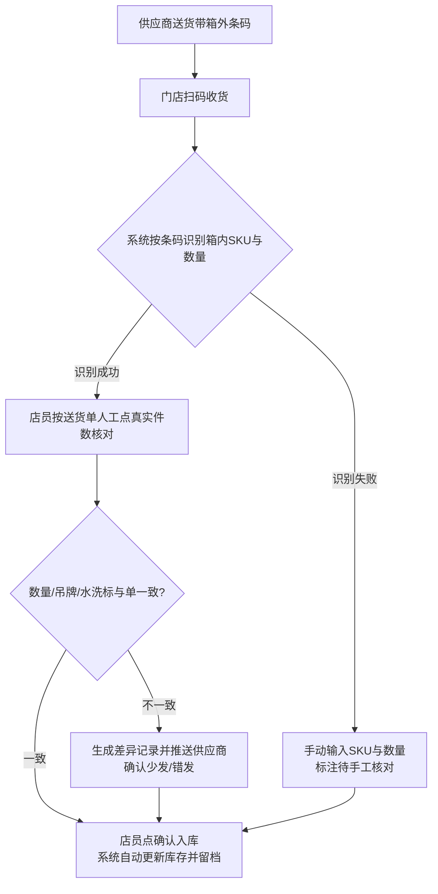
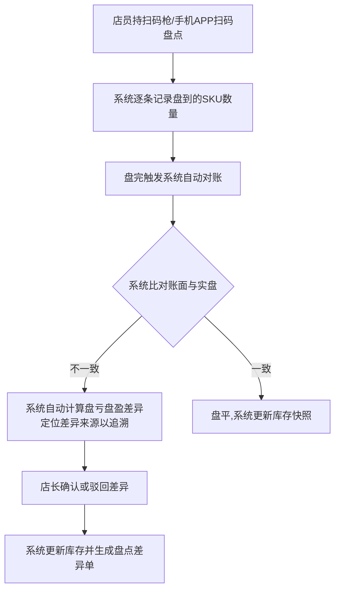
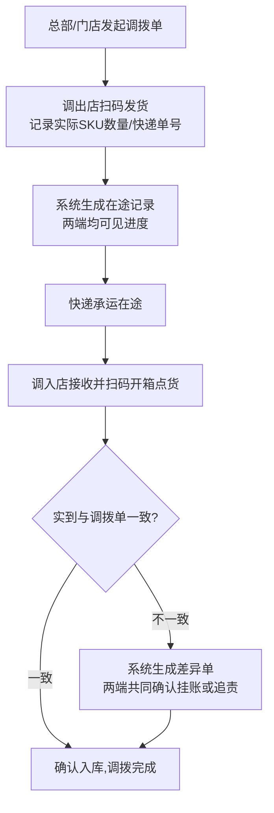
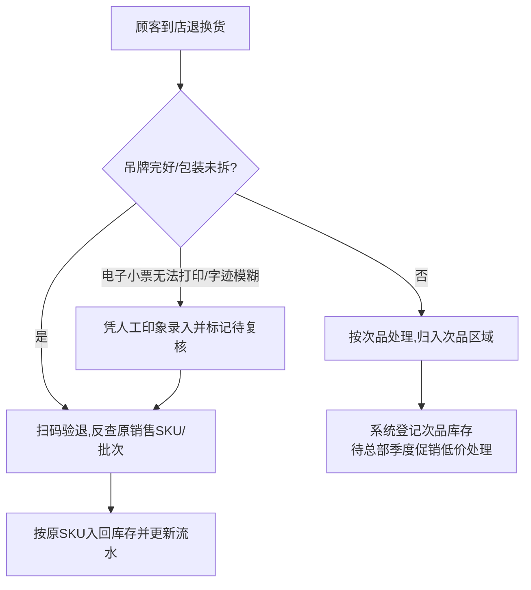
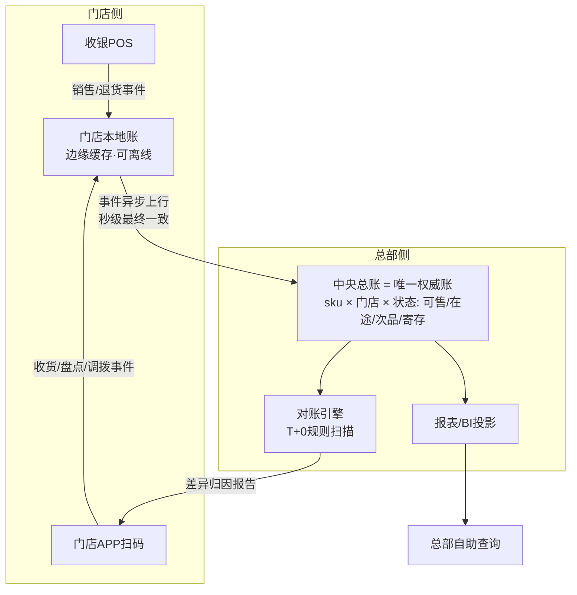

# 简岸门店 WMS 需求分析（v2）

> **素材来源**：[第5章-用户访谈原始记录-店长.md](./第5章-用户访谈原始记录-店长.md)（旗舰店店长张姐实地访谈）

**版本记录**

| 版本 | 日期 | 说明 |
|------|------|------|
| v1 | 2026-10-18 | 初稿，留档于《简岸门店WMS-需求分析.md》（存于课程参考目录 `ai_bootcamp_reference`，未纳入本项目） |
| v2 | 2026-10-18 | ① 顾客寄存降为 Won't（低频灰色地带，本期不做）；② 在途货权待确认项补齐负责人（供应链）与截止日期；③ 目标段量化改写（月损耗率≤1%、盘点差异率≤3%）；④ 采购退货降为 Could、注明本期不实现；⑤ 新增"六、账本与数据架构设计"；⑥ 合并《第5章-需求分析报告-门店WMS.md》优点：痛点追溯映射、非功能需求、落地建议与风险；⑦ 清理模板提示语、修正错别字 |

---

## 一、需求背景分析

**现状背景**：简岸为全国约 100 家直营门店的连锁服装品牌，主营中高端女装。门店目前依赖"4 个 Excel（货号表 / SKU 表 / 库存流水表 / 调拨记录表）+ 收银系统 + 少量扫码枪"进行库存管理，Excel 文件已传承三代店长、含十几个 Sheet 和几百个公式。本文基于旗舰店店长张姐（从业 8 年）的实地访谈整理。

**当前业务痛点**：
- **盘点低效差慢**：每月月底人工盘点需约 3 小时（每次 2 人），先开 4 个 Excel，再靠人眼对货号/颜色/尺码，盘点准确率仅约 90%，剩余 10% 差异无法定位。
- **库存不实时**：库存为 Excel 事后录入，只能知道"今天早上 10 点的库存"，无法知道"现在 3 点"的真实库存；顾客询问是否有货时只能凭记忆，易引发断货误客、投诉率高。
- **多店协同差**：每家门店 Excel 相互独立、不互通，调拨必须靠打电话询问对方"发了什么、几号发的、快递单号多少"，总部/其他门店无法直接查看本店库存。
- **调拨差异大**：调拨在途货物权属不清，收货数与调拨单/签收单常不一致（如收 8 件实到 7 件），差异只能"挂账"待下次盘点，长期成为糊涂账。
- **退换货入错库存**：退换货每月约 50 笔，其中约 5 笔入错位置（占比 10%），是库存差异最大来源之一。
- **月损耗超标**：月损耗率约 1.5%-2%，高于总部要求（1% 以下），且 80% 的损耗原因填写为"原因不明"，无法追溯根源。
- **总部要数据慢**：每周一早 9 点需提交销售报表（耗时约 1.5 小时，需现做），临时要数据最快 30 分钟，无现成数据可自助查询。
- **采购收货靠人工**：到货需人工逐件点数并手动录入 Excel，一箱 50 件约 20 分钟；送货单与实际常不符，每周至少 1 次差错。
- **采购退货流程冗长**：次品退货需"店长/总部/供应商"三方签字，走纸质流程约 2 周，Excel 内再手动减库存。
- **顾客寄存留灰色地带**：寄存商品不计销售也不退库存，常被遗忘，寄存表内累计 20 多件未清理。

**受影响角色**：
- 门店店长（核心使用者）：张姐及同级店长，负责盘点、收货、调拨、退换货、报表制作。
- 门店店员：约 100 家门店约 400 名员工（平均年龄 35 岁），负责日常收货、整理、盘点辅助。
- 总部运营/商品人员：每周索取销售报表，发起调拨，需库存数据做补货预测与活动查询。
- 供应商：采购入库、采购退货的对接方。

**不做的后果**：库存差异持续累积导致月损耗超标被总部追责；总部决策依赖小样本、延迟的人工报表；调拨协同靠电话勉强维持，多店库存无法共享；顾客因误报有货导致投诉流失和口碑受损。

---

## 二、需求目标确认

**核心目标**：通过上架一套门店 WMS 系统（含门店 APP / 门店 PC / 后端服务），替代现行"Excel + 电话"的库存管理模式，实现库存实时化、操作扫码化、协同在线化、数据自助化。

- **目标 1（可衡量）**：盘点质量提升——盘点差异率从约 10% 降到 3% 以内；扫码盘点替代人工抄录，单次盘点时长从约 3 小时降至 1 小时以内。
- **目标 2（可衡量）**：库存实时可见——门店打开系统即可查看当前时刻实时库存，消除"卖场问货靠记忆"的盲区。
- **目标 3（可衡量）**：损耗下降——月损耗率从当前 1.5%-2% 降到 1% 以内，差异可通过追溯定位根源而非"原因不明"。
- **目标 4（可衡量）**：录错率下降——调拨/收货/盘点操作全链路扫码化，减少人工点数与手动录 Excel 环节，降低录错率（如调拨录错数量、退换货入错位置等）。
- **目标 5（可衡量）**：报表提效——总部销售报表（库存周转率、Top 10 滞销款、下周补货预测）与临时数据需求改为总部自助查询，门店不再每周一现做 1.5 小时报表、临时要数据不再等 30 分钟。

**核心价值交付**：将店长从"每周一现做报表 + 月底通宵盘点 + 打电话对调拨"的事务性工作中解放出来，让门店把精力回归卖货本身。

**落地约束（避免"学不会/不稳/太复杂"顾虑）**：
- 操作必须简单（扫码即用），提供培训。
- 系统运行必须稳定，避免"卡死崩溃无货可卖"。
- 不做过度复杂配置，贴合每日"收货、卖货、盘点、退换货"的真实作业场景。

---

## 三、业务流程分析

### 3.1 采购入库流程



### 3.2 盘点流程



### 3.3 门店间调拨流程



### 3.4 退换货处理流程



---

## 四、功能拆解清单

| 终端 | 模块 | 功能 | 功能描述 | 优先级 |
|------|------|------|----------|----------|
| 门店APP | 扫码入库 | 扫码收货 | 扫描箱外条码自动识别箱内 SKU 与数量，联动送货单，支持人工核点件数，确认后自动入库并留档 | Must |
| 门店APP | 扫码入库 | 收货差异处理 | 实点数与送货单不一致时生成差异记录，可推送供应商确认少发/错发 | Should |
| 门店APP | 扫码入库 | 采购退货 | 次品退货在线填单，支持店长/总部/供应商电子化对账与扣款，替代纸质三签流程。**链路复杂、走完约 2 周、本期不实现** | **Could** |
| 门店APP | 扫码盘点 | 扫码盘点 | 持手机/扫码枪扫码自动记录盘到 SKU 数量，替代人眼对货号与手动抄录 | Must |
| 门店APP | 扫码盘点 | 差异自动对账 | 盘完系统自动比对账面与实盘，自动计算盘亏盘盈并生成差异单 | Must |
| 门店APP | 扫码盘点 | 快速盘点 | 支持仅盘点热卖款/指定范围的每日快速盘点，控制盘点时长 | Should |
| 门店APP | 实时库存 | 实时库存查询 | 随时查看当前时刻实时库存（SKU 级，含在途/可售/次品分类），替代 Excel 事后查询 | Must |
| 门店APP | 实时库存 | 库存分类视图 | 按可售、在途、次品、寄存等状态分类展示库存数量 | Should |
| 门店APP | 调拨管理 | 调拨发起与查看 | 发起/接收调拨，实时查看"调拨中/已发货/在途/已签收/已入库"全程进度，无需电话询问 | Must |
| 门店APP | 调拨管理 | 调拨扫码发货/收货 | 调出店扫码发货登记实际 SKU/数量/快递单号，调入店扫码开箱点货 | Must |
| 门店APP | 调拨管理 | 调拨差异处理 | 实到与调拨单不一致时生成差异单，两端共同确认挂账或追责 | Should |
| 门店APP | 差异追溯 | 库存差异追溯 | 盘点差异自动定位来源（如销售未扣库存、退换货入错位、调拨差异、丢失破损），替代"原因不明" | Must |
| 门店APP | 退换货 | 扫码验退与入库 | 退货扫码反查原 SKU/批次，吊牌完好入回原库存，次品归入次品区域 | Must |
| 门店APP | 退换货 | 次品登记 | 登记次品库存及处理状态，联动总部季度促销处理 | Should |
| 门店APP | 寄存管理 | 顾客寄存登记 | 寄存商品单独登记，不计销售/不退库存，支持到期提醒与取件销记。**低频灰色地带，本期不做** | **Won't** |
| 门店PC | 报表中心 | 销售报表生成 | 自动生成上周销量、库存周转率、Top 10 滞销款、下周补货预测等报表 | Must |
| 门店PC | 报表中心 | 日常数据维护 | 管理货号表/SKU 表/库存流水/调拨记录，替代手工维护 4 个 Excel | Could |
| 门店后端 | 库存服务 | 库存实时更新 | 收银系统、调拨、退货、盘点的库存变动实时同步至库存账 | Must |
| 门店后端 | 库存服务 | 实时计算与快照 | 计算库存周转率/Top 10/滞销判定，维护历史库存快照 | Must |
| 门店后端 | 协同服务 | 多门店数据互通 | 各门店库存、调拨、在途数据在线共享，总部/门店可查看任意门店SKU库存 | Must |
| 门店后端 | 差异服务 | 差异定位引擎 | 关联销售/退货/调拨/收银流水定位差异来源 | Should |
| 门店后端 | 调拨服务 | 在途货权管理 | 维护调拨在途状态与货权归属，支持丢失/损毁责任判定 | Should |
| 供应链中台后端 | 数据服务 | 总部数据自助查询 | 总部自助查询各店实时库存、周转率、滞销款、补货预测，无需门店现做 | Must |
| 供应链中台后端 | 采购协同 | 供应商数据对接 | 收货差异、采购退货与供应商电子化对账协同（送货单校验） | Could |

### 4.1 痛点 → 功能追溯映射

每条功能均可回溯到访谈证据，避免"无来源功能"：

| 背景痛点（见"一"） | 对应功能 | 优先级 |
|---|---|---|
| 盘点低效差慢 | 扫码盘点 / 差异自动对账 / 快速盘点 | Must / Should |
| 库存不实时 | 实时库存查询 / 库存实时更新 | Must |
| 多店协同差 | 调拨发起与查看 / 调拨扫码发货收货 / 多门店数据互通 | Must |
| 调拨差异大 | 调拨差异处理 / 在途货权管理 | Should |
| 退换货入错库存 | 扫码验退与入库 | Must |
| 月损耗超标且 80% 原因不明 | 库存差异追溯 / 差异定位引擎 | Must / Should |
| 总部要数据慢 | 销售报表生成 / 总部数据自助查询 | Must |
| 采购收货靠人工 | 扫码收货 / 收货差异处理 | Must / Should |
| 采购退货流程冗长 | 采购退货（电子三签） | Could（本期不实现） |
| 顾客寄存留灰色地带 | 顾客寄存登记 | Won't（本期不做） |

---

## 五、非功能需求

对应张姐"学不会 / 不稳定 / 太复杂"三个担心与两次事故复盘：

| # | 类别 | 要求 | 依据 |
|---|---|---|---|
| 1 | 易学性 | 核心操作 ≤3 步、扫码优先、大字体大按钮；培训 1 小时内上手 | 店员平均 35 岁，"学不会就不用" |
| 2 | 稳定性与容灾 | 弱网/断网可继续扫码收货、盘点，恢复后自动同步；系统故障不得阻断门店销售 | "系统崩了连货都卖不了" |
| 3 | 简洁性 | 零配置开箱即用，避免"祖传 Excel"式隐性复杂度 | 十几个 Sheet、几百个公式不敢碰 |
| 4 | 数据安全 | 权限分级、操作留痕、防误删误改、自动版本化备份 | 店员删公式导致库存"少 200 件"事故 |
| 5 | 集成性 | 对接收银 POS（自动扣减，堵住 30% 损耗源头）与总部 ERP（盘点/库存上报）；兼容解决 CSV 中文乱码 | 收银没减库存、CSV 编码问题 |

---

## 六、账本与数据架构设计（差异追溯的底层逻辑）

> 本章回答一个关键问题：第三章流程图中的"差异追溯"不只是一句流程节点，而是**账本设计**的产物。追溯能力 = 记账完整性 × 对账规则。

### 6.1 底层前提：一切库存变动事件化（Event Sourcing）

门店当前追溯不了差异的根源：同时存在 5 本互不相通的账（4 个 Excel + 收银系统），任何一本都没有完整的变动流水。

WMS 必须把所有库存变动统一为**不可变事件**（只增不改，修正通过反向事件）：

```text
事件 = { event_id, store_id, sku_id, qty_delta, 事件类型,
         关联单据号, 操作人, 时间戳, 来源系统 }
```

事件类型覆盖：销售、退货入库、采购收货、采购退货、调拨发货/签收/入库、盘点调整、报损、寄存出入。**账面库存 = 期初快照 + Σ事件**。

### 6.2 双层账本：中央总账 + 门店本地账



**"总部与门店数据既要隔离、又要同步"的边界**：

| 数据 | 归属 | 同步策略 | 权限 |
|---|---|---|---|
| 门店库存明细/操作流水 | 门店 | 事件异步上行汇总至中央账（秒级最终一致） | 门店读写本店；总部按权限穿透 |
| 调拨单/在途池 | 中央（协调者） | 双端实时 | 调出/调入两店 + 总部可见 |
| 聚合报表/周转率 | 中央投影 | 从总账派生，不在总账跑重查询 | 总部自助查询；门店看本店 |
| 他店库存 | 中央 | 只读投影 | 门店仅见授权范围可售量，不见成本/流水 |

- **隔离的是写路径**：门店事件先落本地账，断网/系统故障时仍可扫码收货、盘点（离线兜底），恢复后回放同步——直接回应"系统崩了连货都卖不了"的担心。
- **共享的是读投影**：总部拿聚合数据，不碰门店经营明细；门店看本店实时数 + 授权的他店可售量。
- **中央账是唯一权威账（Single Source of Truth）**：POS、门店 APP 的每一次库存变动最终都落中央账，杜绝"第 5 本私账"。

### 6.3 差异追溯引擎：对账规则库

盘点差异 = 实盘快照 − 账面余额（期初 + Σ事件）。追溯引擎在"上次盘点 → 本次盘点"时间窗口内对事件流水跑规则：

| 规则 | 匹配逻辑 | 对应访谈痛点 |
|---|---|---|
| R1 有销售流水、无库存扣减 | POS 流水 ↔ 库存扣减事件差集 | 约 30% 损耗源于"收银没减库存" |
| R2 退货入库 SKU ≠ 原销售单 SKU | 退货入库事件反查原销售单 | 退换货入错位（月约 5 笔） |
| R3 调拨差异单未闭环 | 挂账差异单状态扫描 | 调拨 8 发 7 收，挂账 2 个月 |
| R4 在途超时未签收 | 在途池时效监控 | 在途丢失无人认账 |
| R5 收货差异未与供应商确认 | 收货差异记录状态扫描 | 每周至少 1 次收货差错 |

归因输出与闭环：

1. 匹配成功 → 输出**归因结论 + 证据链**（关联单据号列表 + 置信度）；
2. 匹配失败 → 标记"无法解释"，同时输出可疑事件 Top-N（按时间/数量匹配度排序），不再是一句"原因不明"；
3. 店长确认归因 → 系统生成**盘点调整单**（同样是一条留痕事件），账实归一；
4. 对账时机从"月盘才跑"升级为 **T+0 准实时**（R1 每小时扫描），销售掉单当天发现，而非月底盘点才知道。

### 6.4 调拨在途：在途池虚拟仓位

- 调拨单状态机：发起 → 已发货 → 在途 → 已签收 → 已入库；两端门店与总部实时可见。
- **在途数量挂中央账"在途池"虚拟仓位**（调出店 → 调入店），既不在调出店也不在调入店的可售库存中——账实分离清晰。
- **货权归属规则配置化**：在途货算调出店/调入店/总部、运输丢损责任方，均在签收与差异确认时按配置自动转移记账（规则本身待业务拍板，见"八、待确认事项"第 4 条）。

### 6.5 能力边界：SKU 级账 vs 件级账

SKU 级数量账能回答"少几件、最可能什么原因"，回答不了"那 1 件毛衣具体去哪了"。件级追溯需唯一码（吊牌序列号 / RFID），服装吊牌天然可件级化。建议作为 **V2 演进项**，不纳入本期 MVP。

---

## 七、落地建议与风险

1. **价值度量（上线后按此验收 ROI）**：盘点 3h → 1h 以内、盘点差异率 10% → 3% 以内、周一报表 1.5~3h → 0、月损耗率 1.5%~2% → 1% 以内。
2. **变革管理是最大风险**：门店扫码枪 80% 吃灰证明"配了工具 ≠ 用了工具"。需配套：盘点/录错率纳入店长考核、上线初期驻店陪跑 2~4 周、店员培训 1 小时内上手。
3. **灰度策略**：选痛点最深、意愿最强的旗舰店做种子店（访谈对象张姐手绘了 6 个界面草图，是天然的产品共建者）。
4. **业务规则先行**：在途货权、寄存会计口径等属于组织规则问题，产品只提供配置能力，规则必须总部先拍板（见"八、待确认事项"）。

---

## 八、待确认事项

| 序号 | 待确认事项 | 状态 | 负责人 | 截止日期 |
|------|------------|------|--------|----------|
| 1 | 各部门门店的手机 APP 是否统一由品牌自研，还是后端复用总部现有"零售系统 / ERP"（涉及扫码枪兼容接口） | 待确认 | - | - |
| 2 | 扫码枪与手机 APP 的条码解析库如何对接现有收银系统的商品主数据 | 待确认 | - | - |
| 3 | 总部发起调拨单的规则与权限划分（全国直营 100 家门店，是总部统一发起还是允许门店互调） | 待确认 | - | - |
| 4 | 调拨在途的库存算调出店还是调入店；路上丢失/损毁算谁的（在途货权归属规则） | 待确认 | 供应链 | 2026-10-18 |
| 5 | 收银系统自动减库存失败（员工操作失误）的来源数占比，是否需要对收银流水做二次校验 | 待确认 | - | - |
| 6 | 采购退货电子化对账是否要求与供应商系统对接，还是仅做内部流转 + 手动核款 | 待确认 | - | - |
| 7 | 寄存商品的会计口径（是否计销售/库存）以及寄存周期的强制管理规则 | 待确认 | - | - |
| 8 | 门店 PC 报表中心是否保留"店长手工调整"能力，还是完全由系统自动生成（涉及权限） | 待确认 | - | - |
| 9 | 不同规模/等级门店（小型旗舰店 200 平与大型门店）的系统功能是否差异化配置 | 待确认 | - | - |
| 10 | 系统上线后旧 4 个 Excel 的迁移范围与历史差异数据的处理策略 | 待确认 | - | - |
| 11 | 系统稳定性要求与上线切换策略（避免"系统崩了连货都卖不了"场景的容灾/离线兜底） | 待确认 | - | - |
| 12 | 店员培训投入与操作复杂度上线约束（员工平均年龄 35 岁，需保证学会用） | 待确认 | - | - |

**确认原则**：
- 所有 Must 级别功能必须在 PRD 撰写前完成确认
- 未确认事项不得在 PRD 中编造，必须标注"待确认"
